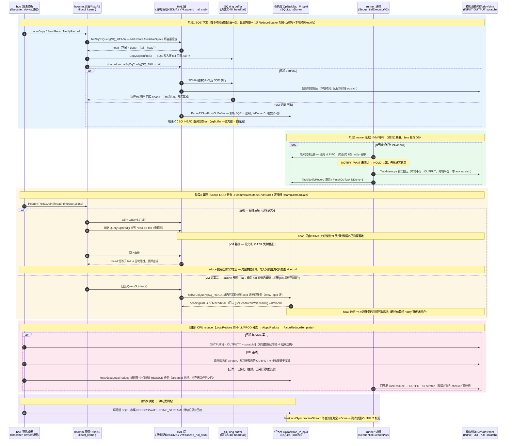
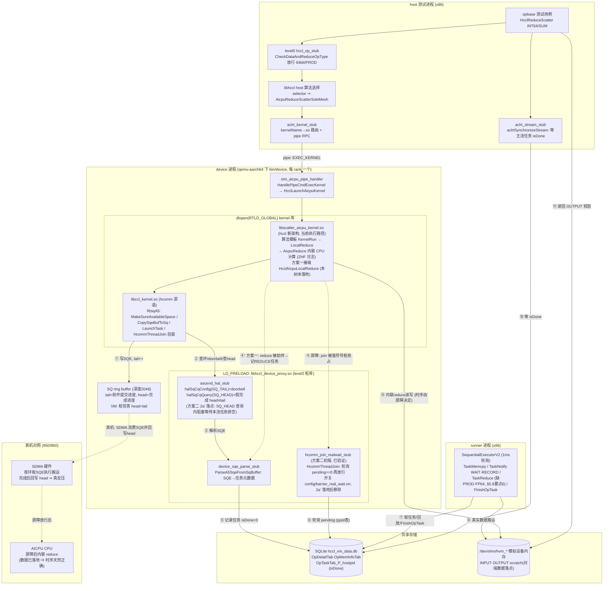

# 64bit / PROD 归约的 CPU 计算流程分析与任务劫持方案（950/960）

> **仓库范围与当前 VM 实际路径（2026-10 依 `hccl_vm_install/bin/log.txt` 复核）**：本方案涉及两个独立仓库——
> - **hccl**（`/home/teamserver/workspace/hccl`，新架构，无指令层，device kernel = `libscatter_aicpu_kernel.so`）：**当前 VM 里 64bit reduce 实际由该仓的库执行**。实测证据（ReduceScatter / INT64(dataType=5) / SUM(reduceOp=0) 用例，`hccl_reducescatter_rootinfo_test.cc:164`）：`aclrt_kernel_stub` 把 `HcclLaunchAicpuKernel` dlsym 自 `libscatter_aicpu_kernel.so`（`log.txt:12228`），算法选中 `AicpuReduceScatterSoleMesh`，归约进入 hccl 的 `LocalReduce→AicpuReduce`，由 `alg_data_trans_wrapper.cc:907` 打印 `ZHF-LocalReduce: dataType is [5], reduceOp is [0]`（`log.txt:12662 / 12674`）。故生效接缝必须落在此仓（方案见 **§5.6**）。
> - **hcomm**（`/home/teamserver/workspace/hcomm`，legacy 架构，含 instruction/`Interpret` 指令层）：**该路径当前执行中未被触达，属已废弃 legacy**。实测：加在其 `ins_to_sqe_rule_v82.cc` 的调试标记 `InsAicpuReduce: Interpret enter` 在 `log.txt` 中出现 **0 次**，全程无 `instruction.cc` / `ins_to_sqe_rule_v82.cc` 日志行；`libccl_kernel.so`（hcomm 产物）虽被 device 进程加载，但不在 64bit 归约计算路径上。原方案 §5.1–§5.5 的 hcomm 改动仅对 legacy/910 或 host 侧 `libhccl_v2.so` 有意义，现作历史参考保留。
>
> **⚠️ 落地状态（重要，2026-10 复核，纠正本文档早期版本的"已落地"表述）**：§5.2–§5.9 中描述的导出接缝 `HcclAicpuLocalReduce`、CheckerL2 双桩（level1 skip / level2 observe）、REDUCE streamId 跟踪机制，**在当前代码树中均未落地**——全仓（hccl / hcomm / CheckerL2 源码）与全部已部署 `.so` 搜索 `HcclAicpuLocalReduce` 均为 0 命中；`aicpu_reduce_observe_stub.cc` 不存在；`hccl_task_collection.cc` 无 `TrackLocalCopyStream` / `GetLastLocalCopyStreamDev`。当前工作区真实改动仅三处调试/实验编辑：① CheckerL2 `hccl_op_stub.cc` 仅注释掉 `HcclReduceScatter` 的 `CheckDataAndReduceOpType` 调用点（:1109）——函数体仍对 64bit/PROD 返回 `NOT_SUPPORT`（:389-395），其余算子（AllReduce :929 / Reduce :1046 / ReduceScatterV / GraphMode 系列）调用点未放行；② hccl `alg_data_trans_wrapper.cc:907` 加 `ZHF-LocalReduce` 日志；③ hcomm `ins_to_sqe_rule_v82.cc` 加 `Interpret enter` 日志。
>
> **⚠️ 当前执行实际结果**：放行 ReduceScatter 后用例确实跑到 hccl `AicpuReduce`，但 device 进程随即在 `libscatter_aicpu_kernel.so` 的 `HcclLaunchAicpuKernelA3` 内 **signal 11 崩溃**（`crash_133229.log` / `crash_133255.log`），host 侧报 `EXEC_KERNEL failed`、用例返回 `retcode 10`。即**没有接缝/桩时，真实 `AicpuReduce` 直接对模拟 device 地址跑 CPU 循环导致崩溃**——这既印证了本方案的必要性（归约必须被劫持为 checker 任务而非真实计算），也说明 §5.6 目前仍是**待实施设计**而非既成事实。（后续 14:39 轮未再崩溃但数据校验失败 `total err is 4`——根因为时序倒置而非地址，两条修复路线与穿刺实现详见 **§9**。）
>
> **汇聚性结论**：对 64bit/PROD 目标用例，CCU/AIV 引擎硬件不支持、被算法选择层强制排除，全部汇聚到 **AICPU 引擎**的单点——hccl 的 `AicpuReduce`（hcomm 的 `RunAicpuReduce` 为已废弃 legacy 的对应点，当前不触达）。详见 **§5.7**。
>
> **修复路线现状（2026-10-24）**：两条路线并行成立——**方案一（接缝+桩任务化，主线）**已实现并测试通过（另工作区）；**方案二（真等）**初版（join 层强符号桩）2026-10-20 穿刺验证通过（`check_result: success`，时序倒置确认为数据错误唯一根因），现已演进为**双形态落地**：level2 = 南向 `halSqCqQuery(SQ_HEAD)` 查询内阻塞等待（2a′）+ level1 = L1 库既有 join 桩接入真等，共享 `barrier_real_wait` 模块（§9.2），level1/level2 实测均通过（2026-10-24）；checker 配套降级（64bit/PROD reduce 类算子跳过语义校验、保留内存冲突校验）见 **§9.6**。SQE 执行流 / reduce 计算流 / 同步关系 / hal ring buffer 的**时序图与模块图见 §10**；**终极方案（hal ring buffer 槽位级真建模，2a′ 的演进终点）的接口与数据结构调研见 §11**。

## 1 问题概述

### 1.1 现象

`src/proxy/level0/hccl_op_stub.cc` 中的 `CheckDataAndReduceOpType` 对 **64bit 数据类型**（INT64 / UINT64 / FP64）与 **PROD（乘）归约**直接返回 `HCCL_E_NOT_SUPPORT`，导致 `HcclAllReduce` / `HcclReduce` / `HcclReduceScatter` 在 host 入口即被拦截：

```cpp
// src/proxy/level0/hccl_op_stub.cc:389
HcclResult CheckDataAndReduceOpType(HcclDataType dataType, HcclReduceOp op)
{
    if (dataType == HCCL_DATA_TYPE_INT64 || dataType == HCCL_DATA_TYPE_UINT64 ||
        dataType == HCCL_DATA_TYPE_FP64 || op == HcclReduceOp::HCCL_REDUCE_PROD) {
        return HcclResult::HCCL_E_NOT_SUPPORT;
    }
    return HcclResult::HCCL_SUCCESS;
}
```

调用点（2026-10 实测行号）：`hccl_op_stub.cc:929`（HcclAllReduce）、`:1046`（HcclReduce）、`:1109`（HcclReduceScatter，**当前已被注释放行**，是唯一放行的入口）、`:1174`（HcclReduceScatterV）及各 GraphMode 入口。函数体本身未改，仍返回 `NOT_SUPPORT`。

### 1.2 根因

在 hcomm 真实业务中，归约计算正常情况下**融合进 SDMA 拷贝任务（inline reduce SQE）**——一次 read-modify-write 就完成"搬运 + 归约"。但 **SDMA 硬件既不支持 64bit 数据类型，也不支持 PROD 乘法**，因此这两类归约被算法层改由 **CPU（AICPU）直接以 C++ 循环计算**，**不生成可供 checker/runner 校验的任务（SQE）**。CheckerL2 的 checker 插件依赖任务制品做事后校验，拿不到任务便无法校验，故在入口直接判 `NOT_SUPPORT`。

### 1.3 目标

在 **950/960** 平台上，为"CPU 归约计算"这一步提供一个**稳定、可劫持、不受符号隐藏影响**的接口，使 CheckerL2 能劫持它并**强制生成 REDUCE 任务**（任务不交真机 NPU 执行，而由后续 checker / runner 插件消费）。

---

## 2 关键概念

### 2.1 三种归约执行引擎

| 引擎 | 承载的归约 | 是否生成任务 | 支持 64bit/PROD |
|------|-----------|-------------|----------------|
| **SDMA inline reduce** | 搬运与归约融合进一个拷贝 SQE | 是（SDMA SQE） | **否** |
| **AIV / TBE 向量核**（910） | 向量 kernel 内做归约 | 是（向量 kernel 任务） | 否（PROD 无原子乘；64bit 不支持） |
| **AICPU CPU 循环**（950/960） | 纯 C++ for 循环逐元素计算 | **否**（仅 DFX 镜像信息） | **是**（正是为此而设） |

### 2.2 数据类型 / 归约算子枚举值

```
HcclDataType:  INT8=0 INT16=1 INT32=2 FP16=3 FP32=4 INT64=5 UINT64=6 UINT8=7 UINT16=8 UINT32=9 FP64=10 BFP16=11
HcclReduceOp:  SUM=0  PROD=1  MAX=2  MIN=3
HcommDataType / HcommReduceOp 取值与上一致（include/hcomm_primitives.h:46-64）
```

---

## 3 业务流程分析

### 3.1 为什么 64bit / PROD 不走 SDMA 任务

SDMA 归约被编码进一个 `MEMCPY_ASYNC` SQE 的 **8bit opcode**：高 4bit 编码数据类型、低 4bit 编码归约种类。位域物理上编不出 64bit 与 PROD：

```cpp
// src/legacy/ascend910/pub_inc/aicpu/aicpu_hccl_sqcq.h
// :220 归约种类只有 CPY/ADD/MAX/MIN/EQUAL —— 无乘法
enum rtStarsMemcpyAsyncOperationKind { ...ADD=0x01, MAX=0x02, MIN=0x03, EQUAL=0x04 };
// :228 数据类型只有 INT8/16/32、UINT8/16/32、FP16/FP32/BFP16 —— 无 64bit
enum rtStarsMemcpyAsyncDataType { ...FP32=0x70, BFP16=0x80 };

// :168 PROD 映射为 INVALID
constexpr aclrtReduceKind RK_MAP_TABLE[...] = {
    ACL_RT_MEMCPY_SDMA_AUTOMATIC_SUM,  /* SUM  */
    ACL_RT_MEMCPY_INVALID,             /* PROD */   // ← 不支持
    ACL_RT_MEMCPY_SDMA_AUTOMATIC_MAX,  /* MAX  */
    ACL_RT_MEMCPY_SDMA_AUTOMATIC_MIN,  /* MIN  */
};
// :150 INT64/UINT64/FP64 映射为 UNDEFINED
constexpr aclDataType DT_MAP_TABLE[...] = { ... ACL_DT_UNDEFINED /*INT64*/, ACL_DT_UNDEFINED /*UINT64*/, ... ACL_DT_UNDEFINED /*FP64*/ ... };
```

能力探测函数一致地把 64bit 与 PROD 排除（`src/legacy/ascend910/platform/common/device_capacity.cc`）：

| 函数 | 位置 | 放行范围 |
|------|------|---------|
| `IsSupportAIVReduce` | :57 | `{int8/16/32, fp16/fp32, bfp16} × {sum,max,min}` |
| `IsDataTypeSupport` | :89 | 无 64bit |
| `IsRedOpSupport` | :112 | 无 PROD |
| `IsSupportSDMAReduce` | :130 | = 对齐 && 数据类型 && 算子 |
| `IsSupportRDMAReduce` | :138 | 无 64bit、无 PROD |

950/960 的能力表同样把 INT64/UINT64/FP64 与 PROD 标为 `false`：`src/legacy/ascend950/unified_platform/common/dev_capability.cc:18-52`。

### 3.2 算法层如何分流

各 executor 用统一三元式把 64bit/PROD 判给非 inline 路径（在 ~12 处逐字重复），例如：

```cpp
// src/legacy/ascend910/algorithm/impl/coll_executor/coll_reduce/coll_reduce_executor.cc:95
ReduceType reduceType =
    ((param.reduceType != HCCL_REDUCE_PROD) && (param.DataDes.dataType != HCCL_DATA_TYPE_INT64))
        ? ReduceType::INLINE_REDUCE   // SDMA，融合进拷贝任务
        : ReduceType::TBE_REDUCE;     // 64bit/PROD 落到别的引擎
```

- **910（legacy）**：`TBE_REDUCE` → `dispatcher_graph.cc:307`（注释"dtype=int64 或者 redOp=prod 都会走 TbeReduce，算法层控制的"）→ `TbeReduceAsync` → 向量核 kernel `HcclTbeReduce`（`extern "C"`，跨 .so）。
- **950/960**：算法选择器命中 64bit/PROD 时选 `"InsReduceAicpuReduce(Mesh2D)"`：

```cpp
// src/legacy/ascend950/service/collective/alg/selector/reduce_auto_selector.cc:266
if (op.dataType == DataType::INT64 || op.dataType == DataType::UINT64 ||
    op.dataType == DataType::FP64 || op.reduceOp == ReduceOp::PROD) {
    primQueueGenName = "InsReduceAicpuReduce";   // ← 走 AICPU CPU 计算
}
// :318 SelectAivAlgo 对 PROD 直接 NOT_MATCH，对 UINT64/FP64 也 NOT_MATCH
```

入口侧另有 `HcclCommunicator::IsReduceWithInt64OrProd`（`hccl_communicator_host.cc:4556`）标识这类算子。

### 3.3 950/960 的 CPU 计算：无任务，只有 DFX 镜像

`InsReduceAicpuReduce` 模板生成 `InsAicpuReduce` 指令（`alg_data_trans_wrapper_mid.cc:908` 的 `AicpuReduce()`）。执行时 `Interpret(InsAicpuReduce)` **不构造任何 SQE**，直接跑 C++ 循环：

```cpp
// src/legacy/ascend950/framework/service/aicpu/ins_to_sqe_rule_v82.cc:721
void Interpret(const InsAicpuReduce& insAicpuReduce, const StreamLite& stream, ResMgrFetcher* resMgrFetcher)
{
    // 使用 aicpu 进行 reduce 运算，支持 int64 uint64 fp64
    ...
    insAicpuReduce.RunAicpuReduce(dst, dstSize, src, srcSize, dataType, reduceOp);  // :745 纯 CPU 计算
    ...
    taskParam.taskType = TaskParamType::TASK_REDUCE_INLINE;                          // :751
    resMgrFetcher->GetMirrorTaskMgrLite()->AddTaskInfo(std::move(taskInfo));         // 仅 DFX 镜像，非硬件任务
}
```

计算本体（`instruction.cc:465`）：

```cpp
template <typename T>
void InsAicpuReduce::AicpuReduceTemplate(T* dst, u64 dstSize, T* src, u64 srcSize, ReduceOp reduceOp)
{
    u64 count = dstSize / u64(sizeof(T));
    for (u64 i = 0; i < count; ++i) {
        switch (reduceOp) {
            case ReduceOp::PROD: *(dst + i) = *(src + i) * *(dst + i); break;   // 乘法在 CPU 上做
            case ReduceOp::SUM:  ...
        }
    }
}
// :500 RunAicpuReduce 仅分派 INT64 / UINT64 / FP64
```

> **结论**：在 reduce 计算发生的时刻，并不存在代表它的 SDMA reduce 任务——搬运用的拷贝 SQE 早已完成，CPU 计算只留一条 `TASK_REDUCE_INLINE` 的 DFX 镜像。checker 无从校验。

### 3.4 SDMA 搬运与 CPU 计算的时序关系

**分工是整体切分，不是从 SDMA 任务里"抠出" PROD/64bit**：SDMA 对这类数据只做纯搬运（0 算术），AICPU 做全部归约算术。

单次算子内是**分阶段 + 完成屏障**串行，而非逐元素穿插。指令队列生成顺序即线性（`ins_temp_all_reduce_aicpu_reduce.cc:110` `GenExtIns`）：

```cpp
RunAllGatherMesh(...);      // 阶段1：全是 SDMA 拷贝指令（InsLocalCopy + SendRecv）
StreamSync(tempInsQues);    // 阶段2：屏障
RunAicpuLocalReduce(...);   // 阶段3：全是 CPU reduce 指令（InsAicpuReduce）+ LocalCopy
```

屏障**等硬件真正执行完成**——`Interpret(InsStreamSync)`（`ins_to_sqe_rule_v82.cc:679`）自旋轮询直到 SQ 头追上尾：

```cpp
do { head = stream.GetRtsq()->QuerySqHead(); ... } while (head != tail);   // :706 等 SDMA 把数据落地
```

多流会合由 `PreStreamSync` + `CheckPreStreamSync`（`ins_executor.cc:266`）保证：所有流都到齐才统一放行。之所以必须串行，是**硬数据依赖**：CPU reduce 读的 SCRATCH 正是 SDMA 要写入的 SCRATCH。

真正的"穿插交替"发生在**更粗的分片（slice/burst）粒度**：数据超过 scratch 容量时按片循环（`ins_v2_reduce_sole_executor.cc:195`），队列呈 `片0[搬|算] 片1[搬|算] …` 交替；叠加"AICPU 提交 vs SDMA 硬件执行异步""多流拷贝并行"两层并发。

```
AICPU解释器:  提交拷贝SQE ─► PreStreamSync(全流flush+会合) ─► [自旋等head==tail] ─► CPU for循环算PROD/int64 ─► 提交LocalCopy
SDMA硬件:              └──────并行搬运各peer数据到SCRATCH──────┘(完成)         (空闲,数据已到)              └─搬运结果─►
                                                                            ▲ 屏障：计算严格晚于搬运完成
```

> 本图为真机（hcomm legacy）视角；**VM 记录-回放视角的完整时序图（含 hal ring buffer 桩语义、runner 回放、方案一/二挂载点）与三进程模块图见 §10**。

---

## 4 劫持点选型分析

约束：**不能用 C++ mangled 符号**（不稳定），且 hcomm 后续会启用**符号隐藏**（未对外导出的符号编译期被藏掉，如 `ccl_dpu.map` 的 `local: *;`）。

### 4.1 南向接口（rts / hccp ra）——不可行

64bit/PROD 落到 CPU 的**根本原因**就是南向引擎全都不支持它：

- RTS：`aclrtReduceAsync`（`orion_adapter_rts.cc:936`）、`hrtReduceAsync`（`cpu_ts_thread.cc:348`）均为 SDMA 背；
- `IAicpuTsThread::SdmaReduce`（`aicpu_ts_thread_interface.cc:148`）对 64bit/PROD 在 `:35/:39` 直接 "not supported"；
- HCCP/RDMA reduce 能力同样排除 64bit/PROD（`IsSupportRDMAReduce`）。

**计算这一步不穿越任何南向接口**（南向只承载数据搬运的拷贝，那部分本就生成任务），故南向无劫持点。

### 4.2 北向已有接口 `HcommLocalReduceOnThread`——不宜直接复用

`HcommLocalReduceOnThread`（`include/hcomm_primitives.h:164`，`extern int32_t`，数据面公共接口）看似理想，但两个硬障碍：

1. **指令引擎上下文无 ThreadHandle**：`framework/service/aicpu/`、`service/collective/instruction/` 内无任何 thread 句柄，而该接口首参即 `thread`；
2. **A5 分支最终仍落 SDMA**：`aicpu_ts_primitives_c_adpt.cc:110` → `threadPtr->LocalReduce → SdmaReduce`，对 64bit/PROD 被拒。

复用它需同时"给引擎注入 thread 句柄 + 在线程引擎加 CPU 回退"，改动面与真机行为风险都大。

> 注：CheckerL2 已在 host（`src/proxy/level1/data_local_op_stub.cc:291`）与 device_arm（`src/device_arm/level1/data_op_device_stub.cc:1845`）劫持 `HcommLocalReduceOnThread` 并生成 REDUCE 任务，且 `ValidateA5Reduce`（`data_op_device_stub.cc:510`）本就接受 8 字节类型（case 5/6/10）与 PROD（reduceOp 0–3）。但该桩只在**数据面编程路径（SDMA inline reduce）**被命中，集合通信的 64bit/PROD 归约走的是 hccl 的 `AicpuReduce`（当前 VM）/ hcomm legacy 的 `InsAicpuReduce`（已废弃），二者都不经此桩——这正是要另设 `HcclAicpuLocalReduce` 接缝的原因。

### 4.3 结论：新增一个导出 C 接缝

采用"稍微修改 hcomm、新增可劫持符号"，并严格套用 hcomm 现有导出机制（`RunAicpuThreadInit` 等即 `__attribute__((visibility("default")))`，见 `aicpu_thread_kernel.h:17`；导出白名单见 `ccl_dpu.map`），天然免疫符号隐藏。

---

## 5 解决方案：新增导出接缝 `HcclAicpuLocalReduce`

> **状态：设计/待实施（当前树未落地）。** 本章 §5.1–§5.9 均为**方案设计**，非既成事实。落地进度以顶部"⚠️ 落地状态"为准：接缝符号、CheckerL2 双桩、streamId 跟踪机制在 hccl/hcomm/CheckerL2 三仓中均不存在；当前仅有一个会崩的 level0 放行实验（见顶部说明与 §5.5）。§5.1–§5.5 针对 **hcomm（已废弃 legacy）**，§5.6 针对 **hccl（当前实际路径，推荐落地方向）**。

将 AICPU 本地归约计算下潜到一个 **`extern "C"` + weak + 默认可见 + 列入 `.map` 白名单** 的符号；`RunAicpuReduce` 退回纯内部实现（可被隐藏），不再是劫持面。

### 5.1 目标符号定位

- 唯一 choke point：`InsAicpuReduce::RunAicpuReduce`（`instruction.cc:500`，声明 `instruction.h:807`），全仓仅 `ins_to_sqe_rule_v82.cc:745` 一处调用，覆盖 AllReduce / Reduce / ReduceScatter 的全部 64bit/PROD 归约。
- **950 无 `ccl_kernel` target**：`instruction.cc` / `ins_to_sqe_rule_v82.cc` 的 CMakeLists 以 `if(TARGET hccl_v2)` / `if(TARGET ccl_kernel)` 双挂载，950 构建只有 `hccl_v2`（`SHARED`，`hccl_v2.cmake:12`）命中，故二者仅编入 **`hccl_v2`**；该库**未使用 `-Bsymbolic`**（仅 release 挂 version-script），intra-DSO 调用走 PLT，可被强符号抢占。
- device_arm 用 `dlopen(RTLD_NOW|RTLD_GLOBAL)` 加载执行 kernel 库（`sim_kernel_lib_mgr.cc:34`）。

### 5.2 hcomm 侧改动（legacy，已废弃 / 未落地——仅历史参考）

> 本节针对 hcomm legacy 指令层路径，当前 VM 执行**不经过**该路径（见顶部复核）。以下改动**未落地**（全仓搜 `HcclAicpuLocalReduce` 为 0），保留仅作历史/910-host 参考。生效方案见 §5.6（hccl 仓）。

**① 声明**（设计：置于 `instruction.h`，`InsAicpuReduce` 类之后；两个 TU 均经 `ins_to_sqe_rule.h:16 → instruction.h` 可见。`weak` 只加在定义处，声明处仅 `visibility("default")`）：

```c
// instruction.h（namespace Hccl 内，extern "C" → 无 mangling 的全局 C 符号）
extern "C" __attribute__((visibility("default"))) int32_t HcclAicpuLocalReduce(
    void* dst, uint64_t dstSize, const void* src, uint64_t srcSize, HcclDataType dataType, HcclReduceOp reduceOp);
```

> `HcclDataType/HcclReduceOp` 经 `instruction.h → coll_operator.h → data_type.h/reduce_op.h → <hccl/hccl_types.h>` 已可见；`int32_t/uint64_t` 经 `types.h → <cstdint>` 可见。无需新增 include。

**② 真机实现**（`instruction.cc`，薄封装，行为不变；反向映射已存在：`data_type.h:103`、`reduce_op.h:51`）：

```cpp
extern "C" __attribute__((weak)) __attribute__((visibility("default"))) int32_t HcclAicpuLocalReduce(
    void* dst, uint64_t dstSize, const void* src, uint64_t srcSize, HcclDataType dataType, HcclReduceOp reduceOp)
{
    InsAicpuReduce::RunAicpuReduce(dst, static_cast<u64>(dstSize), const_cast<void*>(src), static_cast<u64>(srcSize),
        HcclDataTypeToDataType(dataType), HcclReduceOpToReduceOp(reduceOp));
    return 0;
}
```

**③ 改唯一调用点** `ins_to_sqe_rule_v82.cc:745`，由直调内部方法改调导出接缝：

```cpp
    HcclAicpuLocalReduce(dst, insAicpuReduce.GetDstSlice().GetSize(),
        src, insAicpuReduce.GetSrcSlice().GetSize(),
        DataTypeToHcclDataType(insAicpuReduce.GetDataType()),
        ReduceOpToHcclReduceOp(insAicpuReduce.GetReduceOp()));
    // 其后的 DFX mirror（:749-761）保持不变
```

**④ 登记进导出白名单**：在 `instruction.cc` 所属库 `hccl_v2` 的 version-script `src/legacy/ascend950/hccl_v2.map` 的 `global:` 段加一行（`extern "C"` 符号用未 mangling 的纯 C 名）：

```
    HcclAicpuLocalReduce;
```

使其不被 `local: *;` 隐藏。（注：`ccl_dpu.map` 是 host 侧 `ccl_dpu` 库、且该库用了 `-Bsymbolic`，不含指令引擎，非本接缝所属。）

### 5.3 CheckerL2 device_arm 侧强符号劫持（设计，未落地）

与现有 `HcommLocalReduceOnThread` 桩（`data_op_device_stub.cc:1845`，当前实测行号）完全同构，复用 `TransLocalAddrToVirtual` / `InsertCollectedTask` / `GetCurRankId`：

```cpp
extern "C" int32_t HcclAicpuLocalReduce(void* dst, uint64_t dstSize, const void* src, uint64_t srcSize,
                                        HcclDataType dataType, HcclReduceOp reduceOp)
{
    if (dst == nullptr || src == nullptr || dstSize == 0 || dstSize != srcSize) {
        return static_cast<int32_t>(HCCL_E_PARA);
    }
    uint32_t curRank = 0;
    (void)GetCurRankId(&curRank);

    HcclTaskMetaData t{};                       // 本地归约：src/dst 同 rank
    t.taskType = HccLTaskMetaType::REDUCE;
    t.commId   = 0;                             // 允许降级（与 HcommLocalReduceOnThread 桩一致）
    t.rankId   = curRank;
    t.streamId = 0;                             // 如需精确值可给接缝加参，由 stream.GetId() 传入
    t.taskData.reduce.srcDeviceId = curRank;
    t.taskData.reduce.srcOffset   = TransLocalAddrToVirtual(reinterpret_cast<uint64_t>(src));
    t.taskData.reduce.dstDeviceId = curRank;
    t.taskData.reduce.dstOffset   = TransLocalAddrToVirtual(reinterpret_cast<uint64_t>(dst));
    t.taskData.reduce.dataCount   = dstSize;                    // 字节长度，与 device 约定一致
    t.taskData.reduce.dataType    = static_cast<uint8_t>(dataType);   // 已是 HcclDataType
    t.taskData.reduce.reduceOp    = static_cast<uint8_t>(reduceOp);   // 已是 HcclReduceOp

    return InsertCollectedTask(t) == 0 ? 0 : static_cast<int32_t>(HCCL_E_INTERNAL);
    // 不做真实计算，交 runner 执行任务
}
```

放置于 device_arm 主可执行文件（全局作用域）。`ccl_kernel` 以 `RTLD_GLOBAL` dlopen、hcomm 无 `-Bsymbolic` → **强符号抢占 hcomm 的 weak 默认实现**，LD_PRELOAD 式稳定生效。

### 5.4 前置改动（否则到不了劫持点）

放开 level0 `hccl_op_stub.cc:389` 的 `CheckDataAndReduceOpType`：目前它在 host 入口就对 64bit/PROD 返回 `NOT_SUPPORT` 且**不 forward 真机 libhccl**，集合通信不跑，device 侧 `HcclAicpuLocalReduce` 永远不会被调到。改为放行（照常 `RecordOpDbInfo` + forward）。

> **当前实际状态（部分放行实验，未落地为正式方案）**：`CheckDataAndReduceOpType` 函数体**仍**对 INT64/UINT64/FP64/PROD 返回 `HCCL_E_NOT_SUPPORT`（`hccl_op_stub.cc:389-395`，未改）；仅把 `HcclReduceScatter` 一处调用点整段注释掉（`:1109`），其余调用点（`HcclAllReduce:929`、`HcclReduce:1046`、`HcclReduceScatterV:1174` 及各 GraphMode 入口 `:1258/:1540/:1612/:1686`）仍在拦截。因此目前只有 ReduceScatter 的 64bit/PROD 能进 device，且因缺接缝/桩而崩溃（见顶部）。正式落地时应改为函数体恒返回 `HCCL_SUCCESS`（或在各入口按需放行），而非零散注释。

### 5.5 实施状态（2026-10 复核：**下列设计项均未落地**）

> 本节原标题为"已落地改动清单"。经复核，**下表 1–6 项在当前树中全部不存在**（全仓 hccl/hcomm/CheckerL2 源码与全部已部署 `.so` 搜 `HcclAicpuLocalReduce` 为 0 命中）。表格保留为**设计清单**，并逐项标注真实状态：

| # | 仓库 | 文件 | 改动（设计） | 真实状态（2026-10 复核） |
|---|------|------|------|------|
| 1 | hcomm | `src/legacy/ascend950/service/collective/instruction/instruction.h` | `InsAicpuReduce` 类后新增 `extern "C" visibility("default")` 声明 `HcclAicpuLocalReduce` | ❌ 未落地（hcomm 无此符号） |
| 2 | hcomm | `src/legacy/ascend950/service/collective/instruction/instruction.cc` | `RunAicpuReduce` 后新增 weak 默认实现，转发 `RunAicpuReduce` | ❌ 未落地 |
| 3 | hcomm | `src/legacy/ascend950/framework/service/aicpu/ins_to_sqe_rule_v82.cc` | `Interpret(InsAicpuReduce)` 调用点改调 `HcclAicpuLocalReduce(...)` | ❌ 未落地（当前只加了 `Interpret enter` 调试日志，调用点仍是 `RunAicpuReduce`） |
| 4 | hcomm | `src/legacy/ascend950/hccl_v2.map` | `global:` 段新增 `HcclAicpuLocalReduce;` | ❌ 未落地 |
| 5 | CheckerL2 | `src/device_arm/level1/data_op_device_stub.cc` | 新增 `extern "C"` 强符号 `HcclAicpuLocalReduce`，构造 REDUCE 任务并 `InsertCollectedTask` | ❌ 未落地（该文件仅有 `HcommLocalReduceOnThread`（:1845）桩，无 `HcclAicpuLocalReduce`） |
| 6 | CheckerL2 | `src/proxy/level0/hccl_op_stub.cc` | `CheckDataAndReduceOpType` 放行 64bit/PROD（恒返回 `HCCL_SUCCESS`） | ⚠️ 仅部分：注释掉 `HcclReduceScatter` 一处调用点（:1109）；函数体仍返回 `NOT_SUPPORT`（:389-395），其余入口未放行（见 §5.4） |

**验证（原断言已失效）**：原文曾称"level0 通过 `-fsyntax-only`、device_arm 桩与相邻 `HcommLocalReduceOnThread` 桩逐行同构"——那是对 1–5 项**曾一度落地**的描述。当前 1–5 项均未落地，无对应产物可验证；第 6 项的放行片段可编译，但运行期在 hccl `AicpuReduce` 崩溃（见顶部"⚠️ 当前执行实际结果"）。

**集成期假设的核实结论（重要，2026-10 实测修正，分析仍成立）**：原方案据 `instruction.cc → hccl_v2` 推断导出登记在 `hccl_v2.map`，实测发现该假设只覆盖了 **host 侧**、且**当前 VM 的运行路径根本不在 hcomm**：

1. `ins_to_sqe_rule_v82.cc` / `instruction.cc` 在 hcomm 里被**两套构建**分别编入：
   - **host x86** `libhccl_v2.so`（`build/src/legacy/ascend950`，链接 `hccl_v2.map`）——若加声明/定义，`nm -D` 应可见 `W HcclAicpuLocalReduce`（当前未加，故无）；
   - **device aarch64** `libccl_kernel.so`（链接 `ccl_kernel.map`）与 `libaicpu_custom.so`（链接 `aicpu_custom.map`）——这两个 map **未**登记该符号，`local:*;` 会把它隐藏。
2. 且本 VM 里 64bit reduce 的 device 计算**根本不是 hcomm 跑的**：`aclrt_kernel_stub` 把 `HcclLaunchAicpuKernel` dlsym 自 **`libscatter_aicpu_kernel.so`**（`log.txt:12228`），该库由**另一个仓库 `hccl`**（`/home/teamserver/workspace/hccl`）构建，与 hcomm 无关，其归约走 hccl 自己的 `AicpuReduce`（见 §5.6）。即便 hcomm 侧加了接缝也不会进入运行路径。
3. 结论：**生效的接缝必须落在 `hccl` 仓**（§5.6）。hcomm 侧改动仅对 legacy/910 或 host 侧 `libhccl_v2.so` 有意义，当前 VM 不需要。

### 5.6 hccl 仓（新架构 / libscatter_aicpu_kernel.so）同构改动方案（**推荐落地方向，当前未落地**）

> 这是当前 VM 实际路径（见顶部复核），也是接缝**应当**落地的仓。以下 H1/H2/H3 三项**均未实施**：`alg_data_trans_wrapper.cc` 当前只多了 `ZHF-LocalReduce` 调试日志（:907），`AicpuReduce` 仍是库内本地 C++ 调用、`scatter_aicpu_kernel.map` 无 `HcclAicpuLocalReduce`。本节保留为**待实施设计**。

hccl 是新架构仓，**无 instruction/Interpret 指令层**：device kernel 直接跑算法模板的 `KernelRun`，其本地归约统一经 wrapper `LocalReduce` 分派。因此接缝下沉到 `LocalReduce` 的 CPU 分支 `AicpuReduce`（与 hcomm 已废弃 legacy 的 `RunAicpuReduce` 一一对应）。

**汇聚点确认**（全仓唯一，行号为 2026-10 实测）：`AicpuReduce` 全仓仅被 `LocalReduce`（`alg_data_trans_wrapper.cc:901` 定义、:908 调用）调用；`LocalReduce` 被所有 AICPU 归约模板调用（all_reduce / reduce / reduce_scatter / reduce_scatter_v 的 OneShot/TwoShot/NHR/AicpuReduce/order-preserved/dpu 变体，共 ~15 处）；无任何模板绕过 `LocalReduce` 直接调 `AicpuReduceTemplate`/`AicpuReduceFp16`。

```
ins_temp_all_reduce_mesh_1D_one_shot.cc  PostLocalReduce → LocalReduce(...)
  → alg_data_trans_wrapper.cc:901 LocalReduce：64bit/PROD 分支（:907 ZHF 调试日志）
      → :908 AicpuReduce(thread, srcSlice, dstSlice, dataType, reduceOp)   ← 全仓唯一调用点(接缝)
          → :1260 AicpuReduce：switch(dataType) → AicpuReduceTemplate<int64_t/...>(:1320) CPU 循环
```

沿用 hccl 现成的 weak-alias 导出惯例（`HcclGetDeviceType` 即 `hccl_weak_alias` + `hccl.map global:`，见 `common/dev_type.cc:75`、`common/dev_type.h:101`），共 3 处改动：

| # | 仓库 | 文件 | 改动 |
|---|------|------|------|
| H1 | hccl | `src/ops/op_common/algorithm/template/wrapper/alg_data_trans_wrapper.h` | `AicpuReduce` 声明（:82）后新增 `extern "C"` 声明 `HcclAicpuLocalReduce`（签名与 CheckerL2 桩逐字节一致） |
| H2 | hccl | `src/ops/op_common/algorithm/template/wrapper/alg_data_trans_wrapper.cc` | `AicpuReduce`（:1260）保留校验+`TraceDataSlice`，计算 dispatch 改调 `HcclAicpuLocalReduce`；原 switch 搬进 `__HcclAicpuLocalReduce` 并 `hccl_weak_alias(__HcclAicpuLocalReduce, HcclAicpuLocalReduce)` |
| H3 | hccl | `src/scatter_aicpu_kernel.map` | `global:` 段新增 `HcclAicpuLocalReduce;`（该库无 `-Bsymbolic`，intra-DSO 走 PLT，可被强符号抢占） |

**H1 声明**（`alg_data_trans_wrapper.h`，`namespace ops_hccl` 内，`HcclDataType/HcclReduceOp` 已随 `AicpuReduce` 声明可见）：

```cpp
extern "C" __attribute__((visibility("default"))) int32_t HcclAicpuLocalReduce(
    void* dst, uint64_t dstSize, const void* src, uint64_t srcSize, HcclDataType dataType, HcclReduceOp reduceOp);
```

**H2 定义**（`alg_data_trans_wrapper.cc`，改 `AicpuReduce` + 新增 weak 实现，套用 `dev_type.cc` 的 `hccl_weak_alias` 惯例）：

```cpp
HcclResult AicpuReduce(
    const ThreadHandle& thread, const DataSlice& srcSlice, const DataSlice& dstSlice, const HcclDataType dataType,
    const HcclReduceOp reduceOp)
{
    (void)thread;
    CHK_PRT_RET(srcSlice.size_ != dstSlice.size_, /* 原错误打印不变 */, HcclResult::HCCL_E_INTERNAL);
    u8* src = static_cast<u8*>(GetSliceAddr(srcSlice));
    u8* dst = static_cast<u8*>(GetSliceAddr(dstSlice));
    TraceDataSlice("AicpuReduce", "AICPU_REDUCE", 0, 1, srcSlice, dstSlice, src, dst, srcSlice.size_, dataType, reduceOp);
    // 经导出接缝下沉：真机走 weak 默认实现(CPU 循环)，仿真侧强符号覆盖以生成 REDUCE 任务。
    return static_cast<HcclResult>(
        HcclAicpuLocalReduce(dst, dstSlice.size_, src, srcSlice.size_, dataType, reduceOp));
}

#ifdef __cplusplus
extern "C" {
#endif
int32_t __HcclAicpuLocalReduce(
    void* dst, uint64_t dstSize, const void* src, uint64_t srcSize, HcclDataType dataType, HcclReduceOp reduceOp)
{
    auto ret = HcclResult::HCCL_SUCCESS;
    u8* dstU8 = static_cast<u8*>(dst);
    u8* srcU8 = const_cast<u8*>(static_cast<const u8*>(src));
    switch (dataType) {   // ← 原 AicpuReduce 的 switch 原样移入
        case HcclDataType::HCCL_DATA_TYPE_INT8:
            ret = AicpuReduceTemplate<int8_t>(reinterpret_cast<int8_t*>(dstU8), dstSize,
                reinterpret_cast<int8_t*>(srcU8), srcSize, reduceOp); break;
        case HcclDataType::HCCL_DATA_TYPE_INT32:
            ret = AicpuReduceTemplate<int32_t>(reinterpret_cast<int32_t*>(dstU8), dstSize,
                reinterpret_cast<int32_t*>(srcU8), srcSize, reduceOp); break;
        case HcclDataType::HCCL_DATA_TYPE_FP16:
            ret = AicpuReduceFp16(dstU8, srcU8, srcSize, reduceOp); break;
        case HcclDataType::HCCL_DATA_TYPE_FP32:
            ret = AicpuReduceTemplate<float>(reinterpret_cast<float*>(dstU8), dstSize,
                reinterpret_cast<float*>(srcU8), srcSize, reduceOp); break;
        case HcclDataType::HCCL_DATA_TYPE_INT64:
            ret = AicpuReduceTemplate<int64_t>(reinterpret_cast<int64_t*>(dstU8), dstSize,
                reinterpret_cast<int64_t*>(srcU8), srcSize, reduceOp); break;
        case HcclDataType::HCCL_DATA_TYPE_UINT64:
            ret = AicpuReduceTemplate<uint64_t>(reinterpret_cast<uint64_t*>(dstU8), dstSize,
                reinterpret_cast<uint64_t*>(srcU8), srcSize, reduceOp); break;
        case HcclDataType::HCCL_DATA_TYPE_FP64:
            ret = AicpuReduceTemplate<double>(reinterpret_cast<double*>(dstU8), dstSize,
                reinterpret_cast<double*>(srcU8), srcSize, reduceOp); break;
        default:
            HCCL_ERROR("DataType[%d] is not supported", int(dataType));
            ret = HcclResult::HCCL_E_INTERNAL; break;
    }
    return static_cast<int32_t>(ret);
}
hccl_weak_alias(__HcclAicpuLocalReduce, HcclAicpuLocalReduce);
#ifdef __cplusplus
} // extern "C"
#endif
```

> `hccl_weak_alias` 宏来自 `common/dev_type.h`（若 wrapper 未包含则 `#include "dev_type.h"`）；`AicpuReduceTemplate`/`AicpuReduceFp16` 与 weak 实现同 TU（声明在头 :90/:93），可直接调用。

**H3 导出白名单**（`src/scatter_aicpu_kernel.map` 的 `global:` 段，与 `HcclLaunchAicpuKernel` 并列）：

```
        HcclAicpuLocalReduce;
```

**重建部署**（生效关键，否则改动不进运行路径）：

```bash
cd /home/teamserver/workspace/CheckerL2_64bit
bash build_pkg.sh --install hccl   # hccl build.sh --full → .run 装入 CANN → 解包 aicpu_hccl.tar.gz 到 hccl_vm_install/lib/aarch64/
# 自检：应出现 W/T HcclAicpuLocalReduce（当前未落地，故实测为 0 命中）
nm -D hccl_vm_install/lib/aarch64/libscatter_aicpu_kernel.so | grep HcclAicpuLocalReduce
```

CheckerL2 device_arm 侧强符号桩（设计置于 `data_op_device_stub.cc`，随 `libhccl_device_proxy_level1.so` 经 `LD_PRELOAD` 进 device 进程，`sim_sub_process_manager.cc:585`）**当前尚未创建，需新增**；kernel 库以 `dlopen(RTLD_NOW|RTLD_GLOBAL)`（`sim_kernel_lib_mgr.cc:34`）加载、无 `-Bsymbolic` → 强符号抢占 weak 默认实现。

> 注：`alg_data_trans_wrapper.cc` 也被编入 **host** `libhccl.so`（`build/src/CMakeFiles/hccl.dir`，链接 `hccl.map`），供 CCU 2die host 模板调用 `LocalReduce`。该 host 副本当前不被 device 强符号桩覆盖，且 CCU 不支持 64bit/PROD（下表），故对本用例无影响；如需 host 侧也可劫持，另在 `hccl.map global:` 补同名符号即可。

### 5.7 运行模式汇聚性核验（CCU / AICPU / AIV）

被劫持接口须落在"尽量多运行模式都经过"的汇聚位置。核验结论：**对目标用例（INT64/UINT64/FP64 与 PROD），所有引擎在算法选择层被强制汇聚到 AICPU 引擎，进而物理汇聚到 `AicpuReduce`（hccl）/ `RunAicpuReduce`（hcomm）单一接缝**。CCU/AIV 引擎在硬件上不支持这些类型，不可能绕过。

**引擎能力矩阵**（据 `REGISTER_ALG_ATTRS` 与 selector 代码，两仓一致）：

| 引擎 | PROD | INT64 | UINT64/FP64 | 归约实现位置 | 是否经接缝 |
|------|------|-------|-------------|--------------|-----------|
| **AICPU** | ✓ | ✓ | ✓ | `LocalReduce`→`AicpuReduce`（hccl）/ `Interpret(InsAicpuReduce)`→`RunAicpuReduce`（hcomm） | **是（唯一承载 64bit/PROD 的引擎）** |
| **CCU / CCU_MS / CCU_SCHED** | ✗ | ✗ | ✗ | CCU 硬件 mem2mem inline reduce（`ccu_kernel_*` 的 `GroupLocalReduce`/`PairwiseLocalReduce`） | 否（不支持目标类型，选不中） |
| **AIV** | ✗ | 见下 | ✗ | AIV kernel（真机向量核 / 仿真 `libhccl_aiv_kernel.so` 的 `Reduce64`） | 否 |
| **SDMA inline** | ✗ | ✗ | ✗ | 融合进拷贝 SQE（`LocalReduce` 的 `HcommLocalReduceOnThread` 分支） | 已被现有桩劫持（`data_op_device_stub.cc:1845`，实测行号） |

证据：
- **能力声明**：hccl 全仓仅 2 处 `isSupportProd = true`，其中唯一的归约算法是 `AicpuAllReduceSequenceMeshNHRAicpuReduce`（AICPU）；所有 CCU 算法 `isSupportProd=false` 且 `unsupportedDataTypes ⊇ {INT64,UINT64,FP64}`；所有 AIV 算法 `isSupportProd=false` 且 `unsupportedDataTypes ⊇ {UINT64,FP64}`（`alg_attrs.h:85-93`）。
- **selector 强制**：`isDataTypeOrReduceTypeSpecial = INT64||UINT64||FP64||PROD` 命中即选 `Aicpu*` 算法（`all_reduce_auto_selector.cc:432/:536`；hcomm `reduce_auto_selector.cc:266`）。
- **实测（2026-10 `log.txt`，ReduceScatter/INT64/SUM 用例）**：`cost_model.cc:356` `algName=AivReduceScatterSoleMesh filtered: engine=3 not in candidate engines`（`log.txt:7951`）——AIV(engine=3) 被引擎过滤；`selector_engine.cc:446` `SelectMinCost: selected algName=AicpuReduceScatterSoleMesh, engine=AICPU_TS`（`log.txt:8383`），`:315` `dataType[int64] reduceType[sum]`（`log.txt:8385`）——最终选 AICPU 引擎的 `AicpuReduceScatterSoleMesh`。

**AIV INT64 边界说明**（唯一的理论例外，非缝隙）：AIV 能力表未把 INT64 列入 unsupported，理论上 INT64 SUM/MAX/MIN 可走 AIV。但 (1) selector 的 special-datatype 分支把 INT64 也判给 AICPU；(2) 即便走 AIV，其归约在 AIV kernel 内，CheckerL2 由 AIV 桩 `Reduce64` 承接，而该桩当前对 int64 明确 `"Not support yet!"` 报错（`aiv_communication_base_v2.h:481-489`）——是显式失败而非静默漏检；(3) 真机上 AIV INT64 归约是可观测的向量核 kernel 任务。故 AIV INT64 既不构成 checker 盲区，也不需要（且物理上无法）经过本接缝。

**为何接缝放在 `AicpuReduce` 而非更上层的 `LocalReduce`**：`LocalReduce` 是 AICPU（及部分 CCU 2die host 模板）的本地归约总入口，内分两支——64bit/PROD 走 `AicpuReduce`（CPU 循环，**无任务、checker 盲区**），其余走 `HcommLocalReduceOnThread`（SDMA inline，**已生成任务且已被现有桩劫持**）。把接缝放在 `AicpuReduce` 恰好只补上盲区分支，与既有 `HcommLocalReduceOnThread` 桩**互补**、二者并集 = `LocalReduce` 全覆盖；若上移到 `LocalReduce` 会与 SDMA 桩重复捕获。故 `AicpuReduce` 是"最大汇聚且无重复"的正确接缝点。

**汇聚性总结**：CCU/AIV/AICPU 三引擎的归约是物理独立的 kernel 实现，不存在三者共用的单一 C++ 函数；但对 checker 真正缺失的"不可见 CPU 归约"（64bit/PROD），能力矩阵+selector 保证只有 AICPU 能承载，从而 100% 汇聚到 `AicpuReduce`/`RunAicpuReduce` 单点。这是在保持"不与 SDMA/AIV 既有可观测路径重复"前提下能达到的最大汇聚。

### 5.8 等级语义与 CheckerL2 双桩仲裁（level1 skip / level2 observe，**设计；桩未落地**）

> **状态澄清（2026-10 复核）**：本节的**预载仲裁框架是真实的**——`sim_sub_process_manager.cc:576-587` 确实按 `HCCL_VM_LEVEL` 决定 `LD_PRELOAD`（level1=`L1:L0`、level2=仅 `L0`），`libhccl_device_proxy_level1.so` 与 `libhccl_device_proxy.so` 也确实部署。**但两个等级针对 `HcclAicpuLocalReduce` 的桩都不存在**：level1 的强符号桩未加入 `data_op_device_stub.cc`，level2 的 `aicpu_reduce_observe_stub.cc` 文件未创建（且接缝符号本身在 kernel 库里也不存在，见 §5.6）。因此下表"桩语义/数据效果"列为**设计目标**，当前无从触发。唯一属实的现状是要点 6（runner 侧缺口）。

工具启动等级二选一（`--level`，默认 2），两等级下 REDUCE 任务的产出机制**设计**如下：

| 等级 | 预载桩库（`sim_sub_process_manager.cc:576-587`，实测存在） | 桩语义（设计，桩未落地） | 数据效果来源 |
|------|------|------|------|
| **level1**（北向劫持） | `libhccl_device_proxy_level1.so` : `libhccl_device_proxy.so` | **skip**：只记录任务（设计置于 `data_op_device_stub.cc`，**当前无此桩**） | runner 回放任务（`hccl_task_thread.cc:114 TaskReduce`，实测存在但缺 PROD/FP64） |
| **level2**（南向劫持，默认） | 仅 `libhccl_device_proxy.so` | **observe**：记录任务 + 转发真实计算（设计文件 `aicpu_reduce_observe_stub.cc`，**当前不存在**） | 桩内转发 kernel 库自身 weak 默认实现，进程内即时完成 |

要点：

1. **仲裁靠预载顺序，天然互斥**：level1 时 `LD_PRELOAD=level1:level0`，level1 库的同名强符号先被解析，observe 桩不会被调用；level2 只预载 level0 库，observe 桩生效。observe 桩内另以 `HCCL_VM_LEVEL` 做防御性兜底（level1 语义=只记录）。两桩**必须共存**：删除 level1 桩会让 level1 误入 observe 路径，与 runner 回放叠加造成双重归约。
2. **hccl 仓的接缝改动在两个等级下都不可或缺**：没有 §5.6 的改动，`libscatter_aicpu_kernel.so` 对 `HcclAicpuLocalReduce` **零动态引用**（`LocalReduce→AicpuReduce→AicpuReduceTemplate` 是库内本地绑定的 C++ 调用，无 PLT、不在导出表），任何等级的 LD_PRELOAD 强符号都无从被调用。接缝创造"可拦截点"，桩只是拦截者。
3. **observe 桩的转发按"调用方定位"而非 RTLD_NEXT**：`dladdr(返回地址)` → `dlopen(RTLD_NOLOAD)` → `dlsym(调用方库句柄, "HcclAicpuLocalReduce")` 取**调用方库自己的** weak 默认实现。原因：VM device 进程同时加载 hcomm `libccl_kernel.so`（默认实现只分派 INT64/UINT64/FP64，且加载序在前）与 hccl `libscatter_aicpu_kernel.so`（全类型分派），RTLD_NEXT 按全局加载序会交叉绑定到 hcomm 的窄实现，FP32/FP16/INT8/INT32+PROD 会命中其 `NotSupportException`。按调用方定位则两栈各自正确，且数据与未劫持时逐位一致（单一真源=kernel 库自身实现）。
4. **level2 记录格式**沿用 `device_sqe_parse_stub.cc` 约定：`opDetailId → QueryOpDetailIdentity` 还原真实 commId/rankId/deviceId（降级时 commId=0+本 rank，同 level1 桩）；地址经 `ResolveTaskAddress` 转虚拟地址+物理属主设备；`dataCount` 存字节。
5. **streamId 必须还原到主数据流（排序关键；设计，跟踪机制未落地）**：checker 任务图按 `(rank, streamId)` 队列建流内顺序边 + notify 边（`task_graph_generator_v3.cc:GenGraph4Rank`），语义仿真按该 DAG 拓扑序执行（`task_graph_semantic_check_v3.cc`）。若 REDUCE 记 `streamId=0`，会成为无父节点的孤立队列，拓扑序**必然早于**对端远程写入（其在对端流链深处）→ 归并时 src 范围尚无语义 → `GetSourceIntersection` 为空、merge 静默 no-op → AllReduce 语义校验报 `ErrorCode 409: should combine inputs from 2 source ranks, but it actually combines 1`。设计修复：CPU 归约发生在屏障 join 之后、主数据流两次拷贝之间，故 REDUCE **继承"最近一次落地本地（dstDeviceId==本设备）MEM_CPY"的 streamId**——跟踪点拟设在所有设备侧任务入库漏斗 `InsertTaskToCollectionDev`（`hccl_task_collection.cc`，getter `GetLastLocalCopyStreamDev`；**注：该跟踪函数/getter 当前不存在，需新增**），桩入库时序天然把 REDUCE 插进该流队列的正确位置（前序拷贝/屏障 WAIT 之后、结果搬运拷贝之前），跨 rank 顺序由既有 notify RECORD/WAIT 边保证。无跟踪值时回退 0 并打 WARN。**获取逻辑细节、正确性依据、已否决备选与已知边界见 §5.9。**
6. **已知 runner 侧缺口（level1 相关，另行修复；实测属实，2026-10 复核仍成立）**：`TaskReduce`（`hccl_task_thread.cc:114`）只分派 MIN/MAX/SUM，**无 PROD 分支**（`:123 default: break` 直接返回成功=空操作）；且 `MemReduceMin/MaxTemplate` 循环从 `index=1` 起（`hccl_task_reduce_process.cc:36/:50`，漏第 0 元素）、`MemReduce*` 无 FP64 分支（仅 int8/16/32/64、uint8/16/32/64、FP16、float）。level1 下 PROD/FP64 用例回放数据会错，需补 runner 语义（与 hccl `AicpuReduceTemplate` 对齐）。level2 observe 模式不受影响（计算由 kernel 库默认实现完成）。**注：此缺口只有在 §5.6 接缝 + level1 桩落地后才会被触发；当前二者均缺，故尚未显现。**

### 5.9 REDUCE 任务的 streamId 还原（接缝无流上下文，**设计；跟踪机制未落地**）

> **状态（2026-10 复核）**：本节描述的入库漏斗跟踪机制**当前不存在**——`hccl_task_collection.cc` 无 `TrackLocalCopyStream` / `GetLastLocalCopyStreamDev` / `g_lastLocalCopyStream`，`aicpu_reduce_observe_stub.cc` 文件亦不存在。下文行号与"实测 dev1→stream15…"等数据来自**曾一度落地、随后回退**的实现期，当前不可复现，仅作设计依据保留。落地本节须先落地 §5.6 接缝与 §5.8 双桩。

**问题**：接缝签名 `HcclAicpuLocalReduce(dst, dstSize, src, srcSize, dataType, reduceOp)` 不携带 stream/thread 上下文，且无法廉价补齐——hccl 侧调用点 `AicpuReduce(thread, ...)` 只有 `ThreadHandle`（还被 `(void)` 掉），hcomm 北向原语未暴露任何 thread→stream 映射（`hcomm_primitives.h` 中 stream 相关 API 为 0 个）；只有 hcomm 侧 `Interpret(InsAicpuReduce)` 有 `stream.GetId()` 可传。而 checker 任务图按 `(rank, streamId)` 队列建流内顺序边，`streamId=0` 的 REDUCE 会成为孤立节点、拓扑序必然早于对端远程写入，导致语义合并 no-op（§5.8 要点 5 的 409 故障）。

**设计方案：入库漏斗跟踪 + 继承**（不改接缝 ABI，纯 CheckerL2 侧；下列文件/函数均待新增）：

```
每个设备侧任务入库都经过 InsertTaskToCollectionDev（device 可执行文件，--export-dynamic 供桩库调用）
  └─ TrackLocalCopyStream(task)                     hccl_task_collection.cc:57 → :27-38
       条件: taskType==MEM_CPY 且 transMem.dstDeviceId==GetCurDeviceKey()（"落地本地"的拷贝）
       动作: g_lastLocalCopyStream[deviceId] = task.streamId   （mutex 保护）
  └─ GetLastLocalCopyStreamDev(deviceId)            hccl_task_collection.cc:41-46（无跟踪值返回 UINT64_MAX）

observe 桩记录 REDUCE 时:                            aicpu_reduce_observe_stub.cc:136-146
  taskMeta.streamId = GetLastLocalCopyStreamDev(localDeviceId)；无值 → 回退 0 + WARN
```

**正确性依据**：
1. **时序事实**：CPU 归约由 kernel 主线程在屏障 join 之后、其下一次数据拷贝之前执行；紧邻其前的"落地本地"拷贝正是主数据流（主线程 SQ）上的基线数据搬运（本例 dev1 的 INPUT→scratchA 在 stream15）。该前提来自 AICPU 归约算法家族的通用分阶段模型（§3.4），非 64bit allreduce 特有；**循环归约场景已核实**：TwoShot 按 sliceIdx 连续 `LocalReduce`（`ins_temp_all_reduce_mesh_1D_two_shot.cc:353-359`）、ReduceScatter 屏障后按 peer 循环累加（`ins_temp_reduce_scatter_mesh_1D.cc:206-220`），多次 reduce 之间无新拷贝 → 全部继承同一流，入库顺序=模板注释"确定性计算，顺序Reduce"的真实顺序。
2. **过滤正确**：出站远程写（dst=对端）被 `dstDeviceId==本设备` 条件排除；对端写进本 rank scratch 的入站任务在**对端进程**入库，不污染本 rank 跟踪，其跨 rank 先后由 notify RECORD/WAIT 边表达。
3. **队列位置**：每 rank 任务表按自增 id 即真实时间序，REDUCE 入库时刻天然落在该流队列的正确位置（前序拷贝/屏障 WAIT 之后、结果搬运拷贝之前），checker 的流内顺序边由此给出正确偏序。实测：dev1→stream15（`COPY(12310)→WAIT 5(12311)→[REDUCE]→COPY(12492)`）、dev2→stream9，跨 rank 链 `dev1 COPY→RECORD 131082→dev2 WAIT→…→dev2 REDUCE` 逐边核实成立。

**已否决的备选**：
| 备选 | 否决原因 |
|------|---------|
| 接缝 ABI 加 streamId/thread 参数 | hccl 侧拿不到值（无 thread→stream API）；需同步改两仓 ABI + level1/level2 三处桩 |
| 用 opDetails 的 main stream | 那是 host launch 流空间（如 2/4），与 device SQ（9/10/15/16）不同空间；main 流队列仅有 mainStart→队头边，与 SQE 任务无顺序约束 |
| 保持 streamId=0 | 孤立节点 → 409 语义失败（实测） |
| checker 侧把 stream0 任务按全局插入序做"跨流 cut" | 语义最正统，但需把行 id 透传进 generator，且 host/device 两进程 DB 按 rank 合并后无统一实时序；改动大、回归风险高。**保留为演进方向**（若启发式在某算法失效再上） |

**已知边界**（如实记录）：
- 本进程尚无任何"落地本地"MEM_CPY 入库时（如 inplace 算法省去基线拷贝、入站数据全部由对端远程写投递），回退 `streamId=0` + WARN——排序可能再次不正确；届时需扩展跟踪源（如屏障 WAIT 流）或启用 checker 跨流 cut 方案。
- 若某算法在 reduce 前最后一次落地拷贝由**从流**发起，REDUCE 会继承从流 id，与主流结果拷贝之间的顺序退化为依赖 notify 链（屏障场景通常存在，但弱于同流顺序）。

---

## 6 方案要点与约定

### 6.1 为什么该劫持点稳定可靠

| 关注点 | 保证 |
|--------|------|
| 符号确定 | `extern "C"`，无 C++ mangling；签名全为 C 标量/指针，ABI 稳定 |
| 不被隐藏 | `visibility("default")` + 列入 `.map` `global:` 白名单，与 `RunAicpu*` 同机制；符号隐藏只藏 `local: *` |
| 可靠抢占 | hcomm 侧 weak、CheckerL2 侧 strong，跨 `dlopen(RTLD_GLOBAL)` 覆盖无歧义，不依赖编译器 interposition 默认 |
| 覆盖面 | 单一 choke point，一处改动覆盖三个归约算子的全部 64bit/PROD |

### 6.2 关键约定

1. **skip vs observe（设计的双模语义，桩未落地，见 §5.8）**：level1 桩**跳过**内联计算，与现有 `HcommLocalReduceOnThread` 桩"只记录不计算、由 runner 执行"契约一致（SDMA reduce 在 sim 里也无真硬件、靠 runner 回写，二者对称）；level2 无任务回放环节，observe 桩"记录后转发真实计算"，数据效果进程内即时完成。**当前两桩均未创建**，故此约定为落地目标而非现状。
2. **dataCount 存字节**：`dstSize` 已是字节数，直接存入，匹配 device 侧 `count*typeSize` 约定（参见 `data_op_device_stub.cc` 中 `HcommLocalReduceOnThread` 桩），Checker 才能做地址范围冲突分析。
3. **枚举一致性**：接缝传递 `HcclDataType/HcclReduceOp`，与任务元数据 `taskData.reduce.dataType/reduceOp` 期望的 `hccl_types.h` 枚举对齐（`include/sim_common_defs.h:283-289`）。

---

## 7 备选方案

### 7.1 复用已有北向 `HcommLocalReduceOnThread`（不推荐）

需两处 hcomm 改动：(a) 给指令引擎注入/合成 `ThreadHandle` 并传到 `Interpret`；(b) 在 A5 `LocalReduce` / `IAicpuTsThread::SdmaReduce` 前加"不支持类型 → CPU 循环"回退（绕过 `aicpu_ts_thread_interface.cc:35/39` 的 not-supported）。改动面与真机行为风险均高于新增专用接缝。

### 7.2 纯 CheckerL2 侧劫持 mangled 符号（应急，脆弱）

LD_PRELOAD 强定义 `RunAicpuReduce` 的 mangled C++ 符号抢占 `ccl_kernel`（因其非 `-Bsymbolic`、内部调用走 PLT）。符号名用 `nm -D libccl_kernel.so | grep RunAicpuReduce` 获取。缺点：依赖 mangling/ABI、`u64` 具体类型，且**会被后续符号隐藏特性直接破坏**——不满足约束，仅应急。

---

## 8 关键代码索引

### CheckerL2

> 行号为 2026-10 实测；标注 ✅=当前树存在、❌=设计未落地（当前不存在）、⚠️=部分/实验。

| 说明 | 位置 | 状态 |
|------|------|------|
| 入口拦截 `CheckDataAndReduceOpType` | `src/proxy/level0/hccl_op_stub.cc:389` | ✅ |
| HcclAllReduce / HcclReduce / HcclReduceScatter | `hccl_op_stub.cc:925 / :1042 / :1105` | ✅ |
| level0 放行 64bit/PROD | `hccl_op_stub.cc:1109`（仅 `HcclReduceScatter` 调用点被注释；函数体 :389-395 仍返回 `NOT_SUPPORT`，其余入口 :929/:1046/:1174/:1258/:1540/:1612/:1686 未放行） | ⚠️ 部分实验 |
| host 侧 `HcommLocalReduceOnThread` 桩 | `src/proxy/level1/data_local_op_stub.cc:291` | ✅ |
| device_arm 侧 `HcommLocalReduceOnThread` 桩 | `src/device_arm/level1/data_op_device_stub.cc:1845` | ✅ |
| device_arm 侧 `HcclAicpuLocalReduce` 强符号桩（level1 skip，编入 `libhccl_device_proxy_level1.so`） | 设计置于 `src/device_arm/level1/data_op_device_stub.cc` | ❌ 未落地 |
| device_arm 侧 `HcclAicpuLocalReduce` observe 桩（level2：记录+转发 weak 默认实现，编入 `libhccl_device_proxy.so`） | 设计文件 `src/device_arm/level2/proxy/aicpu_reduce_observe_stub.cc` | ❌ 文件不存在 |
| REDUCE streamId 还原：落地本地拷贝流跟踪 + getter（§5.9） | 设计置于 `src/device_arm/common/hccl_task_collection.cc`（`TrackLocalCopyStream`/`GetLastLocalCopyStreamDev`） | ❌ 函数不存在 |
| device 子进程 LD_PRELOAD 注入（level1=`L1:L0`，level2=`L0`，仲裁依据） | `src/common/sim_sub_process_manager.cc:576-587`（`HCCL_VM_LEVEL` :576；L1 路径 :505） | ✅ |
| level2 任务记录约定（opDetailId 身份还原 / ResolveTaskAddress） | `src/device_arm/level2/proxy/device_sqe_parse_stub.cc`（`QueryOpDetailIdentity` :66；`ResolveTaskAddress` :246） | ✅ |
| runner REDUCE 回放（缺 PROD/FP64 分支，见 §5.8 要点6） | `src/plugin/runner/runner_utils/hccl_task_thread.cc:114`（无 PROD，:123 default）；`hccl_task_reduce_process.cc:36/:50`（Min/Max 从 index=1，无 FP64） | ✅（缺口属实） |
| `ValidateA5Reduce`（接受 8 字节 + PROD） | `data_op_device_stub.cc:510` | ✅ |
| kernel 库 dlopen(RTLD_GLOBAL) | `src/device_arm/common/sim_kernel_lib_mgr.cc:34` | ✅ |
| kernelName→soName 路由（host 解析 kernel.json） | `src/proxy/level2/aclrt_kernel_stub.cc:256-310`（`ParseKernelJson` :256；`soName` :310） | ✅ |
| AIV kernel 仿真（int64 `Reduce64` 当前 Not support yet） | `src/proxy/level2/aiv_kernel/hccl_op_stub/aiv_communication_base_v2.h:481-489` | ✅ |
| REDUCE 任务元数据字段 | `include/sim_common_defs.h:283-289` | ✅ |
| 部署脚本（重建 hccl/hcomm 并解包 aicpu kernel 到 `hccl_vm_install/lib/aarch64/`） | `build_pkg.sh --install <hccl\|hcomm>` | ✅ |

### hcomm（legacy，已废弃 / 当前执行不触达——仅历史参考）

> 下表为 hcomm legacy 指令层路径的代码索引。2026-10 复核：当前 VM 的 64bit reduce **不经过** hcomm（`InsAicpuReduce: Interpret enter` 调试标记在 `log.txt` 出现 0 次），故以下接缝相关条目均为**设计、未落地**；分析类条目（能力表/选择器/指令层结构）仍可作为 legacy 参考。

| 说明 | 位置 |
|------|------|
| SDMA opcode 映射（PROD→INVALID，64bit→UNDEFINED） | `src/legacy/ascend910/pub_inc/aicpu/aicpu_hccl_sqcq.h:150 / :168 / :220 / :228` |
| 能力探测（AIV/SDMA/RDMA reduce） | `src/legacy/ascend910/platform/common/device_capacity.cc:57 / :89 / :112 / :130 / :138` |
| 950 能力表（INT64/PROD=false） | `src/legacy/ascend950/unified_platform/common/dev_capability.cc:18-52` |
| 910 分流三元式 | `.../coll_executor/coll_reduce/coll_reduce_executor.cc:95` |
| 910 TBE 分派（注释） | `src/legacy/ascend910/platform/task/dispatcher_graph.cc:307` |
| 950 选择器路由到 AICPU reduce | `src/legacy/ascend950/service/collective/alg/selector/reduce_auto_selector.cc:266 / :318` |
| CPU 计算本体 `AicpuReduceTemplate` / `RunAicpuReduce` | `src/legacy/ascend950/service/collective/instruction/instruction.cc:465 / :500` |
| `InsAicpuReduce` 类声明 | `.../instruction/instruction.h:792 / :807` |
| `Interpret(InsAicpuReduce)`（唯一调用点；当前仅加了 `Interpret enter` 调试日志，未改调接缝） | `src/legacy/ascend950/framework/service/aicpu/ins_to_sqe_rule_v82.cc:721 / :745` |
| `Interpret(InsStreamSync)` 完成屏障 | `ins_to_sqe_rule_v82.cc:679 / :706` |
| 指令执行器 / PreStreamSync 会合 | `src/legacy/ascend950/framework/service/aicpu/ins_executor.cc:131 / :200 / :266` |
| AllReduce AICPU 模板（搬→屏障→算） | `.../ins_alg_template/ins_temp_all_reduce_aicpu_reduce.cc:110 / :130-132` |
| 分片循环 | `.../ins_alg_executor/reduce/ins_v2_reduce_sole_executor.cc:195` |
| 北向数据面归约原语 | `include/hcomm_primitives.h:164`；实现 `src/base_comm/primitives/api_c_adpt/{cpu,aicpu_ts}_primitives_c_adpt.cc` |
| 南向 SDMA reduce（拒 64bit/PROD） | `src/legacy/ascend950/interface/aicpu_ts_thread_interface.cc:35 / :39 / :148` |
| 导出白名单（符号隐藏机制） | `src/legacy/ascend950/ccl_dpu.map` |
| **version-script（接缝 ❌ 未落地）**：host `libhccl_v2.so`←`hccl_v2.map`、device `libccl_kernel.so`←`ascend910/framework/ccl_kernel.map`、`libaicpu_custom.so`←`aicpu_custom.map`——三者**均未**登记 `HcclAicpuLocalReduce`（因该符号在 hcomm 源码中根本不存在）；若要 hcomm device 侧生效须补进 `ccl_kernel.map` 与 `aicpu_custom.map` | `hccl_v2.map:15` / `ccl_kernel.map` / `aicpu_custom.map` |
| 默认可见导出符号范例 | `src/base_comm/resources/comm_engine_res/threads/device/aicpu_thread_kernel.h:17` |
| 枚举正/反向映射 | `src/legacy/ascend950/common/types/data_type.h:94 / :103`；`reduce_op.h:42 / :51` |
| 910 跨 .so 向量归约入口 | `test/stub/depends/include/hcomm-legacy/hccl_tbe_task.h:19 / :44` |

### hccl（新架构 / 当前 VM 实际运行路径）

> 仓库根：`/home/teamserver/workspace/hccl`。device kernel 产物 `libscatter_aicpu_kernel.so` 由 `src/scatter_aicpu_kernel.cmake` 构建（`AICPU_COMPILE`），是本 VM 64bit reduce 的实际承载库（`log.txt:12228` dlsym、`:8383` 选中 `AicpuReduceScatterSoleMesh`）。行号为 2026-10 实测；接缝相关条目为**设计、未落地**。

| 说明 | 位置 | 状态 |
|------|------|------|
| 本地归约总入口 `LocalReduce`（64bit/PROD→AicpuReduce，其余→SDMA） | `src/ops/op_common/algorithm/template/wrapper/alg_data_trans_wrapper.cc:901`（:907 ZHF 调试日志、:908 调 AicpuReduce） | ✅（:907 日志为实验） |
| **接缝点** `AicpuReduce`（全仓唯一调用点 = LocalReduce） | `alg_data_trans_wrapper.cc:1260` | ✅（接缝❌未加） |
| CPU 归约循环本体 `AicpuReduceTemplate` / FP16 特化 | `alg_data_trans_wrapper.cc:1320 / :1238` | ✅ |
| `AicpuReduce`/`AicpuReduceTemplate` 声明 | `alg_data_trans_wrapper.h:82 / :90 / :93` | ✅ |
| OneShot AllReduce 模板调 LocalReduce | `src/ops/all_reduce/algorithm/template/aicpu/ins_temp_all_reduce_mesh_1D_one_shot.cc` | ✅ |
| AICPU reduce 模板族（all_reduce/reduce/reduce_scatter/reduce_scatter_v） | `src/ops/*/algorithm/template/aicpu/*.cc`（~15 处 `LocalReduce(`） | ✅ |
| device kernel 导出白名单（**设计需加 `HcclAicpuLocalReduce;`，当前无**） | `src/scatter_aicpu_kernel.map`（`global:` :12-15 仅 `HcclLaunchAicpuKernel*`；无 `-Bsymbolic`） | ✅（符号❌未登记） |
| weak-alias 导出惯例范例 `HcclGetDeviceType` | `src/common/dev_type.cc:75`；宏 `src/common/dev_type.h:101` | ✅ |
| 引擎能力预设集合（UNSUPPORTED_64BIT / _UINT64_FP64） | `src/ops/op_common/selector/alg_attrs.h:85-93` | ✅ |
| selector 强制 64bit/PROD→AICPU（`isDataTypeOrReduceTypeSpecial`） | `src/ops/all_reduce/selector/all_reduce_auto_selector.cc:432 / :536`；AIV 拒 UINT64/FP64 `:643` | ✅ |
| 引擎枚举 `EngineType{AICPU,CCU,CCU_CIR_MODE,AIV,CPU}` | `src/ops/op_common/selector/cost_model.h:102` | ✅ |
| 引擎候选过滤（"engine=N not in candidate engines"） | `src/ops/op_common/selector/cost_model.cc:338-357`（实测 `log.txt:7951`） | ✅ |
| CCU 硬件归约（不经接缝，64bit/PROD 不支持） | `src/ops/*/algorithm/template/ccu/kernel/ccu_kernel_*.cc`（`GroupLocalReduce`/`PairwiseLocalReduce`） | ✅ |
| CCU 2die host 模板调 LocalReduce（走 SDMA 分支） | `src/ops/reduce_scatter/algorithm/template/ccu/ccu_temp_reduce_scatter_mesh2die.cc:202` | ✅ |
| host 副本链接脚本（如需 host 侧劫持另加符号） | `src/hccl.map`（`build/src/CMakeFiles/hccl.dir`） | ✅ |
| AIV kernel 仿真（int64 `Reduce64` = Not support yet） | CheckerL2 `src/proxy/level2/aiv_kernel/hccl_op_stub/aiv_communication_base_v2.h:481` | ✅ |
| device 加载 libscatter + dlsym 证据 | `log.txt:12227-12228`（`loaded so:...libscatter_aicpu_kernel.so` / `dlsym(HcclLaunchAicpuKernel)`） | ✅ |
| 64bit reduce 进入 `LocalReduce→AicpuReduce` 证据 | `log.txt:12662 / 12674`（`ZHF-LocalReduce: dataType is [5], reduceOp is [0]`） | ✅ |
| **当前崩溃证据**（未劫持→真实 AicpuReduce 越界） | `hccl_vm_install/bin/crash_133229.log` / `crash_133255.log`（`HcclLaunchAicpuKernelA3` signal 11）；host 报 `EXEC_KERNEL failed`、`retcode 10` | ✅ |

---

## 9 两条修复路线：方案一（任务化，已验证）与方案二（屏障真等，穿刺试验）

> 背景（2026-10-19 14:39 实测）：level0 放行 ReduceScatter/INT64/SUM 后，用例不再崩溃（与 12:06 轮不同），但**数据校验失败**——`total err is 4`、`check_result: failed`（`log.txt:14448/14468`，两个 rank 的 4 个 int64 输出元素全错）。根因分析（§9.0）表明这不是地址错误，而是记录-回放架构下的**时序倒置**。据此形成两条修复路线：方案一已实现并测试通过；方案二于本轮完成穿刺实现（仅 CheckerL2 侧），供对照验证。

### 9.0 根因：生成/回放时间线解耦，屏障反压被桩掉

**真机（单时间线）**：hccl 对 64bit/PROD 在 `LocalReduce` 前有专门屏障（`ins_temp_reduce_scatter_mesh_1D.cc:198-205`：`HcommBatchModeEnd/Start` + 逐线程 `HcommThreadJoin`）；`HcommThreadJoin`（hcomm `aicpu_ts_primitives_c_adpt.cc:1136`）自旋 `do { head = QuerySqHead(); } while (head != tail)`，其中 **tail 由软件提交推进、head 由 SDMA 硬件完成推进**——生成线程被反压阻塞到数据物理落地，屏障后的内联 CPU reduce 天然安全。

**VM（双时间线）**：`ascend_hal_stub.cc:296-303` 的 `halSqCqQuery` 把 SQ_HEAD 恒答 `GetSqTail(sqId)`（注释"代表sqBuffer一直为空"）→ join 的 do-while 首轮即过（`log.txt`：`SqCqQuery is empty` → 立即 `HcommThreadJoin SUCCESS. RTSQ's head[9]==tail[9]`），屏障退化 no-op。数据搬运（MEM_CPY/NOTIFY）在生成期只被 `device_sqe_parse_stub` 记录入库，真实数据效果全部推迟到 runner 回放期（host `aclrtSynchronizeStream` 等待 isDone 期间）。于是内联 reduce 有两个死点，任何竞态都无法挽救：

1. **读不到生产者**：执行时 scratch 尚无对端数据（对端远程写任务未回放）；
2. **写不过回放者**：其写入的 OUTPUT 随后必被回放的本地拷贝任务覆盖——OUTPUT 的最后写者永远在回放序列中，而回放序列里没有 REDUCE。

任务间顺序本身是忠实的（流内按 id FIFO、跨流/跨卡靠 NOTIFY_WAIT/RECORD 偏序 + runner HOLD 让出），所以修复的关键 = 让内联 reduce 回到时间线的正确位置。两条路线由此分野：**方案一把 reduce 迁到回放时间线（任务化）**；**方案二把回放数据拉回生成时间线（屏障真等）**。

#### 9.0.1 实测任务流解码（14:39 轮，rank0/dev1，opIter0，`OpTaskTab_P_322656` BLOB 逐条解码）

```
#1  stream4  NOTIFY_RECORD(notifyId=6)                 主流握手
#2  stream9  NOTIFY_WAIT(6)   #3 RECORD(7)   #4 WAIT(5)
#5-#7  stream10 WAIT(7)/RECORD(131081→dev2)/WAIT(9)
#8  stream10 MEM_CPY dev1:INPUT+32 → dev2:0x2000000400001(对端scratch) len=32   ← 远程写对端半份
#9  stream10 NOTIFY_RECORD(131082→dev2)   #10 WAIT(10)   #11 RECORD(5)
#12 stream9  MEM_CPY dev1:INPUT+0 → dev1:OUTPUT+0 len=32                        ← 本地半份入输出
#13-#15 屏障后收尾：RECORD(2)/WAIT(2)/SYNC_STREAM
REDUCE 任务：0 条（taskType 分布 = 12×NOTIFY_WAIT + 12×NOTIFY_RECORD + 4×MEM_CPY + 2×SYNC_STREAM，全 isDone=1）
```

跨卡数据依赖链（回放偏序如何保证对端数据落进本 rank scratch）：
`rank0 reduce 读 scratch ⇠ rank0 #10 WAIT(10) ⇠ rank1 #9 RECORD(10) ⇠ rank1 #8 COPY(→rank0 scratch)`；
且 rank0 流9 的 `#4 WAIT(5) ⇠ rank0 #11 RECORD(5)`（流10，排在 #10 之后）把该依赖传递进 reduce 所在流——**#12 之后的 REDUCE 任务位置天然正确**（方案一的排序依据），而生成期内联 reduce 完全脱离该链（方案二要修的就是这一点）。

### 9.1 方案一：接缝 + 桩（reduce 任务化，迁入回放时间线）——已实现并测试通过

> 状态：实现者已于 2026-10 在独立工作区完整落地并测试通过（本树当前未包含这些改动，详见顶部"⚠️ 落地状态"）。详细设计即本文档 §5.6（hccl 接缝 H1/H2/H3）、§5.3（level1 skip 桩）、§5.8（双桩仲裁）、§5.9（streamId 继承），此处只记结论与数据时间线。

**数据时间线（落地后）**：

```
生成期(device)：发射 #8/#12/notify（记录）→ 屏障(空转，无害) → reduce 被 HcclAicpuLocalReduce 桩截获
                → 仅记录 REDUCE 任务（streamId 继承 #12 所在流，§5.9），不做真实计算
回放期(runner)：… → rank1#8(对端数据落 scratch) → #12(OUTPUT=本地半份) → REDUCE(OUTPUT+=scratch) ✓
checker：REDUCE 节点入任务图 → 语义归并看到 2 个 source rank ✓
```

**落地清单**（编号沿用 §5.5/§5.6）：hccl 仓 H1/H2/H3 + `build_pkg.sh --install hccl` 重建部署；CheckerL2 level1 skip 桩、level2 observe 桩、streamId 跟踪（§5.9）、level0 `CheckDataAndReduceOpType` 正式放行；runner 全量覆盖另需补 `TaskReduce` PROD 分支与 `MemReduce*` FP64/index0（§5.8 要点6；INT64/SUM 用例走现成 `MemReduceSumTemplate<int64_t>`，`hccl_task_reduce_process.cc:67`）。

**优点**：数据正确 + checker 可校验双达成；与既有桩体系（`HcommLocalReduceOnThread`）同构；无新增跨进程等待面；level1 skip 顺带消灭生成期真算的崩溃风险（12:06 型 signal 11）。
**代价/边界**：跨仓接缝维护（hccl 上游演进需保持）；weak/strong 抢占依赖构建约定（§6.1）；§5.9 streamId 启发式在"无前导本地拷贝"场景回退 0 可能重现 409。

### 9.2 方案二：屏障真等（恢复反压，内联真算）——双形态已实施（2026-10-24；仅 CheckerL2 侧，不改 hccl 仓）

> **实现位置演进**：初版为 **2b join 层强符号桩**（抢占 `HcommThreadJoin`，2026-10-20 穿刺验证通过，§9.3 第一~四轮为其记录）；2026-10-21 设计更新为 **2a′ 南向 hal 查询内等待**；2026-10-24 **双形态落地**：**level2 = hal `halSqCqQuery(SQ_HEAD)` 查询内等待（2a′）+ level1 = L1 库既有 join 桩接入真等**，共享同一等待模块 `barrier_real_wait`；初版 L0 join 强符号桩已移除（避免与 hal 层双重等待，且原 hcomm join 自旋恢复、日志可观测性更好）。

**原理**：真机反压语义的唯一信号是"SQ head 由硬件完成推进"（§11.2/§11.3）；当前桩把 head 恒答 `GetSqTail`（假完成）。2a′ **不改变 head 的计数契约**（完成后仍答 head=tail，规避计数空间错位），而是**把等待移进查询内部**：`halSqCqQuery(SQ_HEAD)` 在该 sqId 存在未完成任务时阻塞轮询（runner 回放完成度），排空后才返回。由此 level2 下**所有 head 消费者**——`HcommThreadJoin`/`HcommThreadSynchronize` 自旋、`MakeSureAvailableSpace` 容量检查、`PollCompletion` 完成收割——统一获得真反压，无需任何北向符号抢占。level1 下北向劫持使 SQE/doorbell 不再生成、hal 路径整体短路（2026-10-24 第五轮实证），故 level1 的真等做在 **L1 库既有 `HcommThreadJoin` no-op 桩**内（全表等待，初版已验证语义）。等价于把真机"head 由 SDMA 硬件完成推进"替换为"任务 isDone 由 runner 回放推进"。

**变体取舍（更新）**：
- ~~2a（head 直接按任务完成数应答）~~：head/tail 是 SQE 环形计数空间，与任务行数不同序（并非每条 SQE 都产生任务行、mod-2048 绕圈），存在"永不相等 → 屏障卡死"风险。否决。
- **2a′（查询内阻塞等待，level2 现实现）**：保持"head==tail 即通过"的计数契约不变，等待发生在桩内部——无计数错位风险；hal 桩是这些接口的**唯一实现**（非抢占），不依赖强符号/RTLD_NEXT/预载序。level1 下 hal 路径被北向桩短路不触发 → 由 L1 join 桩形态补齐（下条）。
- **level1 join 桩形态（现实现）**：L1 库既有 no-op `HcommThreadJoin` 桩（`dpu_rpc_device_stub.cc`）内接入共享等待模块（门控开启时先全表真等再返回 0；关闭时保持原 no-op）。level1 的任务由北向桩合成（不经 SQE），join 是模板中唯一的会合点，语义与初版 2b 一致（第三轮已验证）。
- 2b（L0 join 层强符号桩，初版/已验证/已移除）：仅覆盖 level2 的 `HcommThreadJoin`；依赖强符号抢占 + RTLD_NEXT 转发。其验证结论与防挂死闸门全部继承进共享模块。

**实现（2026-10-24 已落地，5 处改动）**：

| # | 文件 | 改动 |
|---|------|------|
| D1 | `src/device_arm/common/barrier_real_wait.{h,cc}`（新增） | 共享等待模块，**编入 device 可执行**（`--export-dynamic`，两代理库以未定义符号引用、加载期解析——同 `InsertTaskToCollectionDev` 模式，保证同进程门控缓存/节流状态唯一）。提供 `BarrierRealWaitEnabled`（双通道门控+entry 自检日志）与 `BarrierRealWait(streamId, wholeTable, tag)`（阻塞等待 pending==0；内建 runner 安装门禁/300s 上限/60s 停滞三重 fail-open，2ms 轮询、500ms 节流日志 `[BarrierRealWait]`） |
| D2 | `src/device_arm/level2/proxy/ascend_hal_stub.cc` | `halSqCqQuery` **仅 `DRV_SQCQ_PROP_SQ_HEAD` 分支**接入 `BarrierRealWait(sqId, per-stream, "L2-SqHead")`，等待后按原契约返回 `GetSqTail(sqId)`；**其余 prop（SQ_TAIL/SQ_DEPTH/SQ_BASE 等）与 `halSqCqConfig` 行为逐字节不变**；门控关闭时 SQ_HEAD 亦与基线一致 |
| D3 | `src/device_arm/level1/dpu_rpc_device_stub.cc` | `HcommThreadJoin` 桩接入 `BarrierRealWait(0, whole-table, "L1-Join")`；门控关闭保持原 no-op 日志与语义 |
| D4 | `include/operation_data/operation_data_ops.h` + `.cc` | 新增导出 `QueryPendingOpTaskCountByStreamDev(streamId, total, pending)`：ppid 作用域 + streamId 过滤（per-SQ 粒度，streamId 与任务表同空间=device SQ id）；既有全表版 `QueryPendingOpTaskCountDev` 保留（level1 形态用） |
| R′ | `src/device_arm/level2/proxy/hcomm_join_realwait_stub.cc` | **已移除**（连同 CMake 挂载）——level2 等待职责移交 D2，避免 join+hal 双层等待；原 hcomm join 自旋恢复（`[HcommThreadJoin] START/SUCCESS` 日志回归，观测性更好） |

**门控与防挂死（D1 内建，两形态共用）**：
- 双通道开关：env `HCCL_VM_BARRIER_REAL_WAIT`（显式 "0" 强制关；非空非 "0" 开）→ 缺省看 `<installRoot>/config/barrier_real_wait.on`（必须放 `config/`：`hccl-vm start` 的 `envInit()` 每次 `remove_all(data/)`，10-20 第二轮教训）。首次判定打 `gate init` 自检日志（pid/ppid/env 原值/flagFile/gate，标注 first caller）。
- runner 安装门禁：runtime DB `Plugin` 表 `tag=="runner"` 行（判据同 host `aclrt_stream_stub.cc:228`；静态缓存）——未安装直接不等待回退基线（10-21 第四轮挂起事故的根治）。
- fail-open 全覆盖：查询失败 / 停滞 60s / 上限 300s → 放行 + WARN/ERROR，绝不无限挂起。

**完成判定机制（"runner 已执行完"如何被感知）**：等待方与 runner **无直接通信**，唯一介质是共享任务表的 `isDone` 列（SQLite WAL，写提交即跨进程可见）：
- **写方（runner，唯一推进者）**：`SequentialExecutorV2::Execute` 每 1ms 取未完成任务按流回放——MEM_CPY 在 shm 上真实 memcpy 后才算完；NOTIFY_WAIT 在 notify 未置位时返回 **HOLD（不置 done、让出）**，置位后才完成（跨流/跨卡依赖在此翻译成 isDone）；随后 `FinishOpTask` → `UPDATE OpTaskTab_P_<task.pid> SET isDone=1 WHERE id=..`（`hccl_task_sequential_execute_v2.cc:228`、`operation_data_ops.cc:952`）。
- **读方（BarrierRealWait）**：每 2ms 一条聚合 COUNT——`CountMatches<OpTaskTab>(Process(getppid()), [Eq(streamId),] Eq(isDone,false))` → `pending==0` 即 drained 放行（DB 端计数，不拉任务行）。
- **正确性传递链**：MEM_CPY done ⇔ 数据已物理搬运；NOTIFY_WAIT done ⇔ 对应 RECORD done ⇔（流内 id 序）其前序 COPY done——跨卡链 `本rank WAIT(10) ⇐ 对端 RECORD(10) ⇐ 对端 COPY(→本rank scratch)`（§9.0.1）⇒ pending 清零 = 该阶段依赖的对端数据全部落地。
- **语义精度**：isDone=1 = "runner 已处理到**终态**"而非"成功"（硬失败同样置 done 以防 host 死等，失败由 ERROR 日志与数据校验暴露）；读方按 `getppid()`、写方按 `task.pid` 选表，两者指向同一张 `OpTaskTab_P_<hostpid>`。

**等待集与死锁分析（两形态差异）**：
1. level1（全表）：等待集 = 本 rank 表内全部未完成任务；与初版 2b 相同（第三轮已验证：屏障前任务 notify 依赖链无环、归纳可排空）；
2. level2（per-sqId）：等待集 = 该 SQ 流上已记录任务，更贴近真机 per-SQ 语义；屏障处 join 自旋的首次 head 查询阻塞到本流排空 → head==tail 放行；
3. **level2 提交路径新增耦合面（如实记录）**：`MakeSureAvailableSpace` 每次 LaunchTask 查一次 SQ_HEAD → 门控开启时变为"每批提交前先等本流排空"（真机仅环满 2048 才等）。无死锁性依赖"record 先于 wait"的下发纪律（§9.0.1 解码链实证）；若未来算法出现跨 rank"wait 先于其 record"环形模式可能互等——停滞闸门（60s）兜底；
4. 跨 rank 数据正确性：本流排空 ⇒ 本流 WAIT 完成 ⇒ 对端 RECORD/COPY 完成（notify 链传递，§9.0.1）。

**方案二固有边界（不随实现位置改变）**：
- **checker 盲区仍在（已做配套降级）**：CPU 归约不产生 REDUCE 任务制品，任务图里 OUTPUT 只有本地拷贝一个写者，语义校验若执行必报归并来源不足（409 类）——为此 checker 已实施按需降级：**reduce 类算子 + (64bit|PROD) 跳过语义校验，保留单任务/同步/内存冲突校验**（§9.6）。方案二只修数据时序，**不构成完整校验方案**（与方案一的本质差异）；
- kernel 阻塞 = host pipe RPC（`HandlePipeCmdExecKernel`→`LaunchAICPUKernelFunc`）同步阻塞：等待超出 host 侧 EXEC_KERNEL 窗口会误报"pipe error or device process abnormal"（本用例回放亚秒级，余量大；level2 每 launch 步锁会放大累计等待，重负载需评估）；
- CCU/AIV 展开模式未验证：该模式下 host 侧也向同一 ppid 表插任务（`aclrt_kernel_stub.cc:2176/2239`、`hccp_ccu_stub.cc`），等待集语义需另行确认——**限定 AICPU 流程**；
- 性能：level2 步锁粒度（每次 launch）细于 level1（每个 join），仿真时长拉长更明显；runner 1ms 轮询构成延迟下界；
- **runner 依赖是结构性前提**（Plugin 表门禁显式化）：未安装 runner 时直接答假完成/不等待（基线）。启动顺序：`hccl-vm start` → `hccl-vm plugin install @runner` → 测试用例。

**与 §11 终极方案的关系**：二者同落点（`halSqCqQuery(SQ_HEAD)`）。2a′ = **查询阻塞形态**（head 对外只有"未完成/完成"两态，等待藏在桩内，无需映射表）；终极方案 = **槽位级渐进推进形态**（head 随每条 SQE 完成逐槽推进，需 slot↔task 映射与跨进程完成反馈通道，同时恢复容量反压与 CQ 通道、`PollCompletion` 逐槽收割获得真语义）。2a′ 是终极方案的简化中间形态，向其演进对消费端（hcomm/hccl）零改动、完全透明。

### 9.3 穿刺试验步骤（方案二验证）

> **历史轮次说明**：下列第一~四轮为**初版 2b（join 层强符号桩）**的实施与验证记录（`[BarrierRealWait]` 日志签名属该版本），保留存档；其结论（时序倒置=唯一根因、runner 门禁必要性、开关文件放 `config/`）对 2a′ hal 层实现同样适用。2a′ 的试验步骤见本节末。

> **第一轮（2026-10-20 09:32）未生效记录**：重跑后 `[BarrierRealWait]` 日志 0 条、原 join 首轮即过（`head[3]==tail[3]`）、ZHF reduce 仍早于 host `Waiting for stream`、err=4 复现。排查：桩库已部署且被加载（同库 hal/sqe 桩日志活跃、`nm` 有 `T HcommThreadJoin`、`strings` 含桩体）；`device` 可执行不定义 join（无"可执行文件优先"陷阱）；`libscatter` link.txt 仅 `--version-script` 无 `-Bsymbolic*`（PLT 可抢占）→ 结论：**门控 env 未传入 device 进程**，桩按设计静默转发原实现（与无桩日志不可区分，暴露了诊断盲点）。修复：新增入口自检日志 + 文件兜底开关（见 §9.2 关键参数）。
>
> **第二轮（2026-10-20 12:03）未生效记录**：入口日志正常打出且信息完整——`stub entry: env=[<unset>], flagFile[.../data/barrier_real_wait.on]=absent, gate=OFF`，实证桩被调用、抢占成立、安装根解析正确；但**开关文件被 `hccl-vm start` 的 `envInit()` 连同 `data/` 整目录 `remove_all` 清掉**（`src/main.cc:41`）。修复：开关文件迁移至 `config/barrier_real_wait.on`（`envInit` 只清 `data/` 与 `logs/`），桩同步改路径并重建部署（12:07）。
>
> **第三轮（2026-10-20 14:06）✅ 穿刺验证通过**：`stub entry: ... flagFile[.../config/barrier_real_wait.on]=present, gate=ON(real-wait)`（`log.txt:12686/12703`，两 device 进程）；7 条 `waiting runner replay: N/M pending`（如 `:12696` 3/11）→ 16 条 `barrier drained: all 11/12 task(s) done`（4 join × 2 op × 2 rank）；**`ZHF-LocalReduce`（`:12763`）首次出现在 drained（`:12761/12762`）之后**——reduce 晚于数据落地，时序倒置消除；测试 `check_result: success`、无 `total err` 行（`:13820-13821`）。数据侧复核（`hccl_vm_data_backup_20261020_140717.db`）：每 rank 30 任务（12 WAIT + 12 RECORD + 4 MEM_CPY + 2 SYNC）全部 `isDone=1`，**REDUCE=0 条**——符合预期（方案二不产生任务制品，checker 盲区仍在，见 §9.2 边界）。**结论：时序倒置是数据错误的唯一根因，地址映射与归约计算逻辑本身无误；方案二数据可行性成立。**
>
> **第四轮（2026-10-21 17:57）❌ 挂起事故 → 防挂死加固**：重跑同用例，双 rank 卡在 `waiting runner replay: 11/11`、0 条 drained，日志被 waiting 节流行与 device 后台线程（`aicpu_daemon_service`）的 `SqCqQuery` 行刷屏（44199 行），表现为"死循环"。取证（`hccl_vm_data_backup_20261021_175900.db`）：22 条任务全部 `done=0`，**连无任何依赖、理应毫秒级完成的首条 `NOTIFY_RECORD` 都未被执行** ⇒ 本轮 **runner 根本没有消费 DB**（未启动，或残存旧 runner 持锁但绑定的是被 envInit 删除的旧 DB inode）；host 侧停在 `LaunchAICPUKernelFunc` pipe RPC，从未到达 sync。**排除桩逻辑死锁**：屏障前任务依赖链无环（#1 RECORD 自洽、跨 rank notify 两两配对、双方屏障前任务均已入库），且 14:06 成功轮亚秒级 drained 证明机制本身成立。根因 = 真等把"runner 已安装并消费本轮 DB"从隐性假设变成强依赖，而本轮用户未 `hccl-vm plugin install @runner`。加固（已部署）：等待前查 Plugin 表 `tag=="runner"` 行判断 runner 是否安装（未装直接放行不真等）+ 等待上限 300s + 零进度 60s fail-open（§9.2 初版存档）——同场景下现在会立即打 `runner plugin NOT installed ... real-wait disabled`（INFO）并回退基线，不再挂起。（初版加固曾用 flock 锁文件探活，因锁路径在 device 子进程未必解析到 daemon 资源根而改为 Plugin 表查询，判据与 host 侧一致。）
>
> **第五轮（2026-10-24 14:46）❌ level1 下真等被 L1 no-op join 桩短路（非缺陷，属已记录边界）**：本轮以 **level1** 运行（`HCCL_VM_LEVEL=1`，日志出现 `[HCCL-VM-DPU_RPC_DEV]` 标签 ×16 确证 L1 库预载），`total err is 4` 复现。取证：① 18 条 join 日志全部为 `dpu_rpc_device_stub.cc` 的 `HcommThreadJoin: thread=N, no-op`（L1 既有 no-op 桩按预载序 L1:L0 抢占，零等待直接返回）；② `[BarrierRealWait]`/`JOIN_REALWAIT` 0 条——L0 真等桩未被调用；③ `HCCL-VM-STUB`（hal 桩）与 `PrintTaskMetaData`（SQE 解析）均 0 条——**level1 北向劫持把 SQE 生成整体短路，南向 hal 路径不触发**（由此实证：2a′ 在 level1 下同样无效，§9.2 变体取舍已修正）；④ `ZHF-LocalReduce` ×8（内联真算照跑、抢跑）；⑤ DB 每 rank 30 任务（12W+12R+4MEM_CPY+2SYNC）全 done、REDUCE=0——本树 L1 库无方案一 `HcclAicpuLocalReduce` skip 桩，reduce 未任务化。结论：本轮 = 纯基线行为，err=4 必然；**方案二两种形态均仅 level2 生效，level1 的 64bit 修复唯一正解 = 方案一 L1 skip 桩**。处置：验证方案二请 `unset HCCL_VM_LEVEL`（level2）重跑；走 level1 则需先落地方案一（§9.1 清单）。

**初版（2b join 桩）试验步骤存档**：构建自检（`nm -D libhccl_device_proxy.so` 出 `T HcommThreadJoin`、`nm -D bin/device` 出 `T QueryPendingOpTaskCountDev`）→ `touch config/barrier_real_wait.on` + `hccl-vm plugin install @runner` → 重跑 → 按 `[BarrierRealWait]` 签名（stub entry gate=ON / waiting N/M / barrier drained / runner NOT installed / zero progress / wait cap）对号诊断。第三轮已验证通过（见上）。

**双形态（2026-10-24 已实施）试验步骤**：

```bash
# 0) 构建部署自检（bash build.sh --aicpu --package-path <CANN> --hcomm-path <hcomm> --hccl-path <hccl>）
nm -D hccl_vm_install/bin/device | grep -E "BarrierRealWait|QueryPendingOpTaskCountByStreamDev"
#      期望 T：sim::BarrierRealWait / BarrierRealWaitEnabled / QueryPendingOpTaskCount{Dev,ByStreamDev}
nm -D hccl_vm_install/lib/aarch64/libhccl_device_proxy.so | grep -cE "T HcommThreadJoin"   # 期望 0（初版桩已移除）
nm -D hccl_vm_install/lib/aarch64/libhccl_device_proxy.so | grep BarrierRealWait           # 期望 U
nm -D hccl_vm_install/lib/aarch64/libhccl_device_proxy_level1.so | grep -E "T HcommThreadJoin|BarrierRealWait"
#      期望 T HcommThreadJoin（L1 join 桩，已接入真等）+ U BarrierRealWait

# 1) 开关与前置（两形态共用）
touch hccl_vm_install/config/barrier_real_wait.on     # 或 export HCCL_VM_BARRIER_REAL_WAIT=1（启动测试的 shell）
./hccl-vm plugin install @runner                      # 未装 runner → 不等待直接基线（Plugin 表门禁）

# 2) 启动顺序：hccl-vm start <yaml> → plugin install @runner → 跑 opbase 测试
#    level2（缺省）：hal SQ_HEAD 查询内等待生效；level1（HCCL_VM_LEVEL=1）：L1 join 桩真等生效

# 3) 预期观测（hccl_vm_install/bin/log.txt，按时序；两形态日志同前缀 [BarrierRealWait]，tag 区分）：
#    a. [BarrierRealWait] gate init (first caller=L2-SqHead|L1-Join): ... gate=ON(real-wait)
#                                                              ← 每 device 进程一条；判定开关到位
#    b. [BarrierRealWait] L2-SqHead|L1-Join waiting runner replay: N/M task(s) pending   ← 真等中
#    c. [BarrierRealWait] ... drained: all M recorded task(s) done, pass                 ← 排空放行
#    d. level2 额外可见：原 [HcommThreadJoin] START/SUCCESS 日志回归（join 自旋由真数据落地满足，
#       SUCCESS 恒出现在同流 c 行之后）；level1 可见 "HcommThreadJoin: thread=N, real-wait pass"
#    e. ZHF-LocalReduce 出现在 c/d 之后；total err is 0；check_result: success
# 4) 诊断决策树（按日志签名对号）：
#    - 无 a 行                             → 等待路径未被触发：level2 查 hal 桩是否被调用（SqCqQuery 日志），
#                                            level1 查 [HCCL-VM-DPU_RPC_DEV] join 日志是否存在
#    - a 行 gate=OFF                       → 开关未到位（flagFile=absent 且 env=<unset>；必须在 config/ 下）
#    - "runner plugin NOT installed"       → 未装 runner：先 `hccl-vm plugin install @runner`（err=4 属预期）
#    - "zero progress for 60s fail-open"   → runner 已装未消费（崩溃/残存旧 runner 绑定已删 DB）→ 清理重跑
#    - "wait cap 300s fail-open"           → 回放过慢/卡住 → 查 isDone 进度与 notify 链
#    - b 行 pending 不减                   → 解码该流任务：WAIT 的 notifyId 是否有对应 RECORD 已入库
#    - level2 提交路径明显变慢             → 每 launch 步锁放大（§9.2 风险3）；确认无跨 rank 环形等待模式
# 5) 对照组：rm config/barrier_real_wait.on（或 env=0）重跑 → err=4 复现（基线不变性，两形态同）
# 6) checker 侧预期（§9.6 降级已实施）：任务表仍无 taskType=2（REDUCE）；语义校验阶段
#    打 WARN "[SemanticCheckSkip] ... 缺少 REDUCE 的 SQE 任务 ... 跳过语义校验流程 ..."、
#    stage=SemanticCheck status=skipped reason=missing-reduce-sqe-task(64bit-or-PROD)；
#    单任务/同步/内存冲突校验照常执行且应通过
```

### 9.4 两方案对比与定位

| 维度 | 方案一（任务化，§5.6/§5.8/§5.9） | 方案二（屏障真等，§9.2） |
|---|---|---|
| 数据正确 | ✓ 回放序列保证（REDUCE 任务排在 #8/#12 后） | ✓ 真等后内联真算（真机同一份代码） |
| checker 可校验 | ✓ REDUCE 制品入任务图 | ✗ 制品缺失（结构性）；已配套降级：64bit/PROD reduce 类算子跳过语义校验、保留内存冲突校验（§9.6） |
| 改动范围 | hccl 仓 3 处 + CheckerL2 4-5 处 | 仅 CheckerL2：`ascend_hal_stub.cc` 的 `halSqCqQuery` SQ_HEAD 分支 + 1 个 per-stream 查询 API（2a′） |
| 行为影响面 | 仅 64bit/PROD 被劫持路径 | 门控开启时**所有 SQ_HEAD 消费者**（Join/Synchronize 自旋、MakeSureAvailableSpace 容量检查、PollCompletion）——覆盖面最广、也最贴近真机 |
| 等待面/死锁风险 | 无新增 | 新增 device↔runner 跨进程等待；屏障路径归纳无环，提交路径依赖"record 先于 wait"下发纪律（§9.2 分析）；CCU/AIV 未验证 |
| runner 语义补全 | 需补 PROD/FP64（§5.8 要点6） | 不需要（真机代码算，天然全类型） |
| 生成期真算崩溃风险（12:06 型） | level1 skip 消除 | 仍存在（真算照跑，只是时机对了） |
| 性能 | 无影响 | 生成↔回放步锁（2a′ 粒度到每次 launch，细于初版每屏障） |
| level 适用性 | level1 skip / level2 observe 双模 | **双等级覆盖（2026-10-24 双形态实施）**：level2 = hal `SQ_HEAD` 查询内等待（2a′）；level1 = L1 库既有 join 桩接入真等（hal 路径在 level1 被北向劫持短路，第五轮实证）。共享 `barrier_real_wait` 模块 |
| 跨仓维护 | 接缝需随 hccl 上游演进 | 无 |
| 符号机制依赖 | weak/strong 抢占 + map 白名单 | **无**（hal 桩本就是唯一实现，不依赖抢占/RTLD_NEXT） |
| 状态 | **已实现并测试通过（主线方案）** | 初版 2b（join 桩）**穿刺验证通过**（2026-10-20：gate=ON → drained → reduce 后置 → `check_result: success`）；**2a′（hal 层查询内等待）为现设计，待实施**（§9.2） |

**定位结论**：方案一是产品化主线（可校验性是 CheckerL2 的存在意义）；方案二用于验证"时序倒置是数据错误的唯一根因"（初版已验证成立），并作为其它"生成期内联计算"类问题的通用时序兜底。二者不互斥：方案二门控缺省关闭，不影响方案一路径；方案一落地后仍可保留方案二作调试对照。**演进路线（三级粒度，同一反压思想的递进）**：初版 2b 在 join 桩层等待（粗粒度、仅屏障点）→ 现设计 2a′ 在 hal `halSqCqQuery(SQ_HEAD)` 查询内阻塞等待（覆盖全部 head 消费者，head 仍只有"未完成/完成"两态）→ 终极方案在 hal 层做 SQ ring buffer 槽位级建模（head 随每条 SQE 完成渐进推进，容量反压与 CQ 通道一并恢复）——2a′ 即终极方案的查询阻塞简化形态，接口与 ring 结构调研见 **§11**。

### 9.5 方案二代码索引（双形态，2026-10-24 已实施）

| 说明 | 位置 | 状态 |
|------|------|------|
| 共享等待模块（门控/runner 门禁/300s 上限/60s 停滞/节流日志；编入 device 可执行经 `--export-dynamic` 供两代理库解析） | `src/device_arm/common/barrier_real_wait.{h,cc}`；挂载 `src/device_arm/CMakeLists.txt`（device sources） | ✅ D1 |
| level2 形态：`halSqCqQuery` 仅 `SQ_HEAD` 分支查询内等待（per-sqId），其余 prop 不变 | `src/device_arm/level2/proxy/ascend_hal_stub.cc`（SQ_HEAD case） | ✅ D2 |
| level1 形态：L1 既有 `HcommThreadJoin` 桩接入真等（全表；门控关闭保持 no-op） | `src/device_arm/level1/dpu_rpc_device_stub.cc` | ✅ D3 |
| per-stream ppid 域完成度查询 API（level2 用）；全表版（level1 用） | `include/operation_data/operation_data_ops.h` + `.cc`：`QueryPendingOpTaskCountByStreamDev` / `QueryPendingOpTaskCountDev` | ✅ D4 |
| 初版 L0 join 强符号桩（2b，已验证） | ~~`src/device_arm/level2/proxy/hcomm_join_realwait_stub.cc`~~ | 🗑 已移除（R′，职责移交 D2；原 hcomm join 自旋与日志恢复） |
| 门控开关（两形态共用） | env `HCCL_VM_BARRIER_REAL_WAIT` + 文件 `<installRoot>/config/barrier_real_wait.on`（缺省关闭；必须放 `config/`，`data/` 会被 start 清掉） | ✅ |
| runner 安装判据（Plugin 表 tag='runner'） | 共享模块内实现；判据同 host `src/proxy/level2/aclrt_stream_stub.cc:227-231` | ✅ |
| 真机屏障参考实现 | hcomm `src/base_comm/primitives/api_c_adpt/aicpu_ts_primitives_c_adpt.cc:1136`（`HcommThreadJoin` do-while head!=tail） | 参考 |
| 真机 head 消费全景（容量反压/完成收割） | hcomm `rtsq_a5.cc`（`MakeSureAvailableSpace`/`PollCompletion`），详见 §11.2.3 | 参考 |
| 64bit 模板屏障调用点 | hccl `src/ops/reduce_scatter/algorithm/template/aicpu/ins_temp_reduce_scatter_mesh_1D.cc:198-205` | 参考 |

### 9.6 checker 配套降级：64bit/PROD reduce 类算子跳过语义校验（2026-10-24 已实施）

**动机**：方案二下数据正确（真等后内联真算），但 CPU 归约不产生 REDUCE 任务制品（§9.2 固有盲区）——checker 的任务图缺失归约节点，**语义校验**（按 DAG 依赖逐节点模拟内存来源、校验各 rank 输出布局/归并来源）必然报"归并来源不足"（ErrorCode 409 类），属预期盲区而非业务错误。目标：**识别该类算子后直接舍弃语义校验，仅保留内存类校验**。

**降级判定**（`checker.cc IsReduceSemanticBlindSpotOp`，与 hccl `LocalReduce→AicpuReduce` 分支命中条件严格一致，`alg_data_trans_wrapper.cc:905`）：

```
reduce 类算子：cmdType ∈ {ALLREDUCE, REDUCE, REDUCE_SCATTER, REDUCE_SCATTER_V}
且（64bit 类型：dataType ∈ {INT64, UINT64, FP64}  或  PROD 归约：reduceType == HCCL_REDUCE_PROD）
```

**落点与行为**：
- 位置：`src/plugin/checker/src/checker/checker.cc` `CheckGraphV3Semantic` 入口（语义校验是 V3 管线四阶段的最后一个：单任务内存 → 同步资源 → 内存冲突 → **语义**；`GenAndCheckGraphV3` 由 `main.cc:323` **按 op 组**逐个调用，判定取 `StorageManager::GetCheckerParam()` 的当前 op 属性——**降级粒度 = 单 op**，同轮其它普通算子不受影响）；
- 命中时：打用户提示 WARN——`[SemanticCheckSkip] 当前算子为 reduce 类且命中 64bit 数据类型或 PROD 归约（cmdType=.., dataType=.., reduceType=..）：该场景下归约由 device 侧 AICPU 内联计算完成，缺少 REDUCE 的 SQE 任务（任务图不含归约节点，属方案二已知盲区），无法进行数据流归并推演，故跳过语义校验流程；单任务内存/同步资源/内存冲突校验仍正常执行。`；阶段计时器状态记 `skipped`、附加 `reason=missing-reduce-sqe-task(64bit-or-PROD)`，返回 SUCCESS；
- **保留的校验**：单任务内存校验（CheckGraphV3TaskMem）、同步资源校验（SyncConflict）、**内存冲突校验（MemConflict）**照常执行——即"舍弃语义、保留内存冲突"；
- 大图路径（`BigGraphCheckerV3::SemanticCheck`）本就返回 NOT_SUPPORT，无需处理。

**边界与演进**：
- 判定基于 **op 属性**而非"任务图是否缺 REDUCE 节点"（用户指定的简化判据）：若未来方案一落地（REDUCE 任务制品存在、语义校验可行），本降级会**过度跳过**——届时应移除本判定，或演进为按"图中该 op 是否含 REDUCE 节点"检测（更本质，代价是成图后扫描）；
- reduce 类 + 64bit/PROD 之外的算子（含 fp32 SUM 等 SDMA inline 路径）语义校验行为不变。

---

## 10 时序与模块视图（SQE 执行流 × reduce 计算流 × 同步关系 × hal ring buffer）

> 导读：本节两张图把前文分散的机制收敛到一个视图。**时序图（§10.1）**按五个阶段展示"正常 SQE 任务的生成→执行流"与"reduce 计算流"如何在屏障处汇合——真机靠 **SQ ring buffer 的 head/tail 硬件反压**（head 由 SDMA 完成回写），VM 基线把它桩成**假完成**（head≡tail）导致时序倒置（§9.0 失败根源），方案二用**任务 isDone 反压**恢复屏障（初版 join 层已验证；现设计为南向 `halSqCqQuery(SQ_HEAD)` 查询内等待，§9.2 2a′），方案一把 reduce **迁入回放序列**免去等待。**模块图（§10.2）**给出三进程 + 共享存储 + 真机对照的部件视图，标注两方案的挂载点与 ①–⑪ 数据/控制流编号。不变式：生成顺序 = 任务记录顺序 = 回放偏序；各方案差异只在"reduce 之前，谁负责让数据落地"。

### 10.1 时序图：SQE 任务流与 reduce 计算流的同步关系



### 10.2 模块图：三进程部件视图与两方案挂载点



### 10.3 同步关系速查表（谁等谁、经什么介质）

| 同步点 | 真机 | VM 基线（失败形态） | 方案二（已验证） | 方案一（主线） |
|--------|------|--------------------|------------------|----------------|
| 拷贝完成 → CPU reduce | SQ ring head/tail：head 由 SDMA 硬件完成回写，`HcommThreadJoin` 自旋=反压 | head≡tail 假完成，屏障空转 ⇒ reduce 抢跑（读空数据+写被覆盖） | `halSqCqQuery(SQ_HEAD)` 查询内阻塞等待该流任务全部 isDone 后才应答 head=tail（2a′；初版为 join 桩层轮询，已验证）⇒ reduce 后于回放 | 无需等待：reduce 本身是任务，回放序列天然排在拷贝之后 |
| 跨卡数据可见性 | 远程写 SQE + notify（硬件按流序执行） | NOTIFY_RECORD/WAIT 任务由 runner 门控（偏序忠实） | 同基线 | 同基线 |
| host ↔ device 收敛 | stream 同步（硬件 CQ 完成） | `aclrtSynchronizeStream` 轮询主流任务 isDone | 同基线 | 同基线 |
| ring buffer 容量反压 | head 推进才释放环空间 | head≡tail"永远空"（容量反压也失效，小流量无感） | 容量检查同经 SQ_HEAD 查询内等待（提交路径步锁为其副作用，§9.2 风险3）；head 逐槽渐进推进仍留给终极方案（§11.5） | 同基线 |

> 图注：时序图阶段1/3 中 hal 层四条 ring 操作（查 head 容量检查、写环 tail++、doorbell、完成回写 head）即"维系同步的 hal 层 ring buffer 操作"全集；VM 桩掉了其中"完成回写"这一条（改为记录任务+isDone 由 runner 推进），方案二用 isDone 计数在 join 处把它补了回来，方案一则让 reduce 不再依赖这条同步（自己进入被同步的序列）。

---

## 11 终极方案调研：hal SQ/CQ 接口与 ring buffer 真机建模（2026-10-21）

> **定位**：当前 64bit reduce 时序问题的总根源是 `halSqCqQuery` 等桩把 SQ ring 的 **head（硬件完成进度）恒答为 tail（假完成）**，使建立在 head/tail 之上的全部同步原语失效（§9.0）。终极方案 = 对这些 hal 桩重新实现，**对 SQ 队列（ring buffer）完整建模**，让 head 由"runner 回放完成"真实推进——即把方案二（2a′，已在同一落点做"查询内阻塞等待"，§9.2）演进为**槽位级 head 渐进推进**，一次性恢复全部同步原语与容量反压。本节为实施前的接口/数据结构/真机语义调研存档。

### 11.1 分层总览（接口消费链）

```
hccl 算法模板 (libscatter)   LocalCopy/SendRecv/Notify/HcommThreadJoin/LocalReduce
  → hcomm 北向原语 (libccl_kernel)   HcommLocalCopyOnThread / HcommThreadJoin ...
    → AicpuTsThread 线程引擎 → StreamLite（每 aicpu 流一个，持 sqId）
      → RtsqA5 : RtsqBase            ← SQ ring buffer 管理器（建模对象）
        → sqe_build_a5  BuildA5SqeSdmaCopy/NotifyWait/... → 64B SQE
        → hal 接口：drvGetLocalDevIDByHostDevID / halSqCqQuery / halSqCqConfig
          ├─ 真机：driver → TS/SDMA 硬件（head 由硬件完成回写）
          └─ VM：ascend_hal_stub（head≡tail 假完成 → 反压/屏障全部失效）
```

### 11.2 hal 接口清单（定义、功能、真机语义 vs 当前桩语义）

接口声明：CANN `pkg_inc/driver/ascend_hal_base.h`；结构体/枚举：`pkg_inc/driver/hal_pkg/trs_pkg.h`。

#### 11.2.1 核心接口（构成 ring buffer 协议）

**① `drvError_t halSqCqQuery(uint32_t devId, struct halSqCqQueryInfo* info)`**（`ascend_hal_base.h:4370`）

```c
struct halSqCqQueryInfo {          // trs_pkg.h:108
    drvSqCqType_t type;            // normal/callback/logic/shm/ctrl/gdb
    uint32_t tsId;                 // TS(task scheduler) 流 id
    uint32_t sqId;  uint32_t cqId;
    drvSqCqPropType_t prop;        // 查询属性
    uint32_t value[8];             // 出参（SQ_BASE 用 value[0/1]=低/高32位）
};
```

按 `prop`（`drvSqCqPropType_t`，`trs_pkg.h:77-96`）读 SQ/CQ 属性：

| prop | 功能 | 真机语义 | 当前桩（`ascend_hal_stub.cc:287`） |
|---|---|---|---|
| `SQ_HEAD`(0x1) | **消费进度** | 硬件每执行完一条 SQE 回写 +1——全系统唯一"数据已物理落地"信号源 | `=GetSqTail(sqId)` **恒等 tail（假完成，总根源）** |
| `SQ_TAIL`(0x2) | 生产进度 | 软件最近 doorbell 值 | `=GetSqTail`（注释"代表sqBuffer一直为空"） |
| `SQ_DEPTH`(0x7) | 环深度 | 2048 | 常量 `HCCL_SQE_MAX_CNT`=2048 ✓ |
| `SQ_BASE`(0x6) | 环内存基址 | driver 每 SQ 独立分配 | **全局静态数组** `sqBuffer[64×2048]`（`hccl_device_pub.cc:71`，所有 SQ 共享） |
| `SQ_CQE_STATUS`(0x4) | CQE 状态（读清） | 完成队列状态位 | 未建模 |
| 其余 | SQ_STATUS / SQ_REG_BASE / SQ_PAUSE / SQ_RESUME / SQ_MEM_ATTR / SQCQ_RESET / CQ_DEPTH / SQE_SIZE / CQE_SIZE / H2D(D2D)_ASYNC_JETTY_INFO | 状态/管控/尺寸类 | 空实现 |

**② `drvError_t halSqCqConfig(uint32_t devId, struct halSqCqConfigInfo* info)`**（`:4380`，`ASCEND_HAL_WEAK`）

```c
struct halSqCqConfigInfo {         // trs_pkg.h:100
    drvSqCqType_t type;  uint32_t tsId;
    uint32_t sqId;  uint32_t cqId;         // U32_MAX = pause/resume 作用于进程内全部队列
    drvSqCqPropType_t prop;
    uint32_t value[8];                     // value[7]=flag: 0 local / 1 remote
};
```

写属性；**核心用途 = doorbell**：`prop=SQ_TAIL, value[0]=newTail` → 通知芯片"从 head 取 SQE 执行到 newTail"。当前桩（`:322`）：SQ_TAIL → `ParseA5SqeFromSqBuffer`（doorbell 时刻同步解析环内新 SQE → 任务入库 isDone=0），其余 prop no-op。**此半边是保真的**（任务产生源），失真在于"解析入库"被当成了"完成"。

**③ `drvGetLocalDevIDByHostDevID(devPhyId, &localDevId)`**——设备号映射（`RtsqBase` 构造首行），hal 调用均以 localDevId 为 devId。

#### 11.2.2 外围接口（同族、不在 A5 热路径）

| 接口 | 定义要点 | 说明 |
|---|---|---|
| `halSqCqAllocate(devId, halSqCqInputInfo*, halSqCqOutputInfo*)`（`:4349`） | 创建 SQ/CQ 对；`halSqCqInputInfo{type, tsId, sqeSize=64B, cqeSize=12B, sqeDepth, cqeDepth, grpId, flag, sqId/cqId, info[5](mailbox), ext_info}`（`trs_pkg.h:45`） | A5 上 SQ 由 TS/driver 在线程创建期分配，hcomm 业务代码只 Query 不 Allocate；当前 VM 未桩（静态 buffer 顶替） |
| `halSqCqFree(devId, halSqCqFreeInfo*)`（`:4360`） | 释放（先 free cqsq 再 free stream_id） | 同上 |
| `halSqMemGet(devId, in, out)`（`:4450`） | SQ 内存查询 | 未在 A5 路径 |
| `halTaskSend` / `halReportRecv`（`trs_pkg.h:163/175`：`{sqe_addr, sqe_num, timeout, 出参pos}` / `{cqe_addr, cqe_num, stream_id, task_id(全1=不严格匹配)}`） | 批量提交/阻塞收 CQE 的**替代通道** | 910 legacy 用（`aicpu_hccl_sqcq.cc:296`、`aicpu_utils.cc:106`）；A5 用 ring+doorbell |
| `halShrId*` 家族（Create/Open/InfoGet/Record/SetPid…，`:1775-1871`） | 共享资源 id（notify 句柄等跨进程资源） | 桩已有 `halShrIdInfoGet`（`ascend_hal_stub.cc:331`） |
| esched 家族（`halEschedAttachDevice/CreateGrpEx/QueryInfo/SubmitEvent/RegisterAckFunc`） | TS 调度组管理 | 桩全空（`:35-108`） |

#### 11.2.3 hcomm 真机消费端映射（RtsqBase/RtsqA5 → hal）

| hcomm 方法 | hal 调用 | 真机功能 |
|---|---|---|
| `RtsqBase::RtsqBase` ctor（`rtsq_base.cc:19-27`） | `QuerySqHead/Tail/Depth/BaseAddr` = `halSqCqQuery`×4 | 初始化取环参数与当前进度 |
| `QuerySqHead/Tail/Depth/CqeStatus`（`:105-108`） | `halSqCqQuery(prop)`（统一入口 `QuerySqStatusByType:65`） | 进度/状态查询 |
| `ConfigSqTail(v)`（`:131`） | `halSqCqConfig(SQ_TAIL,v)` | **doorbell** |
| `ConfigSqDisableToEnable`（`:136`） | `halSqCqConfig(SQ_DISABLE_TO_ENABLE)` | 队列使能 |
| `MakeSureAvailableSpace`（`rtsq_a5.cc`） | 循环 `QuerySqHead` | **容量反压**：`while(GetTailToHeadDist()<=pendingSqeCnt){ head=QuerySqHead(); 30s节流打印; 超时(1836+20s) }` |
| `LaunchTask`（`rtsq_a5.cc:229-274`） | `CopySqeBufToSq(locBuf)` + `ConfigSqTail((tail+cnt)%depth)` | 整批写环 + 一次 doorbell |
| `PollCompletion` | `QuerySqHead` → 逐槽比对 `dbSendSlots_[].absSlotIdx` | UB doorbell-send 完成收割（head 驱动出队） |
| `HcommThreadJoin/Synchronize`（`aicpu_ts_primitives_c_adpt.cc:1136`） | `QuerySqTail` 一次 + 自旋 `QuerySqHead` 至 head==tail | **完成屏障**（64bit reduce 时序锚点；方案二在此层打桩） |

### 11.3 ring buffer（RTSQ）定义与功能

#### 11.3.1 数据结构

```
常量（rtsq_base.h:33-35）：RTSQ_SQE_SIZE=64B；PER_LAUNCH_SQE_CNT=128（本地暂存批大小）；
                          RTSQ_FULL_TIMEOUT_DEFAULT=1836+20s
环内存：depth(2048) × 64B 连续槽位，基址来自 SQ_BASE 查询
       （真机=driver 每 SQ 独立分配；VM 桩=全局共享静态数组——简化点之一）
三要素：tail（生产者游标：软件下一条写入位）、head（消费者游标：硬件已完成位）、depth
空闲空间 GetTailToHeadDist（rtsq_a5.cc）：
       head==tail → depth（空）；tail<head → head-tail；否则 depth-(tail-head)   ← 环回绕语义
本地暂存：locBuf[128×64B]——SQE 先构建于暂存区（pendingSqeCnt 累计），
       LaunchTask/batch-end 整批写环+一次 doorbell（HcommBatchModeStart/End 摊薄门铃开销）
```

#### 11.3.2 SQE 格式（64B，`sqe_v82.h:139/449`）

```c
struct Rt91095StarsSqeHeader {      // word0-1，所有 SQE 公共头
    uint8_t type:6;                 // SQE 类型（memcpy/notify/db-send...）
    uint8_t lock:1, unlock:1, ie:1; // 锁语义 / 中断使能
    uint8_t preP:1, postP:1;
    uint8_t wrCqe:1;                // 完成时是否写 CQE（CQ 通道开关）
    uint8_t ptrMode:1, rttMode:1, headUpdate:1, sqeProf:1;
    uint16_t numBlocks;
    uint16_t rtStreamId;  uint16_t taskId;   // ← VM 解析桩记录任务 streamId 的来源
};
struct Rt91095StarsMemcpySqe {      // word4 起
    uint32_t opcode:8;              // ★ 0=纯拷贝；≠0=融合归约：高4bit数据类型|低4bit归约种类
                                    //  （BuildA5SqeSdmaCopy 写 (op|type)；64bit/PROD 编不出→CPU 路径）
    uint32_t sssv:1, dssv:1, sns:1, dns:1, ...;   // 源/目的地址空间位
    uint16_t sqeId; uint8_t mapamPartId; ...      // word5
    // 后随 srcAddrLow/High, dstAddrLow/High, length（解析桩 GetFull64BitAddr 拼 64bit 地址）
};
```

（CheckerL2 侧镜像定义：`src/device_arm/level2/proxy/sqe_v82_stub.h`；解析入口 `device_sqe_parse_stub.cc:126 ParseA5SqeFromSqBuffer` 已按 `sqeCnt=(2048+tail-head)%2048` 处理回绕。）

#### 11.3.3 协议功能（ring 存在的意义）

1. **生产者-消费者解耦**：kernel 线程（软件）与 SDMA/TS（硬件）异步推进，doorbell 批量交接；
2. **容量反压**：`MakeSureAvailableSpace` 等 head 腾槽，防止覆盖未执行 SQE；
3. **完成通知（最关键）**：head 只由硬件回写 ⇒ "head 追上 tail"=数据物理落地——Join/Synchronize/PollCompletion/PreStreamSync 一切同步原语的共同地基；
4. **流内定序**：单 SQ 按环序取指执行 ⇒ 流内任务序=提交序（VM runner"流内 id FIFO 回放"的保真依据）；
5. **回绕**：`CopySqeBufToSq` 对 tail+cnt>depth 两段 memcpy；
6. **CQ 侧**：cqeSize=12B，按 SQE 头 `wrCqe` 回写；`SQ_CQE_STATUS` 读清——A5 热路径以 head 轮询为主，CQE 用于 UB db-send 等场景。

#### 11.3.4 真机一次完整提交时序

```
构建SQE→locBuf(pendingSqeCnt++) → MakeSureAvailableSpace(查head,不足自旋等 ←容量反压)
→ CopySqeBufToSq(locBuf→ring[tail..],回绕两段拷贝) → ConfigSqTail((tail+cnt)%depth) ←doorbell
→ 【硬件】按 head 序取 SQE → SDMA 执行(搬运/融合归约) → 每完成一条 head++ (wrCqe→写CQE)
→ 【软件】QuerySqHead 轮询(Join 自旋/PollCompletion) 观察 head==tail ⇒ 全部落地
```

### 11.4 当前桩失真对照表

| 环节 | 真机 | 当前桩 | 保真度 |
|---|---|---|---|
| 环内存 | 每 SQ 独立分配 | 全局共享静态 `sqBuffer`（`hccl_device_pub.cc:71`） | ⚠️ 多 SQ 并发串扰隐患（小规模未暴露） |
| 写环/回绕 | CopySqeBufToSq | 同一份 hcomm 代码真实执行 | ✓ |
| doorbell | 触发硬件消费 | 触发解析入库 isDone=0（`halSqCqConfig`→`ParseA5SqeFromSqBuffer`） | ✓ 形保留（执行者换成 runner） |
| **head** | **硬件完成回写** | **恒=tail（假完成）** | ✗ 反压/屏障失效总根源 |
| 容量反压 | 等 head 腾位 | 永不触发（"一直为空"） | ✗ 丢失（小流量无害） |
| 完成屏障 | Join 真自旋 | 首轮即过 | ✗ 64bit 时序倒置之源（§9.0） |
| CQ/CQE | wrCqe→CQE、读清状态 | 无 | ✗（A5 热路径未依赖，未暴露） |

### 11.5 终极方案重实现要点（按依赖序）

1. **每 SQ 环状态建模**：`{base(独立 buffer), depth=2048, tail, head, slot→task 映射表}`；
2. **完成反馈通道（核心新增）**：runner `FinishOpTask(isDone=1)` → 按环序**连续**推进 head（跳过未完成槽）；映射必须覆盖"不产生任务行的 SQE 也占槽即完成"——此前 §9.2 否决 2a 简化版的计数空间错位问题，全量建模下以 slot↔task 1:1 映射根治；介质建议共享内存（device 低延迟读；DB 轮询即方案二 2ms 轮询的退化形态）；
3. **halSqCqQuery 真语义**：SQ_HEAD 返回真 head、SQ_TAIL 返回真 tail（废除"一直为空"）；DEPTH/BASE 按每 SQ 独立 buffer 返回；
4. **doorbell 语义保留**：`halSqCqConfig(SQ_TAIL)` 仍同步解析入库（任务产生源不变），但**入库≠完成**；
5. **收益**：head/tail 之上全部同步原语（Join/Synchronize/MakeSureAvailableSpace/PollCompletion/PreStreamSync）一次性恢复真机语义——64bit 内联 reduce 自然落在数据之后（方案二的查询阻塞等待亦不再需要：head 本身就是真实完成进度），容量反压盲区同步修复；与方案一不冲突（REDUCE 任务制品仍靠方案一接缝记录，checker 可校验性两者互补）；
6. **风险面**：全局行为变更（回归=全量用例）；head 推进依赖 runner 存活（滞后/丢失 → Join 1836s 超时挂 kernel，需 fail-open 兜底）；runner↔device 跨进程共享内存协议的回绕/并发正确性（`PollCompletion` 的 `absSlotIdx` 逐槽匹配是现成参照）。

**定位**：终极方案与方案二（2a′）**同落点**（`halSqCqQuery(SQ_HEAD)`），差异在 head 的形态——2a′ 是**查询阻塞形态**（head 对外只有"未完成/完成"两态，等待藏在桩内，无需映射表）；终极方案是**槽位级渐进推进形态**（head 随每条 SQE 完成逐槽推进，需 slot↔task 映射与跨进程完成反馈通道，同时恢复容量反压与 CQ 通道、`PollCompletion` 逐槽收割获得真语义）。2a′ 即终极方案的简化中间形态，向其演进对消费端（hcomm/hccl）零改动、完全透明。架构上终极方案最正确（与真机同构），代价是回归面最大，且 checker 可校验性仍需方案一接缝互补。三方案关系：**方案一（任务化，主线，已验证）⊥ 方案二（真等：初版 join 层已验证 → 现设计 hal 层 2a′，§9.2）⊂ 终极方案（hal ring 槽位级真建模，方向）**。

### 11.6 关键代码索引（本节调研落点）

| 说明 | 位置 |
|------|------|
| hal 接口声明（SqCq 族/ShrId 族/SqMemGet） | CANN `pkg_inc/driver/ascend_hal_base.h:4349/4360/4370/4380/4450/1775-1871` |
| 结构体与枚举（QueryInfo/ConfigInfo/InputInfo/prop 枚举/SQE 头字段参照） | CANN `pkg_inc/driver/hal_pkg/trs_pkg.h:45/77-96/100/108/163/175` |
| RtsqBase（ctor 取环参数 / QuerySq* / ConfigSqTail / DisableToEnable） | hcomm `src/legacy/ascend950/unified_platform/resource/stream/aicpu/rtsq_base.cc:19-27/65/105-108/110-136` |
| ring 常量（SQE 64B / 批 128 / 满超时 1836+20s） | hcomm `rtsq_base.h:33-35` |
| RtsqA5（容量反压 / 写环回绕 / doorbell / 完成收割） | hcomm `rtsq_a5.cc`（`MakeSureAvailableSpace` / `CopySqeBufToSq` / `LaunchTask:229-274` / `PollCompletion` / `GetTailToHeadDist`） |
| SQE 结构（公共头 / Memcpy 融合 opcode） | hcomm `sqe_v82.h:139-175/449-480`；构建 `sqe_build_a5.cc BuildA5SqeSdmaCopy` |
| 完成屏障消费端 | hcomm `aicpu_ts_primitives_c_adpt.cc:1136`（`HcommThreadJoin` 自旋 head==tail） |
| VM 桩：假完成语义（改造对象） | CheckerL2 `src/device_arm/level2/proxy/ascend_hal_stub.cc:287-330`（`halSqCqQuery` head=GetSqTail）、`:322`（`halSqCqConfig`→解析入库） |
| VM 桩：环内存与 tail 簿记 | CheckerL2 `src/device_arm/common/hccl_device_pub.cc:71`（共享静态 `sqBuffer`）、`:91-94`（`sqTailMap/GetSqTail/UpdateSqTail`）；常量 `hccl_device_pub.h:24-26` |
| VM 桩：SQE 解析入库（doorbell 时机） | CheckerL2 `src/device_arm/level2/proxy/device_sqe_parse_stub.cc:126`（`ParseA5SqeFromSqBuffer`，含回绕拷贝）、`:203/271`（opcode==0→MEM_CPY，≠0→REDUCE 融合解析） |
| 完成推进现状（head 的真实来源应接此处） | CheckerL2 `src/plugin/runner/runner_utils/hccl_task_thread.cc FinishOpTask`（isDone=1）→ `operation_data_ops.cc:952` |
