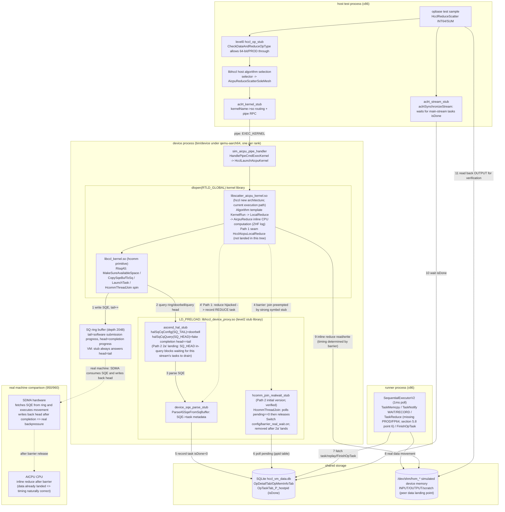

# 64-bit / PROD Reduction CPU Compute Flow Analysis and Task Hijacking Design (950/960)

> **Repository scope and actual VM path (re-verified 2026-10 against `hccl_vm_install/bin/log.txt`)**: This design involves two independent repositories --
> - **hccl** (`/home/teamserver/workspace/hccl`, new architecture, no instruction layer, device kernel = `libscatter_aicpu_kernel.so`): **In the current VM, 64-bit reduce is actually executed by this repository's library**. Actual-test evidence (ReduceScatter / INT64(dataType=5) / SUM(reduceOp=0) sample, `hccl_reducescatter_rootinfo_test.cc:164`): `aclrt_kernel_stub` dlsyms `HcclLaunchAicpuKernel` from `libscatter_aicpu_kernel.so` (`log.txt:12228`), the algorithm selects `AicpuReduceScatterSoleMesh`, reduction enters hccl's `LocalReduce -> AicpuReduce`, and `alg_data_trans_wrapper.cc:907` prints `ZHF-LocalReduce: dataType is [5], reduceOp is [0]` (`log.txt:12662 / 12674`). Therefore, the effective seam must land in this repository (see **section 5.6** for the plan).
> - **hcomm** (`/home/teamserver/workspace/hcomm`, legacy architecture, contains instruction/`Interpret` instruction layer): **This path is not reached in current execution; it is deprecated legacy**. Actual test: the debug marker `InsAicpuReduce: Interpret enter` added to its `ins_to_sqe_rule_v82.cc` appears **0 times** in `log.txt`; there are no `instruction.cc` / `ins_to_sqe_rule_v82.cc` log lines at all. Although `libccl_kernel.so` (an hcomm product) is loaded by the device process, it is not on the 64-bit reduction computation path. The original plan's hcomm changes in section 5.1 - section 5.5 matter only for legacy/910 or host-side `libhccl_v2.so`, and are retained as historical reference.
>
> **Landing status (important; 2026-10 re-verification; corrects the earlier "already landed" wording of this document)**: The exported seam `HcclAicpuLocalReduce`, the CheckerL2 dual stubs (level1 skip / level2 observe), and the REDUCE streamId tracking mechanism described in section 5.2 - section 5.9 **have not landed in the current code tree**. Full-repo searches (hccl / hcomm / CheckerL2 source) and searches of all deployed `.so` files for `HcclAicpuLocalReduce` return 0 hits; `aicpu_reduce_observe_stub.cc` does not exist; `hccl_task_collection.cc` does not have `TrackLocalCopyStream` / `GetLastLocalCopyStreamDev`. The actual changes in the current workspace are only three debug/experiment edits: (1) CheckerL2 `hccl_op_stub.cc` only comments out the `HcclReduceScatter` `CheckDataAndReduceOpType` call site (:1109) -- the function body still returns `NOT_SUPPORT` for 64-bit/PROD (:389-395); call sites for other operators (AllReduce :929 / Reduce :1046 / ReduceScatterV / GraphMode family) remain gated; (2) hccl `alg_data_trans_wrapper.cc:907` adds a `ZHF-LocalReduce` log; (3) hcomm `ins_to_sqe_rule_v82.cc` adds an `Interpret enter` log.
>
> **Actual execution result**: After allowing ReduceScatter through, the sample does reach hccl `AicpuReduce`, but the device process then **crashes with signal 11** inside `HcclLaunchAicpuKernelA3` of `libscatter_aicpu_kernel.so` (`crash_133229.log` / `crash_133255.log`). The host side reports `EXEC_KERNEL failed` and the sample returns `retcode 10`. That is, **without the seam/stub, the real `AicpuReduce` directly runs its CPU loop against simulated device addresses and crashes** -- this both validates the necessity of this design (reduction must be hijacked into a checker task instead of real computation) and shows that section 5.6 is currently a **design to be implemented**, not an established fact. (A later 14:39 round did not crash again but failed data verification with `total err is 4` -- the root cause is time inversion, not addressing. The two repair paths and spike implementation details are in **section 9**.)
>
> **Convergence conclusion**: For 64-bit/PROD target samples, CCU/AIV engines are hardware-unsupported and forcibly excluded by the algorithm selection layer. Everything converges to the **AICPU engine** single point -- hccl's `AicpuReduce` (hcomm's `RunAicpuReduce` is the corresponding deprecated-legacy point and is not reached currently). See **section 5.7**.
>
> **Repair path status (2026-10-24)**: Two paths coexist in parallel. **Path 1 (seam + stub task-ification, main line)** is implemented and tested passing (in a separate workspace). **Path 2 (real wait)** initial version (join-layer strong symbol stub) spike verification passed on 2026-10-20 (`check_result: success`; time inversion confirmed as the sole root cause of data errors), and has now evolved into a **dual-form landing**: level2 = southbound `halSqCqQuery(SQ_HEAD)` in-query wait (2a') + level1 = L1 library existing join stub wired to real wait, sharing the `barrier_real_wait` module (section 9.2). Both level1/level2 passed actual tests (2026-10-24). The checker matching downgrade (64-bit/PROD reduce-class operators skip semantic verification; retain memory conflict verification) is in **section 9.6**. **Time sequence and module diagrams for the SQE execution flow / reduce computation flow / synchronization relationship / hal ring buffer are in section 10**; **the ultimate plan (hal ring buffer slot-level true modeling; the evolution endpoint of 2a') interface and data structure research is in section 11**.

## 1 Problem Overview

### 1.1 Symptom

`CheckDataAndReduceOpType` in `src/proxy/level0/hccl_op_stub.cc` directly returns `HCCL_E_NOT_SUPPORT` for **64-bit data types** (INT64 / UINT64 / FP64) and **PROD (multiply) reduction**, causing `HcclAllReduce` / `HcclReduce` / `HcclReduceScatter` to be intercepted at the host entry:

```cpp
// src/proxy/level0/hccl_op_stub.cc:389
HcclResult CheckDataAndReduceOpType(HcclDataType dataType, HcclReduceOp op)
{
    if (dataType == HCCL_DATA_TYPE_INT64 || dataType == HCCL_DATA_TYPE_UINT64 ||
        dataType == HCCL_DATA_TYPE_FP64 || op == HcclReduceOp::HCCL_REDUCE_PROD) {
        return HcclResult::HCCL_E_NOT_SUPPORT;
    }
    return HcclResult::HCCL_SUCCESS;
}
```

Call sites (2026-10 actual-test line numbers): `hccl_op_stub.cc:929` (HcclAllReduce), `:1046` (HcclReduce), `:1109` (HcclReduceScatter, **currently commented out to allow through; the only entry allowed through**), `:1174` (HcclReduceScatterV), and each GraphMode entry. The function body itself is unchanged and still returns `NOT_SUPPORT`.

### 1.2 Root Cause

In real hcomm business, reduction computation is normally **fused into SDMA copy tasks (inline reduce SQE)** -- one read-modify-write completes both "movement + reduction". However, **SDMA hardware supports neither 64-bit data types nor PROD multiply**. Therefore, these two reduction types are rerouted by the algorithm layer to **CPU (AICPU) direct C++ loop computation**, which **does not produce SQE tasks consumable by checker/runner for verification**. The CheckerL2 checker plugin relies on task artifacts for post-hoc verification; without tasks, it cannot verify. Therefore, it directly returns `NOT_SUPPORT` at the entry.

### 1.3 Objective

On **950/960** platforms, provide a **stable, hijackable, symbol-hiding-immune** interface for the "CPU reduction computation" step, so that CheckerL2 can hijack it and **forcibly generate REDUCE tasks** (tasks are not executed by the real NPU but consumed by subsequent checker / runner plugins).

---

## 2 Key Concepts

### 2.1 Three Reduction Execution Engines

| Engine | Reductions Carried | Produces Tasks | Supports 64-bit/PROD |
|------|-----------|-------------|----------------|
| **SDMA inline reduce** | Movement and reduction fused into one copy SQE | Yes (SDMA SQE) | **No** |
| **AIV / TBE vector kernel** (910) | Reduction inside vector kernel | Yes (vector kernel task) | No (PROD has no atomic multiply; 64-bit not supported) |
| **AICPU CPU loop** (950/960) | Pure C++ for-loop element-wise computation | **No** (only DFX mirror info) | **Yes** (this is what it is designed for) |

### 2.2 Data Type / Reduction Operator Enum Values

```
HcclDataType:  INT8=0 INT16=1 INT32=2 FP16=3 FP32=4 INT64=5 UINT64=6 UINT8=7 UINT16=8 UINT32=9 FP64=10 BFP16=11
HcclReduceOp:  SUM=0  PROD=1  MAX=2  MIN=3
HcommDataType / HcommReduceOp values are consistent with the above (include/hcomm_primitives.h:46-64)
```

---

## 3 Business Flow Analysis

### 3.1 Why 64-bit / PROD Does Not Go Through SDMA Tasks

SDMA reduction is encoded into an 8-bit opcode of a `MEMCPY_ASYNC` SQE: high 4 bits encode data type, low 4 bits encode reduction kind. The bit field physically cannot encode 64-bit and PROD:

```cpp
// src/legacy/ascend910/pub_inc/aicpu/aicpu_hccl_sqcq.h
// :220 Reduction kinds are only CPY/ADD/MAX/MIN/EQUAL -- no multiply
enum rtStarsMemcpyAsyncOperationKind { ...ADD=0x01, MAX=0x02, MIN=0x03, EQUAL=0x04 };
// :228 Data types are only INT8/16/32, UINT8/16/32, FP16/FP32/BFP16 -- no 64-bit
enum rtStarsMemcpyAsyncDataType { ...FP32=0x70, BFP16=0x80 };

// :168 PROD maps to INVALID
constexpr aclrtReduceKind RK_MAP_TABLE[...] = {
    ACL_RT_MEMCPY_SDMA_AUTOMATIC_SUM,  /* SUM  */
    ACL_RT_MEMCPY_INVALID,             /* PROD */   // <- not supported
    ACL_RT_MEMCPY_SDMA_AUTOMATIC_MAX,  /* MAX  */
    ACL_RT_MEMCPY_SDMA_AUTOMATIC_MIN,  /* MIN  */
};
// :150 INT64/UINT64/FP64 map to UNDEFINED
constexpr aclDataType DT_MAP_TABLE[...] = { ... ACL_DT_UNDEFINED /*INT64*/, ACL_DT_UNDEFINED /*UINT64*/, ... ACL_DT_UNDEFINED /*FP64*/ ... };
```

Capability detection functions consistently exclude 64-bit and PROD (`src/legacy/ascend910/platform/common/device_capacity.cc`):

| Function | Location | Allowed Range |
|------|------|---------|
| `IsSupportAIVReduce` | :57 | `{int8/16/32, fp16/fp32, bfp16} x {sum,max,min}` |
| `IsDataTypeSupport` | :89 | No 64-bit |
| `IsRedOpSupport` | :112 | No PROD |
| `IsSupportSDMAReduce` | :130 | = alignment && data type && operator |
| `IsSupportRDMAReduce` | :138 | No 64-bit, no PROD |

The 950/960 capability table also marks INT64/UINT64/FP64 and PROD as `false`: `src/legacy/ascend950/unified_platform/common/dev_capability.cc:18-52`.

### 3.2 How the Algorithm Layer Routes

Each executor uses a uniform ternary expression to route 64-bit/PROD to the non-inline path (repeated verbatim in ~12 places), for example:

```cpp
// src/legacy/ascend910/algorithm/impl/coll_executor/coll_reduce/coll_reduce_executor.cc:95
ReduceType reduceType =
    ((param.reduceType != HCCL_REDUCE_PROD) && (param.DataDes.dataType != HCCL_DATA_TYPE_INT64))
        ? ReduceType::INLINE_REDUCE   // SDMA, fused into copy task
        : ReduceType::TBE_REDUCE;     // 64-bit/PROD falls to another engine
```

- **910 (legacy)**: `TBE_REDUCE` -> `dispatcher_graph.cc:307` (comment: "dtype=int64 or redOp=prod both take TbeReduce, controlled by the algorithm layer") -> `TbeReduceAsync` -> vector kernel `HcclTbeReduce` (`extern "C"`, cross-.so).
- **950/960**: When the algorithm selector hits 64-bit/PROD, it picks `"InsReduceAicpuReduce(Mesh2D)"`:

```cpp
// src/legacy/ascend950/service/collective/alg/selector/reduce_auto_selector.cc:266
if (op.dataType == DataType::INT64 || op.dataType == DataType::UINT64 ||
    op.dataType == DataType::FP64 || op.reduceOp == ReduceOp::PROD) {
    primQueueGenName = "InsReduceAicpuReduce";   // <- takes AICPU CPU computation
}
// :318 SelectAivAlgo returns NOT_MATCH for PROD directly; NOT_MATCH for UINT64/FP64 as well
```

On the entry side, there is also `HcclCommunicator::IsReduceWithInt64OrProd` (`hccl_communicator_host.cc:4556`) that identifies these operators.

### 3.3 950/960 CPU Computation: No Tasks, Only DFX Mirror

The `InsReduceAicpuReduce` template generates `InsAicpuReduce` instructions (`alg_data_trans_wrapper_mid.cc:908` `AicpuReduce()`). At execution time, `Interpret(InsAicpuReduce)` **constructs no SQE at all** and directly runs a C++ loop:

```cpp
// src/legacy/ascend950/framework/service/aicpu/ins_to_sqe_rule_v82.cc:721
void Interpret(const InsAicpuReduce& insAicpuReduce, const StreamLite& stream, ResMgrFetcher* resMgrFetcher)
{
    // Use aicpu to perform reduce; supports int64 uint64 fp64
    ...
    insAicpuReduce.RunAicpuReduce(dst, dstSize, src, srcSize, dataType, reduceOp);  // :745 pure CPU computation
    ...
    taskParam.taskType = TaskParamType::TASK_REDUCE_INLINE;                          // :751
    resMgrFetcher->GetMirrorTaskMgrLite()->AddTaskInfo(std::move(taskInfo));         // DFX mirror only; not a hardware task
}
```

Computation body (`instruction.cc:465`):

```cpp
template <typename T>
void InsAicpuReduce::AicpuReduceTemplate(T* dst, u64 dstSize, T* src, u64 srcSize, ReduceOp reduceOp)
{
    u64 count = dstSize / u64(sizeof(T));
    for (u64 i = 0; i < count; ++i) {
        switch (reduceOp) {
            case ReduceOp::PROD: *(dst + i) = *(src + i) * *(dst + i); break;   // Multiply on CPU
            case ReduceOp::SUM:  ...
        }
    }
}
// :500 RunAicpuReduce dispatches only INT64 / UINT64 / FP64
```

> **Conclusion**: At the moment reduction computation occurs, there is no SDMA reduce task representing it. The copy SQE used for movement has already completed. The CPU computation leaves only a `TASK_REDUCE_INLINE` DFX mirror. The checker has nothing to verify against.

### 3.4 Timing Relationship Between SDMA Movement and CPU Computation

**Division is a whole split, not "carving out" PROD/64-bit from inside an SDMA task**: SDMA does pure movement (zero arithmetic) for this data kind; AICPU does all reduction arithmetic.

Within a single operator, execution is phased + completion barrier serial, not element-by-element interleaving. The instruction queue generation order is linear (`ins_temp_all_reduce_aicpu_reduce.cc:110` `GenExtIns`):

```cpp
RunAllGatherMesh(...);      // Phase 1: All SDMA copy instructions (InsLocalCopy + SendRecv)
StreamSync(tempInsQues);    // Phase 2: Barrier
RunAicpuLocalReduce(...);   // Phase 3: All CPU reduce instructions (InsAicpuReduce) + LocalCopy
```

The barrier **waits until hardware actually finishes**. `Interpret(InsStreamSync)` (`ins_to_sqe_rule_v82.cc:679`) spin-polls until the SQ head catches the tail:

```cpp
do { head = stream.GetRtsq()->QuerySqHead(); ... } while (head != tail);   // :706 wait for SDMA to land data
```

Multi-stream rendezvous is guaranteed by `PreStreamSync` + `CheckPreStreamSync` (`ins_executor.cc:266`): all streams must arrive before unified release. The reason serial execution is required is **hard data dependency**: the SCRATCH read by CPU reduce is exactly the SCRATCH written by SDMA.

The real "interleaving" happens at **coarser slice/burst granularity**: when data exceeds scratch capacity, it loops by slice (`ins_v2_reduce_sole_executor.cc:195`); the queue shows `slice0[move|compute] slice1[move|compute] ...` alternation. This is overlaid with two concurrency layers: "AICPU submission vs SDMA hardware execution async" and "multi-stream copy parallel".

```
AICPU interpreter:  submit copy SQE -> PreStreamSync (all-stream flush + rendezvous) -> [spin until head==tail] -> CPU for-loop PROD/int64 -> submit LocalCopy
SDMA hardware:              +------parallel movement of each peer's data to SCRATCH------+ (done)         (idle, data arrived)              +--move result-->
                                                                            ^ Barrier: computation strictly after movement completion
```

> This diagram is from the real-machine (hcomm legacy) perspective. **The full timing diagram for the VM record-replay perspective (including hal ring buffer stub semantics, runner replay, Path 1/Path 2 mount points) and the three-process module diagram are in section 10**.

---

## 4 Hijack Point Selection Analysis

Constraint: **Cannot use C++ mangled symbols** (unstable), and hcomm will later enable **symbol hiding** (symbols not exported externally are hidden at compile time, such as `ccl_dpu.map` `local: *;`).

### 4.1 Southbound Interfaces (rts / hccp ra) -- Not Feasible

The **root cause** of 64-bit/PROD falling to CPU is that all southbound engines do not support it:

- RTS: `aclrtReduceAsync` (`orion_adapter_rts.cc:936`), `hrtReduceAsync` (`cpu_ts_thread.cc:348`) are both SDMA-backed;
- `IAicpuTsThread::SdmaReduce` (`aicpu_ts_thread_interface.cc:148`) directly returns "not supported" for 64-bit/PROD at `:35/:39`;
- HCCP/RDMA reduce capability also excludes 64-bit/PROD (`IsSupportRDMAReduce`).

**The computation step does not traverse any southbound interface** (the southbound layer carries only the data movement copies, which already produce tasks). Therefore, there is no southbound hijack point.

### 4.2 Existing Northbound Interface `HcommLocalReduceOnThread` -- Not Suitable for Direct Reuse

`HcommLocalReduceOnThread` (`include/hcomm_primitives.h:164`, `extern int32_t`, data-plane public interface) seems ideal, but has two hard blockers:

1. **The instruction engine context has no ThreadHandle**: `framework/service/aicpu/`, `service/collective/instruction/` have no thread handle anywhere, and the first parameter of this interface is `thread`;
2. **The A5 branch still lands on SDMA**: `aicpu_ts_primitives_c_adpt.cc:110` -> `threadPtr->LocalReduce -> SdmaReduce`, which rejects 64-bit/PROD.

Reusing it requires both "injecting a thread handle into the engine + adding CPU fallback in the thread engine", which has large change scope and real-machine behavior risk.

> Note: CheckerL2 already hijacks `HcommLocalReduceOnThread` on both host (`src/proxy/level1/data_local_op_stub.cc:291`) and device_arm (`src/device_arm/level1/data_op_device_stub.cc:1845`) and generates REDUCE tasks. Also, `ValidateA5Reduce` (`data_op_device_stub.cc:510`) already accepts 8-byte types (case 5/6/10) and PROD (reduceOp 0-3). However, that stub is hit only on the **data-plane programming path (SDMA inline reduce)**. Collective communication 64-bit/PROD reduction goes through hccl's `AicpuReduce` (current VM) / hcomm legacy's `InsAicpuReduce` (deprecated); neither goes through that stub. This is exactly why a separate `HcclAicpuLocalReduce` seam is needed.

### 4.3 Conclusion: Add a New Exported C Seam

Adopt "slightly modify hcomm, adding a hijackable symbol" strictly following hcomm's existing export mechanism (`RunAicpuThreadInit` and others use `__attribute__((visibility("default")))`; see `aicpu_thread_kernel.h:17`; export whitelist is in `ccl_dpu.map`). Naturally immune to symbol hiding.

---

## 5 Solution: Add Exported Seam `HcclAicpuLocalReduce`

> **Status: design / to be implemented (not landed in current tree).** Section 5.1 - section 5.9 in this chapter are all **plan designs**, not established facts. Landing progress follows the top "Landing status" section: the seam symbol, CheckerL2 dual stubs, and streamId tracking mechanism do not exist in any of the three repositories hccl/hcomm/CheckerL2. Currently, only a level0 allow-through experiment that crashes exists (see the top description and section 5.5). Section 5.1 - section 5.5 targets **hcomm (deprecated legacy)**; section 5.6 targets **hccl (the current actual path; the recommended landing direction)**.

Sink AICPU local reduction computation into a symbol that is **`extern "C"` + weak + default-visible + listed in the `.map` whitelist**. `RunAicpuReduce` retreats to a pure internal implementation (can be hidden) and is no longer the hijack surface.

### 5.1 Target Symbol Location

- Single choke point: `InsAicpuReduce::RunAicpuReduce` (`instruction.cc:500`, declared `instruction.h:807`). Only one call site in the whole repo: `ins_to_sqe_rule_v82.cc:745`. Covers all 64-bit/PROD reductions of AllReduce / Reduce / ReduceScatter.
- **950 has no `ccl_kernel` target**: The CMakeLists of `instruction.cc` / `ins_to_sqe_rule_v82.cc` dual-mount with `if(TARGET hccl_v2)` / `if(TARGET ccl_kernel)`. The 950 build has only `hccl_v2` (`SHARED`, `hccl_v2.cmake:12`) hit, so both are built only into **`hccl_v2`**. That library **does not use `-Bsymbolic`** (only release attaches version-script). Intra-DSO calls go through PLT and can be preempted by strong symbols.
- device_arm uses `dlopen(RTLD_NOW|RTLD_GLOBAL)` to load the execution kernel library (`sim_kernel_lib_mgr.cc:34`).

### 5.2 hcomm-Side Changes (legacy, deprecated / not landed -- historical reference only)

> This section targets the hcomm legacy instruction layer path. Current VM execution **does not pass** through that path (see top re-verification). The following changes are **not landed** (whole-repo search for `HcclAicpuLocalReduce` returns 0). Retained only for historical/910-host reference. The effective plan is in section 5.6 (hccl repo).

**(1) Declaration** (design: placed in `instruction.h`, after the `InsAicpuReduce` class; both TUs are visible via `ins_to_sqe_rule.h:16 -> instruction.h`. `weak` is added only at the definition; the declaration has only `visibility("default")`):

```c
// instruction.h (inside namespace Hccl, extern "C" -> unmangled global C symbol)
extern "C" __attribute__((visibility("default"))) int32_t HcclAicpuLocalReduce(
    void* dst, uint64_t dstSize, const void* src, uint64_t srcSize, HcclDataType dataType, HcclReduceOp reduceOp);
```

> `HcclDataType/HcclReduceOp` are already visible via `instruction.h -> coll_operator.h -> data_type.h/reduce_op.h -> <hccl/hccl_types.h>`; `int32_t/uint64_t` are visible via `types.h -> <cstdint>`. No new includes are required.

**(2) Real-machine implementation** (`instruction.cc`, thin wrapper; behavior unchanged; reverse mappings already exist: `data_type.h:103`, `reduce_op.h:51`):

```cpp
extern "C" __attribute__((weak)) __attribute__((visibility("default"))) int32_t HcclAicpuLocalReduce(
    void* dst, uint64_t dstSize, const void* src, uint64_t srcSize, HcclDataType dataType, HcclReduceOp reduceOp)
{
    InsAicpuReduce::RunAicpuReduce(dst, static_cast<u64>(dstSize), const_cast<void*>(src), static_cast<u64>(srcSize),
        HcclDataTypeToDataType(dataType), HcclReduceOpToReduceOp(reduceOp));
    return 0;
}
```

**(3) Change the only call site** `ins_to_sqe_rule_v82.cc:745` from direct internal method call to calling the exported seam:

```cpp
    HcclAicpuLocalReduce(dst, insAicpuReduce.GetDstSlice().GetSize(),
        src, insAicpuReduce.GetSrcSlice().GetSize(),
        DataTypeToHcclDataType(insAicpuReduce.GetDataType()),
        ReduceOpToHcclReduceOp(insAicpuReduce.GetReduceOp()));
    // The subsequent DFX mirror (:749-761) remains unchanged
```

**(4) Register in the export whitelist**: In the `hccl_v2` library's version-script `src/legacy/ascend950/hccl_v2.map`, add a line to the `global:` section (`extern "C"` symbols use the unmangled pure C name):

```
    HcclAicpuLocalReduce;
```

This prevents it from being hidden by `local: *;`. (Note: `ccl_dpu.map` is the host-side `ccl_dpu` library, and that library uses `-Bsymbolic`; it does not contain the instruction engine and is not the library this seam belongs to.)

### 5.3 CheckerL2 device_arm-Side Strong Symbol Hijacking (Design; Not Landed)

Completely isomorphic to the existing `HcommLocalReduceOnThread` stub (`data_op_device_stub.cc:1845`, current actual-test line number), reusing `TransLocalAddrToVirtual` / `InsertCollectedTask` / `GetCurRankId`:

```cpp
extern "C" int32_t HcclAicpuLocalReduce(void* dst, uint64_t dstSize, const void* src, uint64_t srcSize,
                                        HcclDataType dataType, HcclReduceOp reduceOp)
{
    if (dst == nullptr || src == nullptr || dstSize == 0 || dstSize != srcSize) {
        return static_cast<int32_t>(HCCL_E_PARA);
    }
    uint32_t curRank = 0;
    (void)GetCurRankId(&curRank);

    HcclTaskMetaData t{};                       // Local reduction: src/dst same rank
    t.taskType = HccLTaskMetaType::REDUCE;
    t.commId   = 0;                             // Allow downgrade (consistent with HcommLocalReduceOnThread stub)
    t.rankId   = curRank;
    t.streamId = 0;                             // If an exact value is needed, the seam can take a parameter passed from stream.GetId()
    t.taskData.reduce.srcDeviceId = curRank;
    t.taskData.reduce.srcOffset   = TransLocalAddrToVirtual(reinterpret_cast<uint64_t>(src));
    t.taskData.reduce.dstDeviceId = curRank;
    t.taskData.reduce.dstOffset   = TransLocalAddrToVirtual(reinterpret_cast<uint64_t>(dst));
    t.taskData.reduce.dataCount   = dstSize;                    // Byte length; consistent with device convention
    t.taskData.reduce.dataType    = static_cast<uint8_t>(dataType);   // Already HcclDataType
    t.taskData.reduce.reduceOp    = static_cast<uint8_t>(reduceOp);   // Already HcclReduceOp

    return InsertCollectedTask(t) == 0 ? 0 : static_cast<int32_t>(HCCL_E_INTERNAL);
    // Do not perform real computation; let the runner execute the task
}
```

Place in the device_arm main executable (global scope). `ccl_kernel` is dlopened with `RTLD_GLOBAL`, and hcomm has no `-Bsymbolic` -> **strong symbol preempts hcomm's weak default implementation**; LD_PRELOAD-style stable effect.

### 5.4 Prerequisite Changes (Otherwise the Hijack Point Cannot Be Reached)

Open up level0 `hccl_op_stub.cc:389` `CheckDataAndReduceOpType`: Currently it returns `NOT_SUPPORT` for 64-bit/PROD at the host entry and **does not forward to real-machine libhccl**. Collective communication does not run, and the device-side `HcclAicpuLocalReduce` is never called. Change to allow through (`RecordOpDbInfo` as usual + forward).

> **Current actual status (partial allow-through experiment; not landed as a formal plan)**: The `CheckDataAndReduceOpType` function body **still** returns `HCCL_E_NOT_SUPPORT` for INT64/UINT64/FP64/PROD (`hccl_op_stub.cc:389-395`, unchanged). Only the `HcclReduceScatter` single call site is entirely commented out (`:1109`). Other call sites (`HcclAllReduce:929`, `HcclReduce:1046`, `HcclReduceScatterV:1174`, and each GraphMode entry `:1258/:1540/:1612/:1686`) still intercept. Therefore, currently only ReduceScatter 64-bit/PROD reaches the device, and due to missing seam/stub, it crashes (see top). When formally landing, it should be changed to always return `HCCL_SUCCESS` (or allowed per-entry as needed), rather than scattered comments.

### 5.5 Implementation Status (2026-10 Re-verification: **None of the Following Design Items Has Landed**)

> This section was originally titled "Landed Change List". After re-verification, **items 1-6 in the table below do not exist in the current tree** (whole-repo hccl/hcomm/CheckerL2 source and all deployed `.so` searches for `HcclAicpuLocalReduce` return 0 hits). The table is retained as a **design list**, with each item's actual status marked:

| # | Repo | File | Change (design) | Actual Status (2026-10 re-verification) |
|---|------|------|------|------|
| 1 | hcomm | `src/legacy/ascend950/service/collective/instruction/instruction.h` | After the `InsAicpuReduce` class, add `extern "C" visibility("default")` declaration `HcclAicpuLocalReduce` | Not landed (hcomm has no such symbol) |
| 2 | hcomm | `src/legacy/ascend950/service/collective/instruction/instruction.cc` | After `RunAicpuReduce`, add weak default implementation forwarding to `RunAicpuReduce` | Not landed |
| 3 | hcomm | `src/legacy/ascend950/framework/service/aicpu/ins_to_sqe_rule_v82.cc` | `Interpret(InsAicpuReduce)` call site changed to call `HcclAicpuLocalReduce(...)` | Not landed (currently only added `Interpret enter` debug log; call site still `RunAicpuReduce`) |
| 4 | hcomm | `src/legacy/ascend950/hccl_v2.map` | `global:` section adds `HcclAicpuLocalReduce;` | Not landed |
| 5 | CheckerL2 | `src/device_arm/level1/data_op_device_stub.cc` | Add `extern "C"` strong symbol `HcclAicpuLocalReduce`; construct REDUCE task and `InsertCollectedTask` | Not landed (this file has only `HcommLocalReduceOnThread` (:1845) stub; no `HcclAicpuLocalReduce`) |
| 6 | CheckerL2 | `src/proxy/level0/hccl_op_stub.cc` | `CheckDataAndReduceOpType` allows 64-bit/PROD through (always returns `HCCL_SUCCESS`) | Partial only: commented out one `HcclReduceScatter` call site (`:1109`); function body still returns `NOT_SUPPORT` (`:389-395`); other entries not allowed through (see section 5.4) |

**Verification (original assertion no longer holds)**: The original text once claimed "level0 passed `-fsyntax-only`; device_arm stub is line-by-line isomorphic to neighboring `HcommLocalReduceOnThread` stub" -- that was a description of items 1-5 **having once landed**. Currently, items 1-5 are all not landed; no corresponding artifacts are available for verification. Item 6's allow-through fragment compiles, but at runtime crashes in hccl `AicpuReduce` (see top "Actual execution result").

**Integration-period assumption verification conclusion (important; 2026-10 actual-test correction; analysis still holds)**: The original plan inferred from `instruction.cc -> hccl_v2` that the export registration was in `hccl_v2.map`. Actual testing found that assumption covered only the **host side**, and **the current VM's running path is not in hcomm at all**:

1. `ins_to_sqe_rule_v82.cc` / `instruction.cc` in hcomm are built into **two builds** separately:
   - **Host x86** `libhccl_v2.so` (`build/src/legacy/ascend950`, linked with `hccl_v2.map`) -- if declaration/definition were added, `nm -D` should show `W HcclAicpuLocalReduce` (currently not added; therefore none);
   - **Device aarch64** `libccl_kernel.so` (linked with `ccl_kernel.map`) and `libaicpu_custom.so` (linked with `aicpu_custom.map`) -- these two maps **do not** register the symbol, and `local:*;` would hide it.
2. Moreover, in this VM, the device computation of 64-bit reduce **is not done by hcomm at all**: `aclrt_kernel_stub` dlsyms `HcclLaunchAicpuKernel` from **`libscatter_aicpu_kernel.so`** (`log.txt:12228`). That library is built by **another repository `hccl`** (`/home/teamserver/workspace/hccl`), unrelated to hcomm. Its reduction goes through hccl's own `AicpuReduce` (see section 5.6). Even if hcomm added the seam, it would not enter the running path.
3. Conclusion: **The effective seam must land in the `hccl` repository** (section 5.6). hcomm-side changes matter only for legacy/910 or host-side `libhccl_v2.so`, not needed by the current VM.

### 5.6 hccl Repository (New Architecture / libscatter_aicpu_kernel.so) Isomorphic Change Plan (**Recommended Landing Direction; Currently Not Landed**)

> This is the current VM actual path (see top re-verification), and the repository where the seam **should** land. The following H1/H2/H3 three items are **all not implemented**: `alg_data_trans_wrapper.cc` currently only has an added `ZHF-LocalReduce` debug log (`:907`); `AicpuReduce` is still an in-library local C++ call; `scatter_aicpu_kernel.map` has no `HcclAicpuLocalReduce`. This section is retained as a **design to be implemented**.

hccl is the new-architecture repository. **It has no instruction/Interpret instruction layer**: the device kernel directly runs the algorithm template's `KernelRun`, and its local reduction is uniformly dispatched through the wrapper `LocalReduce`. Therefore, the seam sinks to the CPU branch `AicpuReduce` of `LocalReduce` (one-to-one correspondence with hcomm deprecated legacy's `RunAicpuReduce`).

**Convergence point confirmation** (whole-repo unique; line numbers from 2026-10 actual test): `AicpuReduce` is called whole-repo only by `LocalReduce` (`alg_data_trans_wrapper.cc:901` definition, `:908` call); `LocalReduce` is called by all AICPU reduction templates (all_reduce / reduce / reduce_scatter / reduce_scatter_v's OneShot/TwoShot/NHR/AicpuReduce/order-preserved/dpu variants, total ~15 sites); no template bypasses `LocalReduce` to directly call `AicpuReduceTemplate`/`AicpuReduceFp16`.

```
ins_temp_all_reduce_mesh_1D_one_shot.cc  PostLocalReduce -> LocalReduce(...)
  -> alg_data_trans_wrapper.cc:901 LocalReduce: 64-bit/PROD branch (:907 ZHF debug log)
      -> :908 AicpuReduce(thread, srcSlice, dstSlice, dataType, reduceOp)   <- whole-repo only call site (seam)
          -> :1260 AicpuReduce: switch(dataType) -> AicpuReduceTemplate<int64_t/...>(:1320) CPU loop
```

Following hccl's existing weak-alias export convention (`HcclGetDeviceType` uses `hccl_weak_alias` + `hccl.map global:`; see `common/dev_type.cc:75`, `common/dev_type.h:101`), three changes total:

| # | Repo | File | Change |
|---|------|------|------|
| H1 | hccl | `src/ops/op_common/algorithm/template/wrapper/alg_data_trans_wrapper.h` | After `AicpuReduce` declaration (`:82`), add `extern "C"` declaration `HcclAicpuLocalReduce` (signature byte-identical to CheckerL2 stub) |
| H2 | hccl | `src/ops/op_common/algorithm/template/wrapper/alg_data_trans_wrapper.cc` | `AicpuReduce` (`:1260`) retains validation + `TraceDataSlice`; computation dispatch changed to call `HcclAicpuLocalReduce`; the original switch moved into `__HcclAicpuLocalReduce` with `hccl_weak_alias(__HcclAicpuLocalReduce, HcclAicpuLocalReduce)` |
| H3 | hccl | `src/scatter_aicpu_kernel.map` | `global:` section adds `HcclAicpuLocalReduce;` (this library has no `-Bsymbolic`; intra-DSO goes through PLT; can be preempted by strong symbol) |

**H1 Declaration** (`alg_data_trans_wrapper.h`, inside `namespace ops_hccl`; `HcclDataType/HcclReduceOp` are already visible with the `AicpuReduce` declaration):

```cpp
extern "C" __attribute__((visibility("default"))) int32_t HcclAicpuLocalReduce(
    void* dst, uint64_t dstSize, const void* src, uint64_t srcSize, HcclDataType dataType, HcclReduceOp reduceOp);
```

**H2 Definition** (`alg_data_trans_wrapper.cc`, modify `AicpuReduce` + add weak implementation, following the `dev_type.cc` `hccl_weak_alias` convention):

```cpp
HcclResult AicpuReduce(
    const ThreadHandle& thread, const DataSlice& srcSlice, const DataSlice& dstSlice, const HcclDataType dataType,
    const HcclReduceOp reduceOp)
{
    (void)thread;
    CHK_PRT_RET(srcSlice.size_ != dstSlice.size_, /* original error print unchanged */, HcclResult::HCCL_E_INTERNAL);
    u8* src = static_cast<u8*>(GetSliceAddr(srcSlice));
    u8* dst = static_cast<u8*>(GetSliceAddr(dstSlice));
    TraceDataSlice("AicpuReduce", "AICPU_REDUCE", 0, 1, srcSlice, dstSlice, src, dst, srcSlice.size_, dataType, reduceOp);
    // Sink through the exported seam: real machine takes the weak default implementation (CPU loop); simulation side strong symbol overrides to generate a REDUCE task.
    return static_cast<HcclResult>(
        HcclAicpuLocalReduce(dst, dstSlice.size_, src, srcSlice.size_, dataType, reduceOp));
}

#ifdef __cplusplus
extern "C" {
#endif
int32_t __HcclAicpuLocalReduce(
    void* dst, uint64_t dstSize, const void* src, uint64_t srcSize, HcclDataType dataType, HcclReduceOp reduceOp)
{
    auto ret = HcclResult::HCCL_SUCCESS;
    u8* dstU8 = static_cast<u8*>(dst);
    u8* srcU8 = const_cast<u8*>(static_cast<const u8*>(src));
    switch (dataType) {   // <- The original AicpuReduce switch is moved in verbatim
        case HcclDataType::HCCL_DATA_TYPE_INT8:
            ret = AicpuReduceTemplate<int8_t>(reinterpret_cast<int8_t*>(dstU8), dstSize,
                reinterpret_cast<int8_t*>(srcU8), srcSize, reduceOp); break;
        case HcclDataType::HCCL_DATA_TYPE_INT32:
            ret = AicpuReduceTemplate<int32_t>(reinterpret_cast<int32_t*>(dstU8), dstSize,
                reinterpret_cast<int32_t*>(srcU8), srcSize, reduceOp); break;
        case HcclDataType::HCCL_DATA_TYPE_FP16:
            ret = AicpuReduceFp16(dstU8, srcU8, srcSize, reduceOp); break;
        case HcclDataType::HCCL_DATA_TYPE_FP32:
            ret = AicpuReduceTemplate<float>(reinterpret_cast<float*>(dstU8), dstSize,
                reinterpret_cast<float*>(srcU8), srcSize, reduceOp); break;
        case HcclDataType::HCCL_DATA_TYPE_INT64:
            ret = AicpuReduceTemplate<int64_t>(reinterpret_cast<int64_t*>(dstU8), dstSize,
                reinterpret_cast<int64_t*>(srcU8), srcSize, reduceOp); break;
        case HcclDataType::HCCL_DATA_TYPE_UINT64:
            ret = AicpuReduceTemplate<uint64_t>(reinterpret_cast<uint64_t*>(dstU8), dstSize,
                reinterpret_cast<uint64_t*>(srcU8), srcSize, reduceOp); break;
        case HcclDataType::HCCL_DATA_TYPE_FP64:
            ret = AicpuReduceTemplate<double>(reinterpret_cast<double*>(dstU8), dstSize,
                reinterpret_cast<double*>(srcU8), srcSize, reduceOp); break;
        default:
            HCCL_ERROR("DataType[%d] is not supported", int(dataType));
            ret = HcclResult::HCCL_E_INTERNAL; break;
    }
    return static_cast<int32_t>(ret);
}
hccl_weak_alias(__HcclAicpuLocalReduce, HcclAicpuLocalReduce);
#ifdef __cplusplus
} // extern "C"
#endif
```

> The `hccl_weak_alias` macro comes from `common/dev_type.h` (if the wrapper has not included it, `#include "dev_type.h"`); `AicpuReduceTemplate`/`AicpuReduceFp16` are in the same TU as the weak implementation (declarations in header `:90/:93`) and can be called directly.

**H3 Export Whitelist** (`src/scatter_aicpu_kernel.map` `global:` section, parallel to `HcclLaunchAicpuKernel`):

```
        HcclAicpuLocalReduce;
```

**Rebuild deployment** (critical to take effect; otherwise changes do not enter the running path):

```bash
cd /home/teamserver/workspace/CheckerL2_64bit
bash build_pkg.sh --install hccl   # hccl build.sh --full -> .run installs into CANN -> unpacks aicpu_hccl.tar.gz to hccl_vm_install/lib/aarch64/
# Self-check: W/T HcclAicpuLocalReduce should appear (currently not landed, so actual test is 0 hits)
nm -D hccl_vm_install/lib/aarch64/libscatter_aicpu_kernel.so | grep HcclAicpuLocalReduce
```

The CheckerL2 device_arm-side strong symbol stub (design places it in `data_op_device_stub.cc`; goes into the device process via `LD_PRELOAD` with `libhccl_device_proxy_level1.so`, `sim_sub_process_manager.cc:585`) **has not yet been created and must be added**. The kernel library is loaded with `dlopen(RTLD_NOW|RTLD_GLOBAL)` (`sim_kernel_lib_mgr.cc:34`) and has no `-Bsymbolic` -> strong symbol preempts the weak default implementation.

> Note: `alg_data_trans_wrapper.cc` is also built into the **host** `libhccl.so` (`build/src/CMakeFiles/hccl.dir`, linked with `hccl.map`), for the CCU 2-die host template to call `LocalReduce`. That host copy is currently not overridden by a device strong symbol stub, and CCU does not support 64-bit/PROD (table below), so it has no effect on this sample. If host-side hijacking is also needed, additionally add the same-named symbol to `hccl.map global:`.

### 5.7 Running Mode Convergence Verification (CCU / AICPU / AIV)

The hijacked interface must land at a convergence location that "as many running modes as possible pass through". Verification conclusion: **For the target samples (INT64/UINT64/FP64 and PROD), all engines are forcibly converged to the AICPU engine at the algorithm selection layer, then physically converge to the `AicpuReduce` (hccl) / `RunAicpuReduce` (hcomm) single seam**. CCU/AIV engines do not support these types in hardware and cannot bypass.

**Engine capability matrix** (per `REGISTER_ALG_ATTRS` and selector code; consistent across both repos):

| Engine | PROD | INT64 | UINT64/FP64 | Reduction Implementation Location | Passes Through Seam |
|------|------|-------|-------------|--------------|-----------|
| **AICPU** | Yes | Yes | Yes | `LocalReduce` -> `AicpuReduce` (hccl) / `Interpret(InsAicpuReduce)` -> `RunAicpuReduce` (hcomm) | **Yes (the only engine carrying 64-bit/PROD)** |
| **CCU / CCU_MS / CCU_SCHED** | No | No | No | CCU hardware mem2mem inline reduce (`ccu_kernel_*` `GroupLocalReduce`/`PairwiseLocalReduce`) | No (does not support target types; cannot be selected) |
| **AIV** | No | See below | No | AIV kernel (real-machine vector kernel / simulated `libhccl_aiv_kernel.so` `Reduce64`) | No |
| **SDMA inline** | No | No | No | Fused into copy SQE (the `HcommLocalReduceOnThread` branch of `LocalReduce`) | Already hijacked by existing stub (`data_op_device_stub.cc:1845`, actual-test line number) |

Evidence:
- **Capability declaration**: Whole-repo hccl has only 2 sites with `isSupportProd = true`; the only reduction algorithm among them is `AicpuAllReduceSequenceMeshNHRAicpuReduce` (AICPU). All CCU algorithms have `isSupportProd=false` and `unsupportedDataTypes` contains `{INT64,UINT64,FP64}`. All AIV algorithms have `isSupportProd=false` and `unsupportedDataTypes` contains `{UINT64,FP64}` (`alg_attrs.h:85-93`).
- **Selector enforcement**: `isDataTypeOrReduceTypeSpecial = INT64||UINT64||FP64||PROD` hits immediately select `Aicpu*` algorithms (`all_reduce_auto_selector.cc:432/:536`; hcomm `reduce_auto_selector.cc:266`).
- **Actual test (2026-10 `log.txt`, ReduceScatter/INT64/SUM sample)**: `cost_model.cc:356` `algName=AivReduceScatterSoleMesh filtered: engine=3 not in candidate engines` (`log.txt:7951`) -- AIV (engine=3) filtered out by engine; `selector_engine.cc:446` `SelectMinCost: selected algName=AicpuReduceScatterSoleMesh, engine=AICPU_TS` (`log.txt:8383`), `:315` `dataType[int64] reduceType[sum]` (`log.txt:8385`) -- finally selects AICPU engine's `AicpuReduceScatterSoleMesh`.

**AIV INT64 boundary note** (the only theoretical exception; not a gap): The AIV capability table does not list INT64 as unsupported; theoretically INT64 SUM/MAX/MIN could go through AIV. But (1) the selector's special-datatype branch also routes INT64 to AICPU; (2) even if AIV is taken, its reduction is inside the AIV kernel, and CheckerL2's AIV stub `Reduce64`承接承接承接承接承接承接承接承接承接承接承接承接承接承接承接承接承接承接承接承接承接承接承接承接承接承接承接承接承接承接承接承接承接承接承接承接承接承接承接承接承接承接承接承接承接承接承接承接承接承接承接承接承接承接承接承接承接承接承接承接承接承接承接承接承接承接承接承接承接承接承接承接承接承接承接承接承接承接承接承接承接承接承接承接承接承接承接承接承接承接承接承接承接承接承接承接承接承接承接承接承接承接承接承接承接承接承接承接承接承接承接承接承接承接承接承接承接承接承接承接承接承接承接承接承接承接承接承接承接承接承接承接承接承接承接承接承接承接承接承接承接承接承接承接承接承接承接承接承接承接承接承接承接承接承接承接承接承接承接承接承接承接承接承接承接承接承接承接承接承接承接承接承接承接承接承接承接承接承接承接承接承接承接承接承接承接承接承接承接承接承接承接承接承接承接承接承接承接承接承接承接承接承接承接承接承接承接承接承接承接承接承接承接承接承接承接承接承接承接承接承接承接承接承接承接承接承接承接承接承接承接承接承接承接承接承接承接承接承接承接承接承接承接承接承接承接承接承接承接承接承接承接承接承接承接承接承接承接承接承接承接承接承接承接承接承接承接承接承接承接承接承接承接承接承接承接承接承接承接承接承接承接承接承接承接承接承接承接承接承接承接承接承接承接承接承接承接承接承接承接承接承接承接承接承接承接承接承接承接承接承接承接承接承接承接承接承接承接承接承接承接承接承接承接承接承接承接承接承接承接承接承接承接承接承接承接承接承接承接承接承接承接承接承接承接承接承接承接承接承接承接承接承接承接承接承接承接承接承接承接承接承接承接承接承接承接承接承接承接承接承接承接承接承接承接承接承接承接承接承接承接承接承接承接承接承接承接承接承接承接承接承接承接承接承接承接承接承接承接承接承接承接承接承接承接承接承接承接承接承接承接承接承接承接承接承接承接承接承接承接承接承接承接承接承接承接承接承接承接承接承接承接承接承接承接承接承接承接承接承接承接承接承接承接承接承接承接承接承接承接承接承接承接承接承接承接承接承接承接承接承接承接承接承接承接承接承接承接承接承接承接承接承接承接承接承接承接承接承接承接承接承接承接承接承接承接承接承接承接承接承接承接承接承接承接承接承接承接承接承接承接
### 5.8 Level Semantics and CheckerL2 Dual-Stub Arbitration (level1 skip / level2 observe; **design; stubs not landed**)

> **Status clarification (2026-10 re-verification)**: The **preload arbitration framework in this section is real** -- `sim_sub_process_manager.cc:576-587` indeed decides `LD_PRELOAD` based on `HCCL_VM_LEVEL` (level1=`L1:L0`, level2=only `L0`); `libhccl_device_proxy_level1.so` and `libhccl_device_proxy.so` are also deployed. **But the stubs for `HcclAicpuLocalReduce` at both levels do not exist**: the level1 strong symbol stub has not been added to `data_op_device_stub.cc`, and the level2 `aicpu_reduce_observe_stub.cc` file has not been created (and the seam symbol itself does not exist in the kernel library either; see section 5.6). Therefore, the "Stub semantics / Data effect source" columns in the table below are **design goals**, currently unreachable. The only status item that is accurate is point 6 (runner-side gap).

The tool starts with one of two levels (`--level`, default 2). The REDUCE task production mechanism at the two levels is **designed** as follows:

| Level | Preloaded Stub Library (`sim_sub_process_manager.cc:576-587`; verified to exist) | Stub Semantics (design; stub not landed) | Data Effect Source |
|------|------|------|------|
| **level1** (northbound hijacking) | `libhccl_device_proxy_level1.so` : `libhccl_device_proxy.so` | **skip**: only records the task (design placed in `data_op_device_stub.cc`; **currently no such stub**) | runner replays the task (`hccl_task_thread.cc:114 TaskReduce`, verified to exist but missing PROD/FP64) |
| **level2** (southbound hijacking; default) | only `libhccl_device_proxy.so` | **observe**: records the task + forwards real computation (design file `aicpu_reduce_observe_stub.cc`; **currently does not exist**) | Stub internally forwards to the kernel library's own weak default implementation; completes within the process immediately |

Key points:

1. **Arbitration relies on preload order, naturally mutually exclusive**: At level1, `LD_PRELOAD=level1:level0`; the level1 library's same-named strong symbol is resolved first, and the observe stub is not called. At level2, only the level0 library is preloaded, and the observe stub takes effect. The observe stub additionally uses `HCCL_VM_LEVEL` as a defensive fallback (level1 semantics = record only). Both stubs **must coexist**: deleting the level1 stub would cause level1 to mistakenly enter the observe path, superimposing with runner replay and causing double reduction.
2. **The hccl repository seam change is indispensable at both levels**: Without the section 5.6 change, `libscatter_aicpu_kernel.so` has **zero dynamic references** to `HcclAicpuLocalReduce` (`LocalReduce -> AicpuReduce -> AicpuReduceTemplate` are in-library locally-bound C++ calls; no PLT; not in the export table). No level's LD_PRELOAD strong symbol can be called. The seam creates an "interceptable point"; stubs are only the interceptors.
3. **The observe stub's forwarding uses "caller-based location" rather than RTLD_NEXT**: `dladdr(return address)` -> `dlopen(RTLD_NOLOAD)` -> `dlsym(caller library handle, "HcclAicpuLocalReduce")` obtains the **caller library's own** weak default implementation. Reason: The VM device process simultaneously loads hcomm `libccl_kernel.so` (default implementation dispatches only INT64/UINT64/FP64, loaded earlier) and hccl `libscatter_aicpu_kernel.so` (full-type dispatch). RTLD_NEXT, by global load order, would cross-bind to hcomm's narrow implementation, and FP32/FP16/INT8/INT32+PROD would hit its `NotSupportException`. Caller-based location keeps both stacks correct individually, and data remains bit-identical to the unhijacked case (single source of truth = kernel library's own implementation).
4. **level2 record format** follows the `device_sqe_parse_stub.cc` convention: `opDetailId -> QueryOpDetailIdentity` restores real commId/rankId/deviceId (when downgraded, commId=0 + this rank, same as level1 stub); addresses are converted via `ResolveTaskAddress` to virtual address + physical owner device; `dataCount` stores bytes.
5. **streamId must be restored to the main data stream (ordering-critical; design; tracking mechanism not landed)**: The checker task graph builds in-stream order edges + notify edges by `(rank, streamId)` queue (`task_graph_generator_v3.cc:GenGraph4Rank`). Semantic simulation executes in this DAG topological order (`task_graph_semantic_check_v3.cc`). If REDUCE records `streamId=0`, it becomes an isolated queue with no parent nodes. The topological order **must precede** peer remote writes (which sit deep in the peer stream chain) -> at merge time, src range has no semantics yet -> `GetSourceIntersection` is empty, merge silently no-op -> AllReduce semantic verification reports `ErrorCode 409: should combine inputs from 2 source ranks, but it actually combines 1`. Design fix: CPU reduction executes after the barrier join and between two copies on the main data stream, so REDUCE **inherits the streamId of "the most recent landed-local (dstDeviceId==this device) MEM_CPY"**. The tracking point is planned at the device-side task ingestion funnel `InsertTaskToCollectionDev` (`hccl_task_collection.cc`, getter `GetLastLocalCopyStreamDev`; **Note: this tracking function/getter currently does not exist and must be added**). The stub's ingestion timing naturally inserts REDUCE into the correct position in that stream queue (after preceding copy/barrier WAIT, before result movement copy). Cross-rank ordering is guaranteed by existing notify RECORD/WAIT edges. When no tracking value exists, fall back to 0 and print WARN. **Logic details, correctness basis, rejected alternatives, and known boundaries are in section 5.9.**
6. **Known runner-side gap (level1-related; to be fixed separately; verified to still hold on 2026-10 re-verification)**: `TaskReduce` (`hccl_task_thread.cc:114`) dispatches only MIN/MAX/SUM, **with no PROD branch** (`:123 default: break` returns success directly = no-op). Also, `MemReduceMin/MaxTemplate` loops start from `index=1` (`hccl_task_reduce_process.cc:36/:50`, missing element 0), and `MemReduce*` has no FP64 branch (only int8/16/32/64, uint8/16/32/64, FP16, float). At level1, PROD/FP64 sample replay data would be wrong; runner semantics must be added (aligned with hccl `AicpuReduceTemplate`). level2 observe mode is unaffected (computation is completed by the kernel library default implementation). **Note: this gap is triggered only after the section 5.6 seam + level1 stub land; currently both are missing, so it has not manifested.**

### 5.9 REDUCE Task streamId Recovery (Seam Has No Stream Context; **Design; Tracking Mechanism Not Landed**)

> **Status (2026-10 re-verification)**: The ingestion funnel tracking mechanism described in this section **currently does not exist** -- `hccl_task_collection.cc` does not have `TrackLocalCopyStream` / `GetLastLocalCopyStreamDev` / `g_lastLocalCopyStream`, and the `aicpu_reduce_observe_stub.cc` file also does not exist. The line numbers and data such as "actual-test dev1->stream15..." below come from an implementation period that **once landed and was subsequently reverted**. They are not currently reproducible and are retained only as design basis. Landing this section requires first landing the section 5.6 seam and section 5.8 dual stubs.

**Problem**: The seam signature `HcclAicpuLocalReduce(dst, dstSize, src, srcSize, dataType, reduceOp)` carries no stream/thread context, and it cannot be cheaply completed -- the hccl-side call site `AicpuReduce(thread, ...)` has only `ThreadHandle` (which is `(void)`-ed), and hcomm northbound primitives expose no thread->stream mapping (stream-related APIs in `hcomm_primitives.h` = 0); only hcomm-side `Interpret(InsAicpuReduce)` has `stream.GetId()` to pass. But the checker task graph builds in-stream order edges by `(rank, streamId)` queue. A REDUCE with `streamId=0` becomes an isolated node, its topological order must precede peer remote writes, causing semantic merge no-op (the 409 failure in section 5.8 point 5).

**Design plan: Ingestion funnel tracking + inheritance** (does not change seam ABI; pure CheckerL2 side; the following files/functions are all to be added):

```
Every device-side task ingestion passes through InsertTaskToCollectionDev (device executable, --export-dynamic for stub library calls)
  +-- TrackLocalCopyStream(task)                     hccl_task_collection.cc:57 -> :27-38
       Condition: taskType==MEM_CPY and transMem.dstDeviceId==GetCurDeviceKey() (a "landed local" copy)
       Action: g_lastLocalCopyStream[deviceId] = task.streamId   (mutex protected)
  +-- GetLastLocalCopyStreamDev(deviceId)            hccl_task_collection.cc:41-46 (returns UINT64_MAX if no tracking value)

When the observe stub records REDUCE:                            aicpu_reduce_observe_stub.cc:136-146
  taskMeta.streamId = GetLastLocalCopyStreamDev(localDeviceId); no value -> fall back 0 + WARN
```

**Correctness basis**:
1. **Timing fact**: CPU reduction is executed by the kernel main thread after the barrier join and before its next data copy. The "landed local" copy immediately preceding it is exactly the baseline data movement on the main data stream (main thread SQ) (in this example, dev1's INPUT->scratchA on stream15). This premise comes from the general phased model of the AICPU reduction algorithm family (section 3.4), not unique to 64-bit allreduce; **loop reduction scenario verified**: TwoShot does consecutive `LocalReduce` by sliceIdx (`ins_temp_all_reduce_mesh_1D_two_shot.cc:353-359`); ReduceScatter loops by peer accumulating after the barrier (`ins_temp_reduce_scatter_mesh_1D.cc:206-220`). No new copies between multiple reduces -> all inherit the same stream; ingestion order = template-comment "deterministic computation, ordered Reduce" real order.
2. **Filter correctness**: Outbound remote writes (dst=peer) are excluded by the `dstDeviceId==this device` condition. Inbound tasks where the peer writes into this rank's scratch are ingested in the **peer process** and do not pollute this rank's tracking. Their cross-rank ordering is expressed by notify RECORD/WAIT edges.
3. **Queue position**: Each rank's task table is in auto-increment id = real time order. The REDUCE ingestion time naturally falls at the correct position in that stream queue (after preceding copy/barrier WAIT, before result movement copy). The checker's in-stream order edge thus gives the correct partial order. Actual test: dev1->stream15 (`COPY(12310)->WAIT 5(12311)->[REDUCE]->COPY(12492)`), dev2->stream9. Cross-rank chain `dev1 COPY->RECORD 131082->dev2 WAIT->...->dev2 REDUCE` verified edge by edge.

**Rejected alternatives**:
| Alternative | Rejection Reason |
|------|---------|
| Add streamId/thread parameter to seam ABI | hccl side cannot obtain the value (no thread->stream API); requires synchronizing changes across both repos' ABI + three stub locations |
| Use opDetails' main stream | That is host launch stream space (such as 2/4), different space from device SQ (9/10/15/16). The main stream queue has only mainStart->queue head edge, no order constraint with SQE tasks |
| Keep streamId=0 | Isolated node -> 409 semantic failure (actual test) |
| checker-side "cross-stream cut" for stream0 tasks by global insertion order | Most semantically orthodox, but requires exposing row id into generator, and after host/device two-process DB merge by rank there is no unified realtime order. Large change, high regression risk. **Retained as evolution direction** (if heuristic fails for some algorithm, deploy it) |

**Known boundaries** (recorded as-is):
- When this process has no "landed local" MEM_CPY ingestion at all (such as inplace algorithm skipping baseline copy, inbound data all delivered by peer remote writes), falls back to `streamId=0` + WARN -- ordering may be incorrect again. At that point, tracking source needs to be extended (such as barrier WAIT stream) or checker cross-stream cut plan enabled.
- If for some algorithm the last landed copy before reduce is initiated by a **secondary stream**, REDUCE inherits the secondary stream id, and the order with the main stream result copy degrades to relying on the notify chain (usually exists in barrier scenarios, but weaker than same-stream order).

---

## 6 Plan Key Points and Conventions

### 6.1 Why This Hijack Point Is Stable and Reliable

| Concern | Guarantee |
|--------|------|
| Symbol certainty | `extern "C"`, no C++ mangling; signature all C scalars/pointers, ABI stable |
| Not hidden | `visibility("default")` + listed in `.map` `global:` whitelist, same mechanism as `RunAicpu*`; symbol hiding hides only `local: *` |
| Reliable preemption | hcomm side weak, CheckerL2 side strong, cross-`dlopen(RTLD_GLOBAL)` override unambiguous, does not rely on compiler interposition default |
| Coverage | Single choke point; one change covers all 64-bit/PROD of three reduction operators |

### 6.2 Key Conventions

1. **skip vs observe (designed dual-mode semantics; stubs not landed; see section 5.8)**: level1 stub **skips** inline computation, consistent with the existing `HcommLocalReduceOnThread` stub contract of "record only, no computation; executed by runner" (SDMA reduce also has no real hardware in sim; relies on runner to write back; the two are symmetric). level2 has no task replay phase; observe stub "records then forwards real computation", data effect completes within the process immediately. **Currently both stubs have not been created**, so this convention is a landing goal rather than current state.
2. **dataCount stores bytes**: `dstSize` is already byte count, stored directly, matching the device-side `count*typeSize` convention (see `HcommLocalReduceOnThread` stub in `data_op_device_stub.cc`). Only then can the Checker perform address range conflict analysis.
3. **Enum consistency**: The seam passes `HcclDataType/HcclReduceOp`, aligned with the `hccl_types.h` enums expected by task metadata `taskData.reduce.dataType/reduceOp` (`include/sim_common_defs.h:283-289`).

---

## 7 Alternative Plans

### 7.1 Reuse Existing Northbound `HcommLocalReduceOnThread` (Not Recommended)

Requires two hcomm changes: (a) inject/synthesize `ThreadHandle` into the instruction engine and pass it to `Interpret`; (b) add "unsupported type -> CPU loop" fallback before A5 `LocalReduce` / `IAicpuTsThread::SdmaReduce` (bypassing the not-supported at `aicpu_ts_thread_interface.cc:35/39`). Both change scope and real-machine behavior risk are higher than adding a dedicated seam.

### 7.2 Pure CheckerL2-Side Hijacking of Mangled Symbols (Emergency; Fragile)

LD_PRELOAD strong definition of `RunAicpuReduce`'s mangled C++ symbol preempts `ccl_kernel` (since it is not `-Bsymbolic`; internal calls go through PLT). Symbol name obtained via `nm -D libccl_kernel.so | grep RunAicpuReduce`. Drawbacks: depends on mangling/ABI and the specific `u64` type, and **will be directly broken by the subsequent symbol hiding feature** -- does not satisfy the constraint; emergency use only.

---

## 8 Key Code Index

### CheckerL2

> Line numbers are 2026-10 actual-test; markers: present in current tree, not landed (does not currently exist), partial/experiment.

| Description | Location | Status |
|------|------|------|
| Entry interception `CheckDataAndReduceOpType` | `src/proxy/level0/hccl_op_stub.cc:389` | present |
| HcclAllReduce / HcclReduce / HcclReduceScatter | `hccl_op_stub.cc:925 / :1042 / :1105` | present |
| level0 allows 64-bit/PROD through | `hccl_op_stub.cc:1109` (only `HcclReduceScatter` call site commented out; function body :389-395 still returns `NOT_SUPPORT`; other entries :929/:1046/:1174/:1258/:1540/:1612/:1686 not allowed through) | partial experiment |
| host-side `HcommLocalReduceOnThread` stub | `src/proxy/level1/data_local_op_stub.cc:291` | present |
| device_arm-side `HcommLocalReduceOnThread` stub | `src/device_arm/level1/data_op_device_stub.cc:1845` | present |
| device_arm-side `HcclAicpuLocalReduce` strong symbol stub (level1 skip; built into `libhccl_device_proxy_level1.so`) | Design places in `src/device_arm/level1/data_op_device_stub.cc` | not landed |
| device_arm-side `HcclAicpuLocalReduce` observe stub (level2: record + forward weak default implementation; built into `libhccl_device_proxy.so`) | Design file `src/device_arm/level2/proxy/aicpu_reduce_observe_stub.cc` | file does not exist |
| REDUCE streamId recovery: landed local copy stream tracking + getter (section 5.9) | Design places in `src/device_arm/common/hccl_task_collection.cc` (`TrackLocalCopyStream`/`GetLastLocalCopyStreamDev`) | function does not exist |
| device subprocess LD_PRELOAD injection (level1=`L1:L0`, level2=`L0`; arbitration basis) | `src/common/sim_sub_process_manager.cc:576-587` (`HCCL_VM_LEVEL` :576; L1 path :505) | present |
| level2 task record convention (opDetailId identity restore / ResolveTaskAddress) | `src/device_arm/level2/proxy/device_sqe_parse_stub.cc` (`QueryOpDetailIdentity` :66; `ResolveTaskAddress` :246) | present |
| runner REDUCE replay (missing PROD/FP64 branches; see section 5.8 point 6) | `src/plugin/runner/runner_utils/hccl_task_thread.cc:114` (no PROD, :123 default); `hccl_task_reduce_process.cc:36/:50` (Min/Max from index=1, no FP64) | present (gap confirmed) |
| `ValidateA5Reduce` (accepts 8-byte + PROD) | `data_op_device_stub.cc:510` | present |
| kernel library dlopen(RTLD_GLOBAL) | `src/device_arm/common/sim_kernel_lib_mgr.cc:34` | present |
| kernelName -> soName routing (host parses kernel.json) | `src/proxy/level2/aclrt_kernel_stub.cc:256-310` (`ParseKernelJson` :256; `soName` :310) | present |
| AIV kernel simulation (int64 `Reduce64` currently "Not support yet") | `src/proxy/level2/aiv_kernel/hccl_op_stub/aiv_communication_base_v2.h:481-489` | present |
| REDUCE task metadata fields | `include/sim_common_defs.h:283-289` | present |
| Deployment script (rebuild hccl/hcomm and unpack aicpu kernel to `hccl_vm_install/lib/aarch64/`) | `build_pkg.sh --install <hccl\|hcomm>` | present |

### hcomm (legacy, deprecated / current execution does not reach -- historical reference only)

> The table below is the code index for the hcomm legacy instruction layer path. 2026-10 re-verification: Current VM 64-bit reduce **does not pass** through hcomm (`InsAicpuReduce: Interpret enter` debug marker appears 0 times in `log.txt`), so seam-related entries below are all **design, not landed**; analysis-class entries (capability table / selector / instruction layer structure) can still serve as legacy reference.

| Description | Location |
|------|------|
| SDMA opcode mapping (PROD -> INVALID, 64-bit -> UNDEFINED) | `src/legacy/ascend910/pub_inc/aicpu/aicpu_hccl_sqcq.h:150 / :168 / :220 / :228` |
| Capability detection (AIV/SDMA/RDMA reduce) | `src/legacy/ascend910/platform/common/device_capacity.cc:57 / :89 / :112 / :130 / :138` |
| 950 capability table (INT64/PROD=false) | `src/legacy/ascend950/unified_platform/common/dev_capability.cc:18-52` |
| 910 routing ternary | `.../coll_executor/coll_reduce/coll_reduce_executor.cc:95` |
| 910 TBE dispatch (comment) | `src/legacy/ascend910/platform/task/dispatcher_graph.cc:307` |
| 950 selector routes to AICPU reduce | `src/legacy/ascend950/service/collective/alg/selector/reduce_auto_selector.cc:266 / :318` |
| CPU computation body `AicpuReduceTemplate` / `RunAicpuReduce` | `src/legacy/ascend950/service/collective/instruction/instruction.cc:465 / :500` |
| `InsAicpuReduce` class declaration | `.../instruction/instruction.h:792 / :807` |
| `Interpret(InsAicpuReduce)` (only call site; currently only added `Interpret enter` debug log; seam call not changed) | `src/legacy/ascend950/framework/service/aicpu/ins_to_sqe_rule_v82.cc:721 / :745` |
| `Interpret(InsStreamSync)` completion barrier | `ins_to_sqe_rule_v82.cc:679 / :706` |
| Instruction executor / PreStreamSync rendezvous | `src/legacy/ascend950/framework/service/aicpu/ins_executor.cc:131 / :200 / :266` |
| AllReduce AICPU template (move -> barrier -> compute) | `.../ins_alg_template/ins_temp_all_reduce_aicpu_reduce.cc:110 / :130-132` |
| Slice loop | `.../ins_alg_executor/reduce/ins_v2_reduce_sole_executor.cc:195` |
| Northbound data-plane reduce primitive | `include/hcomm_primitives.h:164`; implementation `src/base_comm/primitives/api_c_adpt/{cpu,aicpu_ts}_primitives_c_adpt.cc` |
| Southbound SDMA reduce (rejects 64-bit/PROD) | `src/legacy/ascend950/interface/aicpu_ts_thread_interface.cc:35 / :39 / :148` |
| Export whitelist (symbol hiding mechanism) | `src/legacy/ascend950/ccl_dpu.map` |
| **version-script (seam not landed)**: host `libhccl_v2.so` <- `hccl_v2.map`, device `libccl_kernel.so` <- `ascend910/framework/ccl_kernel.map`, `libaicpu_custom.so` <- `aicpu_custom.map` -- all three **do not** register `HcclAicpuLocalReduce` (because the symbol does not exist in hcomm source at all). For hcomm device-side to take effect, it must be added to `ccl_kernel.map` and `aicpu_custom.map` | `hccl_v2.map:15` / `ccl_kernel.map` / `aicpu_custom.map` |
| Default-visible exported symbol example | `src/base_comm/resources/comm_engine_res/threads/device/aicpu_thread_kernel.h:17` |
| Enum forward/reverse mapping | `src/legacy/ascend950/common/types/data_type.h:94 / :103`; `reduce_op.h:42 / :51` |
| 910 cross-.so vector reduce entry | `test/stub/depends/include/hcomm-legacy/hccl_tbe_task.h:19 / :44` |

### hccl (New Architecture / Current VM Actual Running Path)

> Repository root: `/home/teamserver/workspace/hccl`. Device kernel artifact `libscatter_aicpu_kernel.so` is built by `src/scatter_aicpu_kernel.cmake` (`AICPU_COMPILE`). It is the actual library carrying 64-bit reduce in this VM (`log.txt:12228` dlsym, `:8383` selects `AicpuReduceScatterSoleMesh`). Line numbers are 2026-10 actual-test; seam-related entries are **design, not landed**.

| Description | Location | Status |
|------|------|------|
| Local reduction master entry `LocalReduce` (64-bit/PROD -> AicpuReduce, others -> SDMA) | `src/ops/op_common/algorithm/template/wrapper/alg_data_trans_wrapper.cc:901` (`:907` ZHF debug log, `:908` calls AicpuReduce) | present (`:907` log is experiment) |
| **Seam point** `AicpuReduce` (whole-repo only call site = LocalReduce) | `alg_data_trans_wrapper.cc:1260` | present (seam not added) |
| CPU reduction loop body `AicpuReduceTemplate` / FP16 specialization | `alg_data_trans_wrapper.cc:1320 / :1238` | present |
| `AicpuReduce`/`AicpuReduceTemplate` declaration | `alg_data_trans_wrapper.h:82 / :90 / :93` | present |
| OneShot AllReduce template calls LocalReduce | `src/ops/all_reduce/algorithm/template/aicpu/ins_temp_all_reduce_mesh_1D_one_shot.cc` | present |
| AICPU reduce template family (all_reduce/reduce/reduce_scatter/reduce_scatter_v) | `src/ops/*/algorithm/template/aicpu/*.cc` (~15 sites with `LocalReduce(`) | present |
| device kernel export whitelist (**design needs to add `HcclAicpuLocalReduce;`; currently absent**) | `src/scatter_aicpu_kernel.map` (`global:` :12-15 only `HcclLaunchAicpuKernel*`; no `-Bsymbolic`) | present (symbol not registered) |
| weak-alias export convention example `HcclGetDeviceType` | `src/common/dev_type.cc:75`; macro `src/common/dev_type.h:101` | present |
| Engine capability preset sets (UNSUPPORTED_64BIT / _UINT64_FP64) | `src/ops/op_common/selector/alg_attrs.h:85-93` | present |
| selector enforces 64-bit/PROD -> AICPU (`isDataTypeOrReduceTypeSpecial`) | `src/ops/all_reduce/selector/all_reduce_auto_selector.cc:432 / :536`; AIV rejects UINT64/FP64 `:643` | present |
| Engine enum `EngineType{AICPU,CCU,CCU_CIR_MODE,AIV,CPU}` | `src/ops/op_common/selector/cost_model.h:102` | present |
| Engine candidate filter ("engine=N not in candidate engines") | `src/ops/op_common/selector/cost_model.cc:338-357` (actual test `log.txt:7951`) | present |
| CCU hardware reduction (does not go through seam; 64-bit/PROD unsupported) | `src/ops/*/algorithm/template/ccu/kernel/ccu_kernel_*.cc` (`GroupLocalReduce`/`PairwiseLocalReduce`) | present |
| CCU 2-die host template calls LocalReduce (takes SDMA branch) | `src/ops/reduce_scatter/algorithm/template/ccu/ccu_temp_reduce_scatter_mesh2die.cc:202` | present |
| host copy link script (if host-side hijacking needed, add symbol separately) | `src/hccl.map` (`build/src/CMakeFiles/hccl.dir`) | present |
| AIV kernel simulation (int64 `Reduce64` = Not support yet) | CheckerL2 `src/proxy/level2/aiv_kernel/hccl_op_stub/aiv_communication_base_v2.h:481` | present |
| device loads libscatter + dlsym evidence | `log.txt:12227-12228` (`loaded so:...libscatter_aicpu_kernel.so` / `dlsym(HcclLaunchAicpuKernel)`) | present |
| 64-bit reduce enters `LocalReduce -> AicpuReduce` evidence | `log.txt:12662 / 12674` (`ZHF-LocalReduce: dataType is [5], reduceOp is [0]`) | present |
| **Current crash evidence** (no hijacking -> real AicpuReduce out-of-bounds) | `hccl_vm_install/bin/crash_133229.log` / `crash_133255.log` (`HcclLaunchAicpuKernelA3` signal 11); host reports `EXEC_KERNEL failed`, `retcode 10` | present |

---

## 9 Two Repair Paths: Path 1 (Task-ification; Verified) and Path 2 (Barrier Real Wait; Spike Experiment)

> Background (2026-10-19 14:39 actual test): After level0 allowed ReduceScatter/INT64/SUM through, the sample no longer crashes (different from the 12:06 round), but **data verification fails** -- `total err is 4`, `check_result: failed` (`log.txt:14448/14468`; all four int64 output elements on both ranks are wrong). Root cause analysis (section 9.0) shows this is not an addressing error but **time inversion** under the record-replay architecture. Accordingly, two repair paths are formed: Path 1 has been implemented and tested passing; Path 2 completed a spike implementation in this round (CheckerL2 side only) for cross-verification.

### 9.0 Root Cause: Generation/Replay Timeline Decoupled; Barrier Backpressure Stubbed Away

**Real machine (single timeline)**: For 64-bit/PROD, hccl has a dedicated barrier before `LocalReduce` (`ins_temp_reduce_scatter_mesh_1D.cc:198-205`: `HcommBatchModeEnd/Start` + per-thread `HcommThreadJoin`). `HcommThreadJoin` (hcomm `aicpu_ts_primitives_c_adpt.cc:1136`) spin-polls `do { head = QuerySqHead(); } while (head != tail)`, where **tail is advanced by software submission and head is advanced by SDMA hardware completion** -- the generation thread is backpressure-blocked until data physically lands. The inline CPU reduce after the barrier is naturally safe.

**VM (dual timeline)**: `ascend_hal_stub.cc:296-303` `halSqCqQuery` always answers `GetSqTail(sqId)` for SQ_HEAD (comment: "represents sqBuffer always empty") -> the join do-while passes on the first iteration (`log.txt`: `SqCqQuery is empty` -> immediately `HcommThreadJoin SUCCESS. RTSQ's head[9]==tail[9]`); barrier degrades to no-op. Data movement (MEM_CPY/NOTIFY) is only recorded to the database by `device_sqe_parse_stub` during the generation phase. All real data effects are deferred to the runner replay phase (during the host `aclrtSynchronizeStream` wait-for-isDone period). Then inline reduce has two fatal points, and no race can salvage it:

1. **Cannot read the producer**: At execution time, scratch has no peer data yet (peer remote write tasks have not been replayed);
2. **Cannot write past the replayer**: Its written OUTPUT is subsequently overwritten by the replayed local copy task -- the last writer of OUTPUT is always in the replay sequence, and REDUCE is not in the replay sequence.

Inter-task order itself is faithful (in-stream by id FIFO; cross-stream/cross-card by NOTIFY_WAIT/RECORD partial order + runner HOLD yield). So the fix key = place inline reduce back at the correct position on the timeline. The two paths diverge here: **Path 1 moves reduce to the replay timeline (task-ification)**; **Path 2 pulls replay data back to the generation timeline (barrier real wait)**.

#### 9.0.1 Actual-Test Task Flow Decoding (14:39 Round, rank0/dev1, opIter0, `OpTaskTab_P_322656` BLOB Decoded Entry by Entry)

```
#1  stream4  NOTIFY_RECORD(notifyId=6)                 main stream handshake
#2  stream9  NOTIFY_WAIT(6)   #3 RECORD(7)   #4 WAIT(5)
#5-#7  stream10 WAIT(7)/RECORD(131081->dev2)/WAIT(9)
#8  stream10 MEM_CPY dev1:INPUT+32 -> dev2:0x2000000400001(peer scratch) len=32   <- remote write peer half
#9  stream10 NOTIFY_RECORD(131082->dev2)   #10 WAIT(10)   #11 RECORD(5)
#12 stream9  MEM_CPY dev1:INPUT+0 -> dev1:OUTPUT+0 len=32                        <- local half into output
#13-#15 post-barrier wrap-up: RECORD(2)/WAIT(2)/SYNC_STREAM
REDUCE tasks: 0 (taskType distribution = 12xNOTIFY_WAIT + 12xNOTIFY_RECORD + 4xMEM_CPY + 2xSYNC_STREAM; all isDone=1)
```

Cross-card data dependency chain (how replay partial order guarantees peer data lands in this rank's scratch):
`rank0 reduce reads scratch <- rank0 #10 WAIT(10) <- rank1 #9 RECORD(10) <- rank1 #8 COPY(->rank0 scratch)`;
and rank0 stream9's `#4 WAIT(5) <- rank0 #11 RECORD(5)` (stream10, ordered after #10) propagates that dependency into the stream where reduce sits -- **REDUCE task position after #12 is naturally correct** (Path 1's ordering basis); generation-phase inline reduce is entirely detached from that chain (what Path 2 needs to fix).

### 9.1 Path 1: Seam + Stub (Reduce Task-ification; Move to Replay Timeline) -- Implemented and Test Passed

> Status: The implementer fully landed and tested passing in a separate workspace in 2026-10 (the current tree does not contain these changes; see top "Landing status"). Detailed design is exactly this document's section 5.6 (hccl seam H1/H2/H3), section 5.3 (level1 skip stub), section 5.8 (dual-stub arbitration), section 5.9 (streamId inheritance). Here only conclusions and data timeline are recorded.

**Data timeline (after landing)**:

```
Generation phase (device): emit #8/#12/notify (record) -> barrier (idle spin; harmless) -> reduce intercepted by HcclAicpuLocalReduce stub
                -> only record REDUCE task (streamId inherited from #12's stream; section 5.9); no real computation
Replay phase (runner): ... -> rank1#8 (peer data lands in scratch) -> #12 (OUTPUT=local half) -> REDUCE (OUTPUT+=scratch) OK
checker: REDUCE node enters task graph -> semantic merge sees 2 source ranks OK
```

**Landing checklist** (numbers follow section 5.5 / section 5.6): hccl repository H1/H2/H3 + `build_pkg.sh --install hccl` rebuild deployment; CheckerL2 level1 skip stub, level2 observe stub, streamId tracking (section 5.9), level0 `CheckDataAndReduceOpType` formally allowed through. For runner to fully cover, additionally need to add `TaskReduce` PROD branch and `MemReduce*` FP64/index0 (section 5.8 point 6; INT64/SUM samples use existing `MemReduceSumTemplate<int64_t>`, `hccl_task_reduce_process.cc:67`).

**Pros**: Data correct + checker verifiable both achieved; isomorphic to the existing stub system (`HcommLocalReduceOnThread`); no new cross-process wait surface; level1 skip additionally eliminates generation-phase real-computation crash risk (12:06-type signal 11).
**Costs/boundaries**: Cross-repo seam maintenance (must be kept aligned as hccl upstream evolves); weak/strong preemption depends on build conventions (section 6.1); section 5.9 streamId heuristic falling back to 0 in "no leading local copy" scenarios may reproduce 409.

### 9.2 Path 2: Barrier Real Wait (Restore Backpressure; Inline Real Computation) -- Dual Form Implemented (2026-10-24; CheckerL2 Side Only; Does Not Change hccl Repo)

> **Implementation location evolution**: Initial version was **2b join-layer strong symbol stub** (preempting `HcommThreadJoin`; 2026-10-20 spike verification passed; section 9.3 rounds 1-4 record it). On 2026-10-21, design updated to **2a' southbound hal in-query wait**. On 2026-10-24, **dual form landed**: **level2 = hal `halSqCqQuery(SQ_HEAD)` in-query wait (2a') + level1 = L1 library existing join stub wired to real wait**, sharing the same wait module `barrier_real_wait`. The initial L0 join strong symbol stub has been removed (to avoid double-wait with the hal layer, and the original hcomm join spin is restored; log observability is better).

**Principle**: The only signal of real-machine backpressure semantics is "SQ head advanced by hardware completion" (section 11.2 / section 11.3). The current stub always answers `GetSqTail` for head (fake completion). 2a' **does not change the head counting contract** (after completion, still answers head=tail; avoids counting space misalignment). Instead, **it moves the wait inside the query**: `halSqCqQuery(SQ_HEAD)` blocks polling (runner replay completion) while that sqId has unfinished tasks, and returns only after drained. Thus at level2, **all head consumers** -- `HcommThreadJoin`/`HcommThreadSynchronize` spin, `MakeSureAvailableSpace` capacity check, `PollCompletion` completion harvest -- uniformly obtain real backpressure, with no northbound symbol preemption needed. At level1, northbound hijacking causes SQE/doorbell to no longer be generated, and the hal path is entirely short-circuited (2026-10-24 round 5 actual evidence). Therefore, level1's real wait is placed **inside the L1 library existing `HcommThreadJoin` no-op stub** (whole-table wait; initial version semantics verified). Equivalent to replacing real-machine "head advanced by SDMA hardware completion" with "task isDone advanced by runner replay".

**Variant trade-offs (updated)**:
- ~~2a (head answered directly by task completion count)~~: head/tail are SQE ring counting space, not in the same order as task row count (not every SQE produces a task row; mod-2048 wrap), with "never equal -> barrier stuck" risk. Rejected.
- **2a' (in-query blocking wait; current level2 implementation)**: Keeps the "head==tail means pass" counting contract unchanged; the wait happens inside the stub -- no counting misalignment risk. The hal stub is the **only implementation** of these interfaces (not preemption); does not rely on strong symbols / RTLD_NEXT / preload order. At level1, the hal path is short-circuited by the northbound stub and not triggered -> compensated by the L1 join stub form (next item).
- **level1 join stub form (current implementation)**: The L1 library existing no-op `HcommThreadJoin` stub (`dpu_rpc_device_stub.cc`) wires in the shared wait module (when gate is open, first does whole-table real wait then returns 0; when closed, keeps original no-op). level1's tasks are synthesized by the northbound stub (not through SQE); join is the only rendezvous point in the template; semantics consistent with initial 2b (round 3 already verified).
- 2b (L0 join-layer strong symbol stub; initial version / verified / removed): Covered only level2's `HcommThreadJoin`; relied on strong symbol preemption + RTLD_NEXT forwarding. Its verification conclusions and anti-stuck gate are all inherited into the shared module.

**Implementation (landed 2026-10-24; 5 changes)**:

| # | File | Change |
|---|------|------|
| D1 | `src/device_arm/common/barrier_real_wait.{h,cc}` (new) | Shared wait module; **built into the device executable** (`--export-dynamic`; both proxy libraries reference as undefined symbol, resolved at load time -- same `InsertTaskToCollectionDev` pattern; guarantees same-process gate cache/throttle state uniqueness). Provides `BarrierRealWaitEnabled` (dual-channel gate + entry self-check log) and `BarrierRealWait(streamId, wholeTable, tag)` (blocks waiting for pending==0; built-in runner install gate / 300s cap / 60s stall triple fail-open; 2ms poll; 500ms throttle log `[BarrierRealWait]`) |
| D2 | `src/device_arm/level2/proxy/ascend_hal_stub.cc` | `halSqCqQuery` **only the `DRV_SQCQ_PROP_SQ_HEAD` branch** wires in `BarrierRealWait(sqId, per-stream, "L2-SqHead")`. After wait, returns `GetSqTail(sqId)` per original contract. **Other props (SQ_TAIL/SQ_DEPTH/SQ_BASE etc.) and `halSqCqConfig` behavior byte-identical**. When gate closed, SQ_HEAD also matches baseline |
| D3 | `src/device_arm/level1/dpu_rpc_device_stub.cc` | `HcommThreadJoin` stub wires in `BarrierRealWait(0, whole-table, "L1-Join")`. When gate closed, keeps original no-op log and semantics |
| D4 | `include/operation_data/operation_data_ops.h` + `.cc` | Add exported `QueryPendingOpTaskCountByStreamDev(streamId, total, pending)`: ppid scope + streamId filter (per-SQ granularity; streamId shares space with task table = device SQ id). Existing whole-table version `QueryPendingOpTaskCountDev` retained (used by level1 form) |
| R' | `src/device_arm/level2/proxy/hcomm_join_realwait_stub.cc` | **Removed** (along with CMake mount) -- level2 wait responsibility transferred to D2; avoids join+hal double wait. Original hcomm join spin restored (`[HcommThreadJoin] START/SUCCESS` log returns; better observability) |

**Gate and Anti-Stuck (Built into D1; Both Forms Share)**:
- Dual-channel switch: env `HCCL_VM_BARRIER_REAL_WAIT` (explicit "0" forces off; non-empty non-"0" on) -> default looks at `<installRoot>/config/barrier_real_wait.on` (must be in `config/`: `hccl-vm start`'s `envInit()` does `remove_all(data/)` each time; lesson from 10-20 round 2). First decision prints `gate init` self-check log (pid/ppid/env original value/flagFile/gate; marks first caller).
- runner install gate: runtime DB `Plugin` table row with `tag=="runner"` (same criterion as host `aclrt_stream_stub.cc:228`; static cached). If not installed, directly does not wait and falls back to baseline (root fix for 10-21 round 4 hang incident).
- fail-open full coverage: query failure / stall 60s / cap 300s -> release + WARN/ERROR; never hangs indefinitely.

**Completion Determination Mechanism (How "runner Has Finished" is Perceived)**: The waiter and runner have **no direct communication**. The only medium is the shared task table's `isDone` column (SQLite WAL; write commit is cross-process visible):
- **Writer (runner; the only advancer)**: `SequentialExecutorV2::Execute` every 1ms fetches unfinished tasks and replays by stream. MEM_CPY counts as finished only after real memcpy on shm. NOTIFY_WAIT, when notify is not set, returns **HOLD (does not set done; yields)**; completes only after set (cross-stream/cross-card dependency is translated to isDone here). Then `FinishOpTask` -> `UPDATE OpTaskTab_P_<task.pid> SET isDone=1 WHERE id=..` (`hccl_task_sequential_execute_v2.cc:228`, `operation_data_ops.cc:952`).
- **Reader (BarrierRealWait)**: Every 2ms one aggregated COUNT -- `CountMatches<OpTaskTab>(Process(getppid()), [Eq(streamId),] Eq(isDone,false))` -> `pending==0` means drained, release (DB-side counting; does not pull task rows).
- **Correctness propagation chain**: MEM_CPY done <=> data physically moved; NOTIFY_WAIT done <=> corresponding RECORD done <=> (in-stream id order) its preceding COPY done -- cross-card chain `this rank WAIT(10) <= peer RECORD(10) <= peer COPY(->this rank scratch)` (section 9.0.1) => pending zero = all depended-on peer data for that phase has landed.
- **Semantic precision**: isDone=1 = "runner has processed to **terminal state**", not "succeeded" (hard failure also sets done to prevent host waiting forever; failure exposed by ERROR log and data verification). Reader selects table by `getppid()`; writer selects table by `task.pid`. Both point to the same `OpTaskTab_P_<hostpid>`.

**Wait Set and Deadlock Analysis (Two Forms Differences)**:
1. level1 (whole table): Wait set = all unfinished tasks in this rank's table; same as initial 2b (round 3 verified: pre-barrier task notify dependency chain is acyclic; inductively drainable).
2. level2 (per-sqId): Wait set = recorded tasks on that SQ stream; closer to real-machine per-SQ semantics. At the barrier, join spin's first head query blocks until this stream drains -> head==tail releases.
3. **level2 submission path adds coupling surface (recorded as-is)**: `MakeSureAvailableSpace` queries SQ_HEAD once per LaunchTask -> when gate open, becomes "before each batch submission, wait for this stream to drain" (real machine waits only when ring full 2048). No deadlock; depends on "record precedes wait" submission discipline (section 9.0.1 decoding chain actual evidence). If future algorithms produce cross-rank "wait precedes its record" ring pattern, they may mutual-wait -- stall gate (60s) fallback.
4. Cross-rank data correctness: This stream drained => this stream WAIT done => peer RECORD/COPY done (notify chain propagation; section 9.0.1).

**Path 2 Inherent Boundaries (Do Not Change With Implementation Location)**:
- **checker blind spot remains (matching downgrade done)**: CPU reduction produces no REDUCE task artifact; task graph OUTPUT has only one writer (the local copy). If semantic verification executes, it must report merge source insufficiency (409 class) -- therefore checker has implemented on-demand downgrade: **reduce-class operators + (64-bit|PROD) skip semantic verification; retain single-task/synchronization/memory conflict verification** (section 9.6). Path 2 fixes only data timing; **does not constitute a complete verification plan** (the essential difference from Path 1).
- kernel blocking = host pipe RPC (`HandlePipeCmdExecKernel` -> `LaunchAICPUKernelFunc`) synchronous blocking: Wait exceeding the host-side EXEC_KERNEL window may falsely report "pipe error or device process abnormal" (this sample replays sub-second; ample margin. level2 per-launch lock amplifies cumulative wait; heavy loads need evaluation).
- CCU/AIV expansion mode unverified: In that mode, the host side also inserts tasks into the same ppid table (`aclrt_kernel_stub.cc:2176/2239`, `hccp_ccu_stub.cc`). Wait set semantics need separate confirmation -- **limited to AICPU flow**.
- Performance: level2 step-lock granularity (per launch) is finer than level1 (per join); simulation duration stretches more noticeably. runner 1ms poll forms the latency lower bound.
- **runner dependency is a structural prerequisite** (Plugin table gate made explicit): When runner not installed, directly answers fake completion / does not wait (baseline). Startup order: `hccl-vm start` -> `hccl-vm plugin install @runner` -> test sample.

**Relationship with the section 11 Ultimate Plan**: Both land at the same point (`halSqCqQuery(SQ_HEAD)`). 2a' = **query blocking form** (head externally has only "unfinished/finished" two states; wait hidden inside stub; no mapping table needed). Ultimate plan = **slot-level gradual advance form** (head advances per-slot as each SQE completes; requires slot<->task mapping and cross-process completion feedback channel; simultaneously restores capacity backpressure and CQ channel; `PollCompletion` harvests per-slot for real semantics). 2a' is a simplified intermediate form of the ultimate plan. Evolving to it requires zero changes to consumer side (hcomm/hccl); fully transparent.

### 9.3 Spike Experiment Steps (Path 2 Verification)

> **Historical round note**: Rounds 1-4 below are records of the **initial 2b (join-layer strong symbol stub)** implementation and verification (`[BarrierRealWait]` log signature belongs to that version); retained for archival. Their conclusions (time inversion = sole root cause, runner gate necessity, switch file in `config/`) apply equally to the 2a' hal-layer implementation. 2a' experiment steps are at the end of this section.

> **Round 1 (2026-10-20 09:32) not-taken-effect record**: After rerun, `[BarrierRealWait]` log 0 entries; original join passed first iteration (`head[3]==tail[3]`); ZHF reduce still earlier than host `Waiting for stream`; err=4 reproduced. Investigation: stub library deployed and loaded (hal/sqe stub logs in same library active; `nm` has `T HcommThreadJoin`; `strings` contains stub body); `device` executable does not define join (no "executable-first" trap); `libscatter` link.txt has only `--version-script`, no `-Bsymbolic*` (PLT preemptible) -> Conclusion: **Gate env not passed to device process**. Stub, by design, silently forwards to original implementation (indistinguishable from no-stub logs; exposed diagnostic blind spot). Fix: Added entry self-check log + file fallback switch (see section 9.2 key parameters).
>
> **Round 2 (2026-10-20 12:03) not-taken-effect record**: Entry log printed normally with complete information -- `stub entry: env=[<unset>], flagFile[.../data/barrier_real_wait.on]=absent, gate=OFF`. Actual evidence that stub is called, preemption holds, install root resolved correctly. But **switch file was cleared by `hccl-vm start`'s `envInit()` along with the entire `data/` directory via `remove_all`** (`src/main.cc:41`). Fix: Switch file migrated to `config/barrier_real_wait.on` (`envInit` clears only `data/` and `logs/`); stub updated path accordingly and redeployed (12:07).
>
> **Round 3 (2026-10-20 14:06) Spike verification passed**: `stub entry: ... flagFile[.../config/barrier_real_wait.on]=present, gate=ON(real-wait)` (`log.txt:12686/12703`; two device processes). 7 entries `waiting runner replay: N/M pending` (e.g., `:12696` 3/11) -> 16 entries `barrier drained: all 11/12 task(s) done` (4 join x 2 op x 2 rank). **`ZHF-LocalReduce` (`:12763`) first appeared after drained (`:12761/12762`)** -- reduce later than data landing; time inversion eliminated. Test `check_result: success`; no `total err` line (`:13820-13821`). Data-side verification (`hccl_vm_data_backup_20261020_140717.db`): 30 tasks per rank (12 WAIT + 12 RECORD + 4 MEM_CPY + 2 SYNC) all `isDone=1`; **REDUCE=0 entries** -- as expected (Path 2 produces no task artifacts; checker blind spot remains; see section 9.2 boundaries). **Conclusion: time inversion is the sole root cause of data errors; address mapping and reduction computation logic themselves are correct. Path 2 data feasibility holds.**
>
> **Round 4 (2026-10-21 17:57) Hang incident -> Anti-stuck hardening**: Reran same sample; both ranks stuck at `waiting runner replay: 11/11`; 0 drained entries. Log filled with waiting throttle lines and device background thread (`aicpu_daemon_service`) `SqCqQuery` lines (44199 lines); appeared as "infinite loop". Evidence (`hccl_vm_data_backup_20261021_175900.db`): 22 tasks all `done=0`; **even the first `NOTIFY_RECORD` with no dependencies and expected to complete in milliseconds was not executed** => This round **runner did not consume the DB at all** (not started, or residual old runner held lock but bound to the old DB inode deleted by envInit). Host side stopped at `LaunchAICPUKernelFunc` pipe RPC; never reached sync. **Stub logic deadlock ruled out**: Pre-barrier task dependency chain is acyclic (#1 RECORD self-consistent; cross-rank notify pairs up; both sides' pre-barrier tasks all ingested). Also, 14:06 success round drained in sub-second, proving the mechanism itself works. Root cause = real wait turned "runner installed and consuming this round's DB" from implicit assumption into strong dependency; this round user did not `hccl-vm plugin install @runner`. Hardening (deployed): Before waiting, query Plugin table `tag=="runner"` row to determine if runner is installed (if not, directly release without real wait) + wait cap 300s + zero-progress 60s fail-open (section 9.2 initial archive) -- in the same scenario, it now immediately prints `runner plugin NOT installed ... real-wait disabled` (INFO) and falls back to baseline; no longer hangs. (Initial hardening used flock file liveness probe; changed to Plugin table query because lock path in device subprocess may not resolve to daemon resource root. Criterion same as host side.)
>
> **Round 5 (2026-10-24 14:46) level1: real wait short-circuited by L1 no-op join stub (not a defect; a recorded boundary)**: This round ran at **level1** (`HCCL_VM_LEVEL=1`; log shows `[HCCL-VM-DPU_RPC_DEV]` tag x16 confirming L1 library preloaded); `total err is 4` reproduced. Evidence: (1) All 18 join logs are `dpu_rpc_device_stub.cc`'s `HcommThreadJoin: thread=N, no-op` (L1 existing no-op stub preempts per L1:L0 preload order; zero wait; returns directly); (2) `[BarrierRealWait]`/`JOIN_REALWAIT` 0 entries -- L0 real-wait stub not called; (3) `HCCL-VM-STUB` (hal stub) and `PrintTaskMetaData` (SQE parse) both 0 entries -- **level1 northbound hijacking short-circuits SQE generation entirely; southbound hal path not triggered** (thus actual evidence: 2a' is also ineffective at level1; section 9.2 variant trade-offs corrected); (4) `ZHF-LocalReduce` x8 (inline real computation runs as before; runs early); (5) DB per-rank 30 tasks (12W+12R+4MEM_CPY+2SYNC) all done; REDUCE=0 -- this tree's L1 library has no Path 1 `HcclAicpuLocalReduce` skip stub; reduce not task-ified. Conclusion: This round = pure baseline behavior; err=4 inevitable. **Both forms of Path 2 take effect only at level2. The only correct fix for level1 64-bit = Path 1 L1 skip stub**. Disposition: To verify Path 2, `unset HCCL_VM_LEVEL` (level2) and rerun. To go through level1, first land Path 1 (section 9.1 checklist).

**Initial (2b join stub) experiment steps archive**: Build self-check (`nm -D libhccl_device_proxy.so` shows `T HcommThreadJoin`; `nm -D bin/device` shows `T QueryPendingOpTaskCountDev`) -> `touch config/barrier_real_wait.on` + `hccl-vm plugin install @runner` -> rerun -> diagnose by `[BarrierRealWait]` signature (stub entry gate=ON / waiting N/M / barrier drained / runner NOT installed / zero progress / wait cap). Round 3 already verified passing (see above).

**Dual-form (implemented 2026-10-24) experiment steps**:

```bash
# 0) Build deployment self-check (bash build.sh --aicpu --package-path <CANN> --hcomm-path <hcomm> --hccl-path <hccl>)
nm -D hccl_vm_install/bin/device | grep -E "BarrierRealWait|QueryPendingOpTaskCountByStreamDev"
#      Expect T: sim::BarrierRealWait / BarrierRealWaitEnabled / QueryPendingOpTaskCount{Dev,ByStreamDev}
nm -D hccl_vm_install/lib/aarch64/libhccl_device_proxy.so | grep -cE "T HcommThreadJoin"   # Expect 0 (initial stub removed)
nm -D hccl_vm_install/lib/aarch64/libhccl_device_proxy.so | grep BarrierRealWait           # Expect U
nm -D hccl_vm_install/lib/aarch64/libhccl_device_proxy_level1.so | grep -E "T HcommThreadJoin|BarrierRealWait"
#      Expect T HcommThreadJoin (L1 join stub; wired to real wait) + U BarrierRealWait

# 1) Switch and prerequisites (both forms share)
touch hccl_vm_install/config/barrier_real_wait.on     # or export HCCL_VM_BARRIER_REAL_WAIT=1 (in the shell starting the test)
./hccl-vm plugin install @runner                      # runner not installed -> no wait; direct baseline (Plugin table gate)

# 2) Startup order: hccl-vm start <yaml> -> plugin install @runner -> run opbase test
#    level2 (default): hal SQ_HEAD in-query wait takes effect; level1 (HCCL_VM_LEVEL=1): L1 join stub real wait takes effect

# 3) Expected observations (hccl_vm_install/bin/log.txt; in time order; both forms' logs share prefix [BarrierRealWait]; tag distinguishes):
#    a. [BarrierRealWait] gate init (first caller=L2-SqHead|L1-Join): ... gate=ON(real-wait)
#                                                              <- one per device process; confirms switch in place
#    b. [BarrierRealWait] L2-SqHead|L1-Join waiting runner replay: N/M task(s) pending   <- real wait in progress
#    c. [BarrierRealWait] ... drained: all M recorded task(s) done, pass                 <- drained release
#    d. level2 additionally visible: original [HcommThreadJoin] START/SUCCESS log returns (join spin satisfied by real data landing;
#       SUCCESS always appears after same-stream line c); level1 shows "HcommThreadJoin: thread=N, real-wait pass"
#    e. ZHF-LocalReduce appears after c/d; total err is 0; check_result: success
# 4) Diagnostic decision tree (match by log signature):
#    - No line a                            -> Wait path not triggered: level2 check whether hal stub is called (SqCqQuery log);
#                                            level1 check whether [HCCL-VM-DPU_RPC_DEV] join log exists
#    - Line a gate=OFF                      -> Switch not in place (flagFile=absent and env=<unset>; must be under config/)
#    - "runner plugin NOT installed"        -> Runner not installed: first `hccl-vm plugin install @runner` (err=4 is expected)
#    - "zero progress for 60s fail-open"    -> Runner installed but not consuming (crashed / residual old runner bound to deleted DB) -> clean and rerun
#    - "wait cap 300s fail-open"            -> Replay too slow / stuck -> check isDone progress and notify chain
#    - Line b pending not decreasing        -> Decode that stream's tasks: Does WAIT's notifyId have a corresponding RECORD ingested?
#    - level2 submission path noticeably slower -> Per-launch lock amplified (section 9.2 risk 3); confirm no cross-rank ring wait pattern
# 5) Control group: rm config/barrier_real_wait.on (or env=0) rerun -> err=4 reproduced (baseline invariance; both forms same)
# 6) checker-side expectation (section 9.6 downgrade implemented): Task table still has no taskType=2 (REDUCE). Semantic verification phase
#    prints WARN "[SemanticCheckSkip] ... missing REDUCE SQE task ... skipping semantic verification flow ...";
#    stage=SemanticCheck status=skipped reason=missing-reduce-sqe-task(64bit-or-PROD).
#    Single-task/synchronization/memory conflict verification runs as normal and should pass
```

### 9.4 Comparison and Positioning of the Two Plans

| Dimension | Path 1 (Task-ification; section 5.6/section 5.8/section 5.9) | Path 2 (Barrier Real Wait; section 9.2) |
|---|---|---|
| Data correct | Yes, replay sequence guaranteed (REDUCE task ordered after #8/#12) | Yes, inline real computation after real wait (same code as real machine) |
| checker verifiable | Yes, REDUCE artifact enters task graph | No, artifact missing (structural); matching downgrade implemented: 64-bit/PROD reduce-class operators skip semantic verification; retain memory conflict verification (section 9.6) |
| Change scope | hccl repo 3 sites + CheckerL2 4-5 sites | CheckerL2 only: `ascend_hal_stub.cc`'s `halSqCqQuery` SQ_HEAD branch + 1 per-stream query API (2a') |
| Behavior impact | Only the 64-bit/PROD hijacked path | When gate open, **all SQ_HEAD consumers** (Join/Synchronize spin, MakeSureAvailableSpace capacity check, PollCompletion) -- widest coverage, closest to real machine |
| Wait surface / deadlock risk | None added | New device<->runner cross-process wait. Barrier path inductively acyclic. Submission path depends on "record precedes wait" submission discipline (section 9.2 analysis). CCU/AIV unverified |
| Runner semantics completion | Need to add PROD/FP64 (section 5.8 point 6) | Not needed (real machine code computes; naturally all types) |
| Generation-phase real-computation crash risk (12:06 type) | level1 skip eliminates | Still exists (real computation runs; only timing is correct) |
| Performance | No effect | Generation<->replay step-lock (2a' granularity down to each launch; finer than initial per-barrier) |
| Level applicability | level1 skip / level2 observe dual mode | **Dual-level coverage (dual form implemented 2026-10-24)**: level2 = hal `SQ_HEAD` in-query wait (2a'); level1 = L1 library existing join stub wired to real wait (hal path short-circuited at level1 by northbound hijacking; round 5 actual evidence). Shares `barrier_real_wait` module |
| Cross-repo maintenance | Seam must evolve with hccl upstream | None |
| Symbol mechanism dependency | weak/strong preemption + map whitelist | **None** (hal stub is already the only implementation; does not rely on preemption/RTLD_NEXT) |
| Status | **Implemented and tested passing (main-line plan)** | Initial 2b (join stub) **spike verification passed** (2026-10-20: gate=ON -> drained -> reduce deferred -> `check_result: success`). **2a' (hal-layer in-query wait) is current design; to be implemented** (section 9.2) |

**Positioning conclusion**: Path 1 is the productization main line (verifiability is CheckerL2's reason for existence). Path 2 is used to verify "time inversion is the sole root cause of data errors" (initial version already verified true), and serves as a general timing fallback for other "generation-phase inline computation" problems. The two are not mutually exclusive: Path 2's gate defaults to closed; does not affect Path 1 path. After Path 1 lands, Path 2 can still be retained as debug control. **Evolution path (three-level granularity; progressive realization of the same backpressure idea)**: Initial 2b waits at the join stub layer (coarse granularity; only at barrier points) -> current design 2a' blocks inside hal `halSqCqQuery(SQ_HEAD)` query (covers all head consumers; head still has only "unfinished/finished" two states) -> ultimate plan does SQ ring buffer slot-level modeling at the hal layer (head advances gradually as each SQE completes; capacity backpressure and CQ channel both restored) -- 2a' is the ultimate plan's query-blocking simplified form. Interface and ring structure research is in **section 11**.

### 9.5 Path 2 Code Index (Dual Form; Implemented 2026-10-24)

| Description | Location | Status |
|------|------|------|
| Shared wait module (gate / runner gate / 300s cap / 60s stall / throttle log; built into device executable via `--export-dynamic` for both proxy libraries to resolve) | `src/device_arm/common/barrier_real_wait.{h,cc}`; mounted `src/device_arm/CMakeLists.txt` (device sources) | D1 |
| level2 form: `halSqCqQuery` only `SQ_HEAD` branch in-query wait (per-sqId); other props unchanged | `src/device_arm/level2/proxy/ascend_hal_stub.cc` (SQ_HEAD case) | D2 |
| level1 form: L1 existing `HcommThreadJoin` stub wired to real wait (whole table; gate closed keeps no-op) | `src/device_arm/level1/dpu_rpc_device_stub.cc` | D3 |
| Per-stream ppid-scope completion query API (used by level2); whole-table version (used by level1) | `include/operation_data/operation_data_ops.h` + `.cc`: `QueryPendingOpTaskCountByStreamDev` / `QueryPendingOpTaskCountDev` | D4 |
| Initial L0 join strong symbol stub (2b; verified) | ~~`src/device_arm/level2/proxy/hcomm_join_realwait_stub.cc`~~ | Removed (R'; responsibility transferred to D2; original hcomm join spin and log restored) |
| Gate switch (both forms share) | env `HCCL_VM_BARRIER_REAL_WAIT` + file `<installRoot>/config/barrier_real_wait.on` (default off; must be in `config/`; `data/` would be cleared by start) | present |
| runner install criterion (Plugin table tag='runner') | Implemented inside shared module; criterion same as host `src/proxy/level2/aclrt_stream_stub.cc:227-231` | present |
| Real-machine barrier reference implementation | hcomm `src/base_comm/primitives/api_c_adpt/aicpu_ts_primitives_c_adpt.cc:1136` (`HcommThreadJoin` do-while head!=tail) | Reference |
| Real-machine head consumer panorama (capacity backpressure / completion harvest) | hcomm `rtsq_a5.cc` (`MakeSureAvailableSpace`/`PollCompletion`); see section 11.2.3 | Reference |
| 64-bit template barrier call site | hccl `src/ops/reduce_scatter/algorithm/template/aicpu/ins_temp_reduce_scatter_mesh_1D.cc:198-205` | Reference |

### 9.6 Checker Matching Downgrade: 64-bit/PROD Reduce-Class Operators Skip Semantic Verification (Implemented 2026-10-24)

**Motivation**: Under Path 2, data is correct (inline real computation after real wait), but CPU reduction produces no REDUCE task artifact (section 9.2 inherent blind spot). The checker task graph lacks the reduction node. **Semantic verification** (simulates memory source per-node along DAG dependencies; verifies each rank output layout / merge sources) inevitably reports "merge source insufficient" (ErrorCode 409 class). This is an expected blind spot, not a business error. Objective: **After identifying such operators, directly discard semantic verification; retain only memory-class verification**.

**Downgrade criterion** (`checker.cc IsReduceSemanticBlindSpotOp`; strictly consistent with hccl `LocalReduce -> AicpuReduce` branch hit condition, `alg_data_trans_wrapper.cc:905`):

```
reduce-class operator: cmdType in {ALLREDUCE, REDUCE, REDUCE_SCATTER, REDUCE_SCATTER_V}
AND (64-bit type: dataType in {INT64, UINT64, FP64} OR PROD reduction: reduceType == HCCL_REDUCE_PROD)
```

**Landing point and behavior**:
- Location: `src/plugin/checker/src/checker/checker.cc` `CheckGraphV3Semantic` entry (semantic verification is the last of the V3 pipeline's four stages: single-task memory -> synchronization resource -> memory conflict -> **semantic**. `GenAndCheckGraphV3` is called **per op group** by `main.cc:323`. The decision reads current op attributes from `StorageManager::GetCheckerParam()` -- **downgrade granularity = single op**; other normal operators in the same round are unaffected).
- On hit: Print user prompt WARN -- `[SemanticCheckSkip] current operator is reduce-class and hits 64-bit data type or PROD reduction (cmdType=.., dataType=.., reduceType=..): in this scenario, reduction is completed by device-side AICPU inline computation; missing REDUCE SQE task (task graph contains no reduction node; a known blind spot of Path 2); cannot perform data flow merge derivation; therefore skipping semantic verification flow. Single-task memory / synchronization resource / memory conflict verification still run normally.` Stage timer status recorded as `skipped`; additional `reason=missing-reduce-sqe-task(64bit-or-PROD)`; returns SUCCESS.
- **Retained verification**: Single-task memory verification (CheckGraphV3TaskMem), synchronization resource verification (SyncConflict), **memory conflict verification (MemConflict)** run as normal -- i.e., "discard semantic; retain memory conflict".
- Big-graph path (`BigGraphCheckerV3::SemanticCheck`) already returns NOT_SUPPORT; no handling needed.

**Boundaries and evolution**:
- Decision based on **op attributes** rather than "whether task graph lacks REDUCE node" (the simplified criterion specified by the user). If Path 1 lands in the future (REDUCE task artifact exists; semantic verification feasible), this downgrade would **over-skip** -- at that point, this decision should be removed, or evolved to detect "whether this op in the graph contains REDUCE node" (more fundamental; cost is post-graph-construction scan).
- Operators other than reduce-class + 64-bit/PROD (including fp32 SUM and other SDMA inline paths) have unchanged semantic verification behavior.

---

## 10 Timing and Module Views (SQE Execution Flow x Reduce Computation Flow x Synchronization Relationship x hal ring buffer)

> Reading guide: The two diagrams in this section converge the mechanisms scattered in prior sections into one view. The **timing diagram (section 10.1)** shows, across five phases, how "normal SQE task generation -> execution flow" and "reduce computation flow" converge at the barrier -- the real machine relies on **SQ ring buffer head/tail hardware backpressure** (head written back by SDMA completion). VM baseline stubs it as **fake completion** (head==tail), causing time inversion (section 9.0 failure root cause). Path 2 uses **task isDone backpressure** to restore the barrier (initial join-layer version verified; current design is southbound `halSqCqQuery(SQ_HEAD)` in-query wait, section 9.2 2a'). Path 1 **moves reduce into the replay sequence** and avoids waiting. The **module diagram (section 10.2)** gives a three-process + shared storage + real-machine对照 component view, marking the two plans' mount points and data/control flow numbers 1-11. Invariant: generation order = task record order = replay partial order. The plans differ only in "before reduce, who is responsible for making the data land".

### 10.1 Timing Diagram: Synchronization Relationship Between SQE Task Flow and Reduce Computation Flow

```mermaid
sequenceDiagram
    autonumber
    participant K as hccl algorithm template<br/>(libscatter, device process)
    participant P as hcomm primitive/RtsqA5<br/>(libccl_kernel)
    participant H as HAL layer<br/>(real machine: driver+SDMA / VM: ascend_hal_stub)
    participant R as SQ ring buffer<br/>(depth 2048, head/tail)
    participant DB as task DB OpTaskTab_P_ppid<br/>(SQLite, isDone)
    participant RUN as runner process<br/>(SequentialExecutorV2)
    participant M as simulated device memory /dev/shm<br/>(INPUT/OUTPUT/scratch)

    rect rgb(232,244,253)
    note over K,M: Phase 1 SQE dispatch (one per copy/notify primitive; loop inside algorithm; using ReduceScatter as example = remote write + local copy + notify)
    K->>P: LocalCopy / SendRecv / NotifyRecord
    P->>H: halSqCqQuery(SQ_HEAD) -- MakeSureAvailableSpace ring capacity check
    H-->>P: head (free = depth - (tail - head))
    P->>R: CopySqeBufToSq -- SQE written to ring at tail position, tail++
    P->>H: doorbell -- halSqCqConfig(SQ_TAIL = tail)
    alt Real machine 950/960
        H->>R: SDMA hardware fetches SQE from ring and executes
        H->>M: Data physically moved (local copy / remote write peer scratch)
        R-->>P: Execution complete; hardware writes back head++ (completion progress; backpressure basis)
    else VM record-replay
        H->>DB: ParseA5SqeFromSqBuffer -- parse SQE -> task row isDone=0 (data not moved)
        note over H,R: Stub semantics: SQ_HEAD query always answers tail (sqBuffer always empty = fake completion)
    end
    end

    rect rgb(232,250,235)
    note over DB,M: Phase 2 runner replay (VM-specific; concurrent with Phase 1; 1ms DB poll)
    loop Until all tasks isDone=1
        RUN->>DB: Fetch unfinished tasks -- in-stream id FIFO; cross-stream/cross-card by notify partial order
        note over RUN: NOTIFY_WAIT not satisfied -> HOLD yield; advance other streams first
        RUN->>M: TaskMemcpy real movement (local half -> OUTPUT; peer half -> this rank scratch)
        RUN->>DB: TaskNotifyRecord set / FinishOpTask isDone=1
    end
    end

    rect rgb(253,246,227)
    note over K,M: Phase 3 Barrier (64-bit/PROD specific: HcommBatchModeEnd/Start + per-thread HcommThreadJoin)
    K->>P: HcommThreadJoin(thread, timeout=1836s)
    alt Real machine -- hardware backpressure (reference semantics)
        P->>H: tail = QuerySqTail()
        P->>H: Spin QuerySqHead() until head == tail (with timeout)
        note over H,M: head advanced only by SDMA completion => when released, data must have physically landed
    else VM baseline -- fake completion (14:39 failure root cause)
        P->>H: Same spin as above
        H-->>P: head always equals tail => passes on first iteration; barrier idle spin
        note over K,M: reduce runs ahead of Phase 2 => computes on empty data; writes overwritten by replayed copies => err=4
    else VM Path 2 -- isDone backpressure (2a': southbound hal in-query wait; initial join-layer stub verified)
        P->>H: Spin QuerySqHead()
        H->>DB: halSqCqQuery(SQ_HEAD) stub internally blocks polling that sqId's unfinished tasks (2ms; ppid table)
        DB-->>H: pending==0 => answer head=tail (log [SqHeadRealWait] waiting->drained)
        note over DB,M: head released => this stream's tasks all replayed and landed (cross-card dependency closed via notify chain propagation)
    end
    end

    rect rgb(253,232,240)
    note over K,M: Phase 4 CPU reduce (LocalReduce's 64-bit/PROD branch -> AicpuReduce -> AicpuReduceTemplate)
    alt Real machine and VM Path 2
        K->>M: OUTPUT[i] = OUTPUT[i] + scratch[i] (peer data landed => result correct)
    else VM baseline
        K->>M: Reads unlanded scratch; writes OUTPUT that will be overwritten => net effect equals no computation
    else Path 1 Task-ification (main line; landed and verified separately)
        K->>DB: HcclAicpuLocalReduce stub intercepts => only records REDUCE task (streamId inherited; ordered after copy tasks)
        RUN->>M: Replay phase TaskReduce -- OUTPUT += scratch (data correct and checker verifiable)
    end
    end

    rect rgb(238,232,250)
    note over K,DB: Phase 5 Wrap-up (three plans isomorphic)
    K->>DB: Post-barrier SQEs (wrap-up RECORD/WAIT, SYNC_STREAM) continue recorded and replayed
    note over RUN,DB: host aclrtSynchronizeStream waits for main-stream tasks all isDone => test reads back OUTPUT for verification
    end
```

### 10.2 Module Diagram: Three-Process Component View and Two Plans' Mount Points



### 10.3 Synchronization Relationship Quick Reference Table (Who Waits for Whom; Via What Medium)

| Sync Point | Real Machine | VM Baseline (Failure Form) | Path 2 (Verified) | Path 1 (Main Line) |
|--------|------|--------------------|------------------|----------------|
| Copy complete -> CPU reduce | SQ ring head/tail: head written back by SDMA hardware completion; `HcommThreadJoin` spin = backpressure | head==tail fake completion; barrier idle spin => reduce runs ahead (reads empty data + writes overwritten) | `halSqCqQuery(SQ_HEAD)` in-query blocks waiting for all that stream's tasks isDone before answering head=tail (2a'; initial version was join-stub-layer poll; verified) => reduce after replay | No wait needed: reduce is itself a task; replay sequence naturally ordered after copies |
| Cross-card data visibility | Remote write SQE + notify (hardware executes in stream order) | NOTIFY_RECORD/WAIT tasks gated by runner (partial order faithful) | Same as baseline | Same as baseline |
| host <-> device convergence | stream synchronization (hardware CQ completion) | `aclrtSynchronizeStream` polls main-stream tasks isDone | Same as baseline | Same as baseline |
| ring buffer capacity backpressure | head advances to release ring space | head==tail "always empty" (capacity backpressure also ineffective; small traffic unaffected) | Capacity check also goes through SQ_HEAD in-query wait (submission path step-lock is its side effect; section 9.2 risk 3); head per-slot gradual advance left to ultimate plan (section 11.5) | Same as baseline |

> Diagram note: The four hal-layer ring operations in timing diagram Phase 1/3 (query head capacity check, write ring tail++, doorbell, completion write-back head) constitute the entire "hal-layer ring buffer operations maintaining synchronization". The VM stub dropped one of them -- "completion write-back" (replaced with record task + isDone advanced by runner). Path 2 uses isDone counting at join to restore it. Path 1 makes reduce no longer depend on this synchronization (itself enters the sequence being synchronized).

---

## 11 Ultimate Plan Research: hal SQ/CQ Interface and ring buffer Real-Machine Modeling (2026-10-21)

> **Positioning**: The overall root cause of the current 64-bit reduce timing problem is that stubs such as `halSqCqQuery` always answer SQ ring **head (hardware completion progress) as tail (fake completion)**, invalidating all synchronization primitives built on head/tail (section 9.0). Ultimate plan = re-implement these hal stubs to **fully model the SQ queue (ring buffer)**, letting head be truly advanced by "runner replay completion" -- i.e., evolve Path 2 (2a', already doing "in-query blocking wait" at the same landing point; section 9.2) into **slot-level head gradual advance**, restoring all synchronization primitives and capacity backpressure at once. This section is the pre-implementation interface/data structure/real-machine semantics research archive.

### 11.1 Layered Overview (Interface Consumption Chain)

```
hccl algorithm template (libscatter)   LocalCopy/SendRecv/Notify/HcommThreadJoin/LocalReduce
  -> hcomm northbound primitive (libccl_kernel)   HcommLocalCopyOnThread / HcommThreadJoin ...
    -> AicpuTsThread thread engine -> StreamLite (one per aicpu stream; holds sqId)
      -> RtsqA5 : RtsqBase            <- SQ ring buffer manager (modeling target)
        -> sqe_build_a5  BuildA5SqeSdmaCopy/NotifyWait/... -> 64B SQE
        -> hal interfaces: drvGetLocalDevIDByHostDevID / halSqCqQuery / halSqCqConfig
          +-- real machine: driver -> TS/SDMA hardware (head written back by hardware completion)
          +-- VM: ascend_hal_stub (head==tail fake completion -> backpressure/barrier all invalidated)
```

### 11.2 hal Interface List (Definition, Function, Real-Machine Semantics vs Current Stub Semantics)

Interface declarations: CANN `pkg_inc/driver/ascend_hal_base.h`. Structs/enums: `pkg_inc/driver/hal_pkg/trs_pkg.h`.

#### 11.2.1 Core Interfaces (Form the ring buffer Protocol)

**(1) `drvError_t halSqCqQuery(uint32_t devId, struct halSqCqQueryInfo* info)`** (`ascend_hal_base.h:4370`)

```c
struct halSqCqQueryInfo {          // trs_pkg.h:108
    drvSqCqType_t type;            // normal/callback/logic/shm/ctrl/gdb
    uint32_t tsId;                 // TS (task scheduler) stream id
    uint32_t sqId;  uint32_t cqId;
    drvSqCqPropType_t prop;        // queried property
    uint32_t value[8];             // out parameter (SQ_BASE uses value[0/1] = low/high 32 bits)
};
```

Reads SQ/CQ properties by `prop` (`drvSqCqPropType_t`, `trs_pkg.h:77-96`):

| prop | Function | Real-Machine Semantics | Current Stub (`ascend_hal_stub.cc:287`) |
|---|---|---|---|
| `SQ_HEAD`(0x1) | **Consumption progress** | Hardware writes back +1 per completed SQE -- the system's only "data physically landed" signal source | `=GetSqTail(sqId)` **always equals tail (fake completion; total root cause)** |
| `SQ_TAIL`(0x2) | Production progress | Software most recent doorbell value | `=GetSqTail` (comment: "represents sqBuffer always empty") |
| `SQ_DEPTH`(0x7) | Ring depth | 2048 | constant `HCCL_SQE_MAX_CNT`=2048 OK |
| `SQ_BASE`(0x6) | Ring memory base | driver allocates per-SQ independently | **Global static array** `sqBuffer[64x2048]` (`hccl_device_pub.cc:71`; all SQs share) |
| `SQ_CQE_STATUS`(0x4) | CQE status (read-clear) | Completion queue status bits | Not modeled |
| Others | SQ_STATUS / SQ_REG_BASE / SQ_PAUSE / SQ_RESUME / SQ_MEM_ATTR / SQCQ_RESET / CQ_DEPTH / SQE_SIZE / CQE_SIZE / H2D(D2D)_ASYNC_JETTY_INFO | Status/control/size class | Empty implementation |

**(2) `drvError_t halSqCqConfig(uint32_t devId, struct halSqCqConfigInfo* info)`** (`:4380`, `ASCEND_HAL_WEAK`)

```c
struct halSqCqConfigInfo {         // trs_pkg.h:100
    drvSqCqType_t type;  uint32_t tsId;
    uint32_t sqId;  uint32_t cqId;         // U32_MAX = pause/resume acts on all queues in the process
    drvSqCqPropType_t prop;
    uint32_t value[8];                     // value[7]=flag: 0 local / 1 remote
};
```

Writes property. **Core use = doorbell**: `prop=SQ_TAIL, value[0]=newTail` -> notifies chip "fetch SQE from head and execute to newTail". Current stub (`:322`): SQ_TAIL -> `ParseA5SqeFromSqBuffer` (doorbell moment synchronously parses new SQEs in ring -> task ingested isDone=0); other props no-op. **This half is faithful** (task production source). Distortion lies in "parse and ingest" being treated as "completed".

**(3) `drvGetLocalDevIDByHostDevID(devPhyId, &localDevId)`** -- device ID mapping (first line of `RtsqBase` ctor); hal calls all use localDevId as devId.

#### 11.2.2 Peripheral Interfaces (Same Family; Not in A5 Hot Path)

| Interface | Definition Key Points | Description |
|---|---|---|
| `halSqCqAllocate(devId, halSqCqInputInfo*, halSqCqOutputInfo*)` (`:4349`) | Creates SQ/CQ pair. `halSqCqInputInfo{type, tsId, sqeSize=64B, cqeSize=12B, sqeDepth, cqeDepth, grpId, flag, sqId/cqId, info[5](mailbox), ext_info}` (`trs_pkg.h:45`) | On A5, SQ is allocated by TS/driver during thread creation; hcomm business code only Queries, never Allocates. Current VM does not stub (static buffer substituted) |
| `halSqCqFree(devId, halSqCqFreeInfo*)` (`:4360`) | Free (free cqsq first then free stream_id) | Same as above |
| `halSqMemGet(devId, in, out)` (`:4450`) | SQ memory query | Not in A5 path |
| `halTaskSend` / `halReportRecv` (`trs_pkg.h:163/175`: `{sqe_addr, sqe_num, timeout, out param pos}` / `{cqe_addr, cqe_num, stream_id, task_id(all 1s = not strict match)}`) | Batch submit / blocking receive CQE **alternative channel** | 910 legacy uses (`aicpu_hccl_sqcq.cc:296`, `aicpu_utils.cc:106`). A5 uses ring+doorbell |
| `halShrId*` family (Create/Open/InfoGet/Record/SetPid..., `:1775-1871`) | Shared resource id (notify handle and other cross-process resources) | Stub already has `halShrIdInfoGet` (`ascend_hal_stub.cc:331`) |
| esched family (`halEschedAttachDevice/CreateGrpEx/QueryInfo/SubmitEvent/RegisterAckFunc`) | TS scheduling group management | Stub all empty (`:35-108`) |

#### 11.2.3 hcomm Real-Machine Consumer Mapping (RtsqBase/RtsqA5 -> hal)

| hcomm Method | hal Call | Real-Machine Function |
|---|---|---|
| `RtsqBase::RtsqBase` ctor (`rtsq_base.cc:19-27`) | `QuerySqHead/Tail/Depth/BaseAddr` = `halSqCqQuery` x 4 | Initialization fetches ring parameters and current progress |
| `QuerySqHead/Tail/Depth/CqeStatus` (`:105-108`) | `halSqCqQuery(prop)` (unified entry `QuerySqStatusByType:65`) | Progress/status query |
| `ConfigSqTail(v)` (`:131`) | `halSqCqConfig(SQ_TAIL,v)` | **doorbell** |
| `ConfigSqDisableToEnable` (`:136`) | `halSqCqConfig(SQ_DISABLE_TO_ENABLE)` | Queue enable |
| `MakeSureAvailableSpace` (`rtsq_a5.cc`) | Loop `QuerySqHead` | **Capacity backpressure**: `while(GetTailToHeadDist()<=pendingSqeCnt){ head=QuerySqHead(); 30s throttle print; timeout(1836+20s) }` |
| `LaunchTask` (`rtsq_a5.cc:229-274`) | `CopySqeBufToSq(locBuf)` + `ConfigSqTail((tail+cnt)%depth)` | Whole batch write ring + one doorbell |
| `PollCompletion` | `QuerySqHead` -> per-slot compare `dbSendSlots_[].absSlotIdx` | UB doorbell-send completion harvest (head drives dequeue) |
| `HcommThreadJoin/Synchronize` (`aicpu_ts_primitives_c_adpt.cc:1136`) | `QuerySqTail` once + spin `QuerySqHead` until head==tail | **Completion barrier** (64-bit reduce timing anchor; Path 2 stubs at this layer) |

### 11.3 ring buffer (RTSQ) Definition and Function

#### 11.3.1 Data Structure

```
Constants (rtsq_base.h:33-35): RTSQ_SQE_SIZE=64B; PER_LAUNCH_SQE_CNT=128 (local staging batch size);
                           RTSQ_FULL_TIMEOUT_DEFAULT=1836+20s
Ring memory: depth(2048) x 64B contiguous slots; base from SQ_BASE query
        (real machine = driver allocates per-SQ independently; VM stub = global shared static array -- one of the simplifications)
Three elements: tail (producer cursor: software next write position), head (consumer cursor: hardware completed position), depth
Free space GetTailToHeadDist (rtsq_a5.cc):
        head==tail -> depth (empty); tail<head -> head-tail; else depth-(tail-head)   <- ring wrap semantics
Local staging: locBuf[128x64B] -- SQE first built in staging area (pendingSqeCnt accumulated);
        LaunchTask/batch-end writes whole batch to ring + one doorbell (HcommBatchModeStart/End amortizes doorbell overhead)
```

#### 11.3.2 SQE Format (64B; `sqe_v82.h:139/449`)

```c
struct Rt91095StarsSqeHeader {      // word0-1; common header for all SQEs
    uint8_t type:6;                 // SQE type (memcpy/notify/db-send...)
    uint8_t lock:1, unlock:1, ie:1; // lock semantics / interrupt enable
    uint8_t preP:1, postP:1;
    uint8_t wrCqe:1;                // whether to write CQE on completion (CQ channel switch)
    uint8_t ptrMode:1, rttMode:1, headUpdate:1, sqeProf:1;
    uint16_t numBlocks;
    uint16_t rtStreamId;  uint16_t taskId;   // <- source of VM parse stub recording task streamId
};
struct Rt91095StarsMemcpySqe {      // from word4
    uint32_t opcode:8;              // * 0=pure copy; !=0=fused reduction: high 4 bits data type | low 4 bits reduction kind
                                    //  (BuildA5SqeSdmaCopy writes (op|type); 64-bit/PROD cannot be encoded -> CPU path)
    uint32_t sssv:1, dssv:1, sns:1, dns:1, ...;   // source/destination address space bits
    uint16_t sqeId; uint8_t mapamPartId; ...      // word5
    // followed by srcAddrLow/High, dstAddrLow/High, length (parse stub GetFull64BitAddr assembles 64-bit address)
};
```

(CheckerL2-side mirror definition: `src/device_arm/level2/proxy/sqe_v82_stub.h`. Parse entry `device_sqe_parse_stub.cc:126 ParseA5SqeFromSqBuffer` already handles wrap by `sqeCnt=(2048+tail-head)%2048`.)

#### 11.3.3 Protocol Function (Why the ring Exists)

1. **Producer-consumer decoupling**: kernel thread (software) and SDMA/TS (hardware) advance asynchronously; doorbell batch hand-off.
2. **Capacity backpressure**: `MakeSureAvailableSpace` waits for head to vacate slots, preventing overwrite of unexecuted SQEs.
3. **Completion notification (most critical)**: head written back only by hardware => "head catches tail" = data physically landed -- common foundation of all synchronization primitives Join/Synchronize/PollCompletion/PreStreamSync.
4. **In-stream ordering**: single SQ fetches and executes in ring order => in-stream task order = submission order (VM runner "in-stream id FIFO replay" faithfulness basis).
5. **Wrap**: `CopySqeBufToSq` does two-segment memcpy when tail+cnt>depth.
6. **CQ side**: cqeSize=12B; written back per SQE header `wrCqe`; `SQ_CQE_STATUS` read-clear. A5 hot path primarily uses head polling; CQE used in scenarios like UB db-send.

#### 11.3.4 Real Machine Complete Submission Timing

```
Build SQE -> locBuf(pendingSqeCnt++) -> MakeSureAvailableSpace(query head; if insufficient, spin wait <- capacity backpressure)
-> CopySqeBufToSq(locBuf -> ring[tail..], wrap two-segment copy) -> ConfigSqTail((tail+cnt)%depth) <- doorbell
-> [Hardware] fetches SQE in head order -> SDMA executes (movement/fused reduction) -> each completion head++ (wrCqe -> writes CQE)
-> [Software] QuerySqHead polling (Join spin / PollCompletion) observes head==tail => all landed
```

### 11.4 Current Stub Distortion Comparison Table

| Link | Real Machine | Current Stub | Fidelity |
|---|---|---|---|
| Ring memory | Per-SQ independent allocation | Global shared static `sqBuffer` (`hccl_device_pub.cc:71`) | Warning: Multi-SQ concurrent cross-talk risk (not exposed at small scale) |
| Write ring / wrap | CopySqeBufToSq | Same hcomm code actually executes | OK |
| doorbell | Triggers hardware consumption | Triggers parse and ingest isDone=0 (`halSqCqConfig` -> `ParseA5SqeFromSqBuffer`) | OK shape preserved (executor replaced by runner) |
| **head** | **Hardware completion write-back** | **Always = tail (fake completion)** | X: Backpressure/barrier invalidation total root cause |
| Capacity backpressure | Waits for head to vacate | Never triggers ("always empty") | X: Lost (harmless at small traffic) |
| Completion barrier | Join real spin | Passes on first iteration | X: Source of 64-bit time inversion (section 9.0) |
| CQ/CQE | wrCqe -> CQE, read-clear status | None | X (A5 hot path does not depend on it; not exposed) |

### 11.5 Ultimate Plan Re-Implementation Key Points (In Dependency Order)

1. **Per-SQ ring state modeling**: `{base (independent buffer), depth=2048, tail, head, slot->task mapping table}`.
2. **Completion feedback channel (core new addition)**: runner `FinishOpTask(isDone=1)` -> advances head **continuously** by ring order (skips unfinished slots). Mapping must cover "SQEs that do not produce task rows also occupy slots and complete as they do" -- the counting space misalignment issue that caused the section 9.2 rejection of the 2a simplified version is fully cured under full modeling via slot<->task 1:1 mapping. Recommended medium: shared memory (device low-latency read; DB polling is the degraded form of Path 2's 2ms polling).
3. **halSqCqQuery real semantics**: SQ_HEAD returns real head; SQ_TAIL returns real tail (abolish "always empty"). DEPTH/BASE return per-SQ independent buffer.
4. **doorbell semantics preserved**: `halSqCqConfig(SQ_TAIL)` still synchronously parses and ingests (task production source unchanged), but **ingest != complete**.
5. **Benefit**: All synchronization primitives built on head/tail (Join/Synchronize/MakeSureAvailableSpace/PollCompletion/PreStreamSync) restore real-machine semantics at once -- 64-bit inline reduce naturally lands after data (Path 2's in-query blocking wait also becomes unnecessary: head itself is the real completion progress). Capacity backpressure blind spot fixed at the same time. Does not conflict with Path 1 (REDUCE task artifact still relies on Path 1 seam recording; checker verifiability complementary between the two).
6. **Risk surface**: Global behavior change (regression = full samples). head advancement depends on runner being alive (lag/loss -> Join 1836s timeout hangs kernel; fail-open fallback needed). runner<->device cross-process shared memory protocol wrap/concurrency correctness (`PollCompletion`'s `absSlotIdx` per-slot matching is a ready reference).

**Positioning**: The ultimate plan and Path 2 (2a') share the **same landing point** (`halSqCqQuery(SQ_HEAD)`). The difference is the form of head -- 2a' is the **query blocking form** (head externally has only "unfinished/finished" two states; wait hidden inside stub; no mapping table needed). The ultimate plan is the **slot-level gradual advance form** (head advances per-slot as each SQE completes; requires slot<->task mapping and cross-process completion feedback channel; simultaneously restores capacity backpressure and CQ channel; `PollCompletion` harvests per-slot for real semantics). 2a' is the ultimate plan's simplified intermediate form. Evolving to it requires zero changes to the consumer side (hcomm/hccl); fully transparent. Architecturally, the ultimate plan is most correct (isomorphic to real machine). Cost is largest regression surface, and checker verifiability still needs Path 1 seam to complement. Three-plan relationship: **Path 1 (task-ification; main line; verified) perpendicular to Path 2 (real wait: initial join-layer verified -> current design hal-layer 2a'; section 9.2) subset of ultimate plan (hal ring slot-level true modeling; direction)**.

### 11.6 Key Code Index (This Section's Research Landing Points)

| Description | Location |
|------|------|
| hal interface declarations (SqCq family / ShrId family / SqMemGet) | CANN `pkg_inc/driver/ascend_hal_base.h:4349/4360/4370/4380/4450/1775-1871` |
| Structs and enums (QueryInfo / ConfigInfo / InputInfo / prop enum / SQE header field reference) | CANN `pkg_inc/driver/hal_pkg/trs_pkg.h:45/77-96/100/108/163/175` |
| RtsqBase (ctor fetches ring parameters / QuerySq* / ConfigSqTail / DisableToEnable) | hcomm `src/legacy/ascend950/unified_platform/resource/stream/aicpu/rtsq_base.cc:19-27/65/105-108/110-136` |
| ring constants (SQE 64B / batch 128 / full timeout 1836+20s) | hcomm `rtsq_base.h:33-35` |
| RtsqA5 (capacity backpressure / write ring wrap / doorbell / completion harvest) | hcomm `rtsq_a5.cc` (`MakeSureAvailableSpace` / `CopySqeBufToSq` / `LaunchTask:229-274` / `PollCompletion` / `GetTailToHeadDist`) |
| SQE structure (common header / Memcpy fused opcode) | hcomm `sqe_v82.h:139-175/449-480`; build `sqe_build_a5.cc BuildA5SqeSdmaCopy` |
| Completion barrier consumer | hcomm `aicpu_ts_primitives_c_adpt.cc:1136` (`HcommThreadJoin` spin head==tail) |
| VM stub: fake completion semantics (modification target) | CheckerL2 `src/device_arm/level2/proxy/ascend_hal_stub.cc:287-330` (`halSqCqQuery` head=GetSqTail), `:322` (`halSqCqConfig` -> parse and ingest) |
| VM stub: ring memory and tail bookkeeping | CheckerL2 `src/device_arm/common/hccl_device_pub.cc:71` (shared static `sqBuffer`), `:91-94` (`sqTailMap/GetSqTail/UpdateSqTail`); constants `hccl_device_pub.h:24-26` |
| VM stub: SQE parse and ingest (doorbell timing) | CheckerL2 `src/device_arm/level2/proxy/device_sqe_parse_stub.cc:126` (`ParseA5SqeFromSqBuffer`, including wrap copy), `:203/271` (opcode==0 -> MEM_CPY, !=0 -> REDUCE fused parse) |
| Completion advance status (head's real source should connect here) | CheckerL2 `src/plugin/runner/runner_utils/hccl_task_thread.cc FinishOpTask` (isDone=1) -> `operation_data_ops.cc:952`
