# HCCL Simulator Runner Data Model Design

> **Naming and provenance conventions**: Entity name = struct name in `include/runnerdb/sim_models.h` (CamelCase; follow the implementation); Field name = field name in that file (snake_case). The persisted table names are in `include/runnerdb/db_sim_sqlite_db.h`; some differ from the struct names: `VirtualMemBlock` -> table `VirMem`, `PhyMemBlock` -> table `PhMem`, `IpcMemWhiteList` -> table `IpMemWhiteList`. Legacy kebab-case spellings that have not been replaced section by section (such as `phy-mem-id`) map to implementation field names by replacing `-` with `_`. For entities not from `sim_models.h` (such as the ACL-side `KernelLaunchCfg`), keep their real field names; do not force snake_case conversion.
>
> **Interface name convention**: The `aclrt*` notation in this document refers to ACL public interfaces (`runtime/include/external/acl/acl_rt.h`). For brevity, the flowcharts and interface tables in section 7 omit the `acl` prefix (`rtLaunchKernel` means `aclrtLaunchKernel`). This form overlaps with the RTS-layer real name `rt*` (`runtime/pkg_inc/runtime/runtime/kernel.h`), but references always follow the ACL layer. ACL type names (such as `aclrtLaunchKernelCfg` and `aclrtLaunchKernelAttr`) keep their full names.

## Table of Contents

- [1. Software and Hardware Resource Interaction Modeling](#1-software-and-hardware-resource-interaction-modeling)
- [2. Device, Context, Stream, and Other Hardware Resource Relationship Modeling](#2-device-context-stream-and-other-hardware-resource-relationship-modeling)
  - [2.1 Basic Device Relationship Modeling](#21-basic-device-relationship-modeling)
    - [2.1.1 Hierarchical Structure Overview](#211-hierarchical-structure-overview)
    - [2.1.2 Network Communication Resources](#212-network-communication-resources)
    - [2.1.3 Key Relationship Description](#213-key-relationship-description)
    - [2.1.4 Interface Mapping Table](#214-interface-mapping-table)
  - [2.2 Basic Memory Management Relationship Modeling](#22-basic-memory-management-relationship-modeling)
    - [2.2.1 Key Relationship Description (Basic Memory Management Relationship Modeling)](#221-key-relationship-description-basic-memory-management-relationship-modeling)
    - [2.2.2 Interface Mapping Table (Basic Memory Management Relationship Modeling)](#222-interface-mapping-table-basic-memory-management-relationship-modeling)
- [3. Extending the Data Task Model on the Basic Model](#3-extending-the-data-task-model-on-the-basic-model)
  - [3.1 Data / Task Flow Modeling](#31-data--task-flow-modeling)
  - [3.2 CCU Resource Modeling](#32-ccu-resource-modeling)
    - [3.2.1 Interface Mapping Table (CCU Resource Modeling)](#321-interface-mapping-table-ccu-resource-modeling)
    - [3.2.2 CCU Resource Lifecycle Description](#322-ccu-resource-lifecycle-description)
  - [3.3 Asynchronous / Synchronous Execution Modeling](#33-asynchronous--synchronous-execution-modeling)
    - [3.3.1 Notify Resource Management](#331-notify-resource-management)
    - [3.3.2 Notify Synchronization Control](#332-notify-synchronization-control)
    - [3.3.3 Event Resource Management](#333-event-resource-management)
    - [3.3.4 Event Flow Control](#334-event-flow-control)
- [4. Communicator Modeling](#4-communicator-modeling)
  - [4.1 Communicator Core Concepts](#41-communicator-core-concepts)
    - [4.1.1 Communicator Basic Definition](#411-communicator-basic-definition)
    - [4.1.2 Control Plane: Socket Communication](#412-control-plane-socket-communication)
    - [4.1.3 Data Plane: RDMA Communication](#413-data-plane-rdma-communication)
    - [4.1.4 Data Plane: UB Unified Bus](#414-data-plane-ub-unified-bus)
    - [4.1.5 Asynchronous Request Management](#415-asynchronous-request-management)
    - [4.1.6 Communicator Architecture Summary](#416-communicator-architecture-summary)
    - [4.1.7 Key Entity Comparison Table](#417-key-entity-comparison-table)
    - [4.1.8 HCCP Interface Classification](#418-hccp-interface-classification)
- [5. Callback and Report Relationship Modeling](#5-callback-and-report-relationship-modeling)
  - [5.1 Key Relationship Description (Callback and Report Relationship Modeling)](#51-key-relationship-description-callback-and-report-relationship-modeling)
    - [5.1.1 Interface Mapping Table (Callback and Report Relationship Modeling)](#511-interface-mapping-table-callback-and-report-relationship-modeling)
- [6. Fine-Grained Low-Level Extension of the Basic `Device` Model](#6-fine-grained-low-level-extension-of-the-basic-device-model)
  - [6.1 Key Relationship Description (Fine-Grained Low-Level Extension of the Basic `Device` Model)](#61-key-relationship-description-fine-grained-low-level-extension-of-the-basic-device-model)
    - [6.1.1 Interface Mapping Table (Fine-Grained Low-Level Extension of the Basic Device Model)](#611-interface-mapping-table-fine-grained-low-level-extension-of-the-basic-device-model)
- [7. Kernel Runtime Relationship Modeling](#7-kernel-runtime-relationship-modeling)
  - [7.1 Key Relationship Description (Kernel Runtime Relationship Modeling)](#71-key-relationship-description-kernel-runtime-relationship-modeling)
    - [7.1.1 Interface Mapping Table (Kernel Runtime Relationship Modeling)](#711-interface-mapping-table-kernel-runtime-relationship-modeling)

## Related Documents

- [`hccl_simulator.md`](./hccl_simulator.md): HCCL simulator requirements analysis (the upstream requirements of this document)
- [`checker_quick_intro.md`](./checker_quick_intro.md): Checker getting started guide (basic concepts and processing flow)
- [`hccl_vm_binary_file_format.md`](./hccl_vm_binary_file_format.md): HCCL VM binary stream file format specification (persisted file format)
- [`header_dependency.md`](./header_dependency.md): CheckerL2 third-party header file dependency list
- [`insightV3_guide.md`](./insightV3_guide.md): HVRM Insight V3 user guide
- [`ranktable_rankid_device_conflict_analysis.md`](./ranktable_rankid_device_conflict_analysis.md): Analysis of mapping conflicts between rankId and Device physical ID in ranktable

## 1. Software and Hardware Resource Interaction Modeling

Data flow interaction diagram.

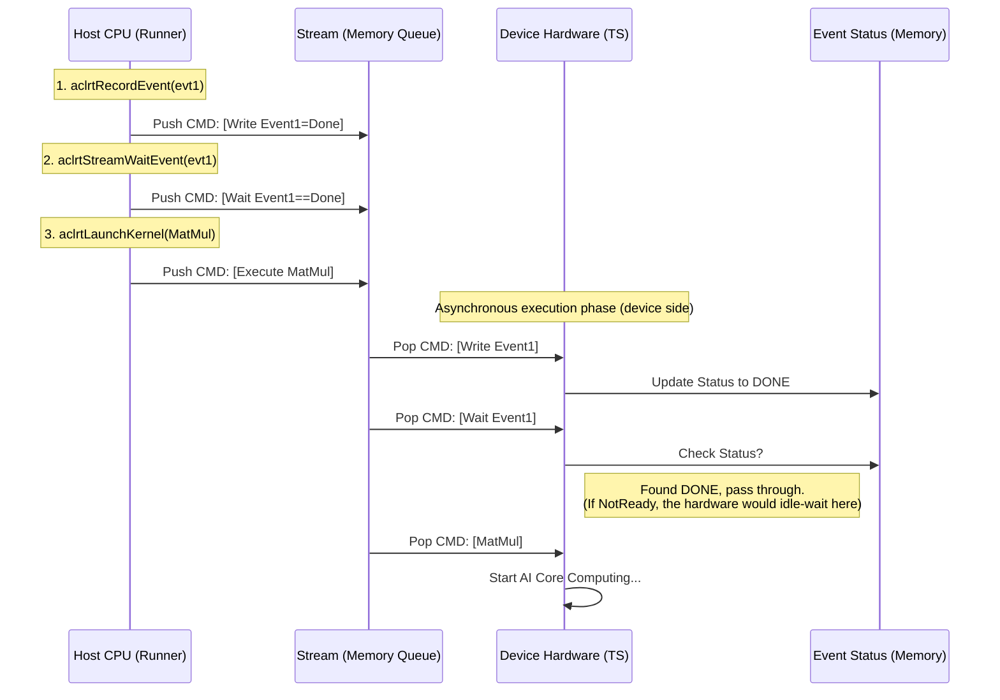

Everything pushed into a Stream is executed by the Device hardware.

## 2. Device, Context, Stream, and Other Hardware Resource Relationship Modeling

Relationship among Device, Context, Stream, and user host threads. For communicator-side resources (Socket/RDMA/UB interfaces), see [section 4 Communicator Modeling](#4-communicator-modeling).

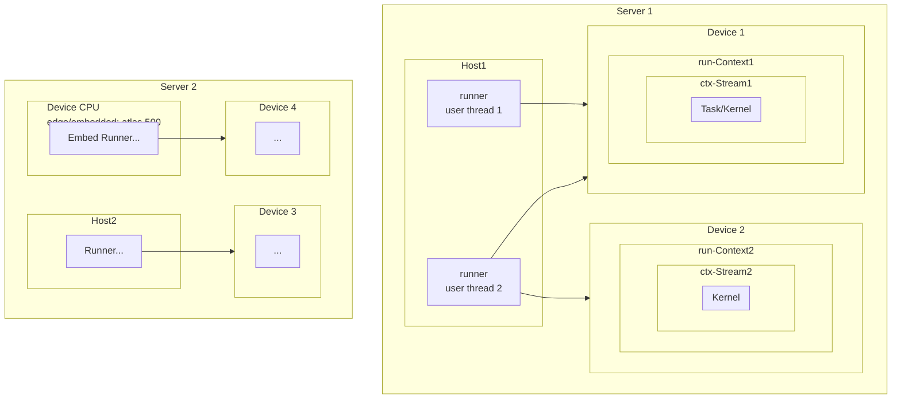

### 2.1 Basic Device Relationship Modeling

#### 2.1.1 Hierarchical Structure Overview

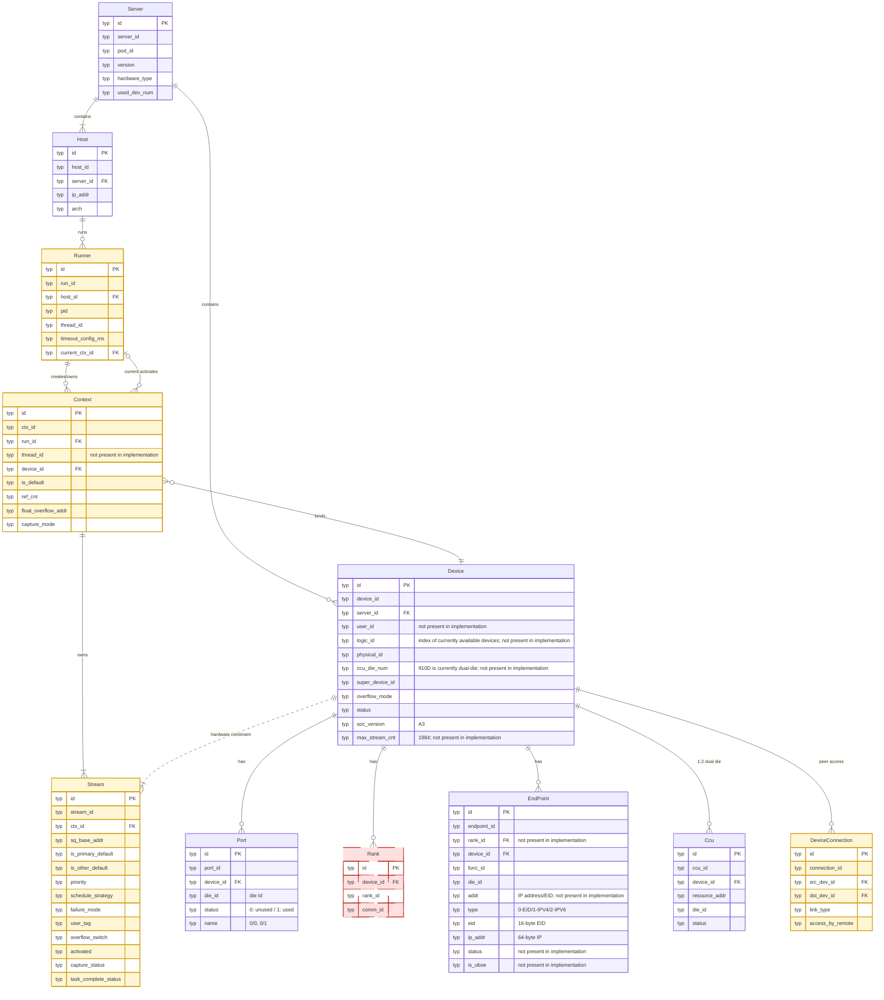

#### 2.1.2 Network Communication Resources

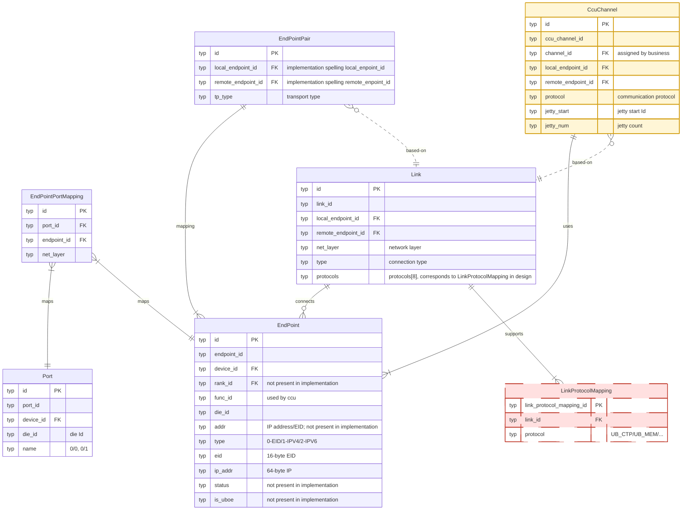

> `LinkProtocolMapping` is not an independent struct/table in the implementation; it is the `Link.protocols[8]` array field (see `include/runnerdb/sim_models.h`). When troubleshooting or creating tables, treat it as an array field; do not split it into independent tables per the diagram.

#### 2.1.3 Key Relationship Description

##### Layer 1: Physical Topology Layer

| Relationship | Meaning | Description / Notes |
| --- | --- | --- |
| Server -> Host | One server may contain multiple Host instances | For example, multi-socket CPUs or virtualized environments |
| Server -> Device | One server contains multiple AI devices | Corresponds to /dev/davinci0, /dev/davinci1, etc. |

##### Layer 2: Process and Context Layer

| Relationship | Meaning | Description / Notes |
| --- | --- | --- |
| Host -> Runner | Each host has multiple application threads (Runner) | Each Runner can create multiple Contexts |
| Runner -> Context | A thread creates or switches to different Contexts | Uses aclrtCreateContext() and aclrtSetCurrentContext() |
| Context -> Device | A Context binds to a Device | Once created, it cannot span devices |
| Context -> Stream | Each Context can create multiple Streams | Corresponds to aclrtCreateStream() |
| Runner <-> Context (current) | Current context activation state | aclrtGetCurrentContext(), aclrtSetCurrentContext() |
| Device .. Stream | Resource upper-bound constraint | Stream count is limited by hardware (`max_stream_cnt`, source `src/proxy/level2/aclrt_stream_stub.cc:244,287`) |

##### Layer 3: Device Internal Resource Layer

| Relationship | Meaning | Description / Notes |
| --- | --- | --- |
| Device -> Port | A device contains multiple communication ports | Used for network topology connections, format such as "0/0, 0/1" |
| Device -> Rank | A device associates with a communication Rank | Rank is the participant node identifier in a communicator |
| Device -> EndPoint | A device contains multiple endpoints | IP address/EID addressing identifiers used for network communication |
| Device -> Ccu | A device contains multiple CCU units | The 910D uses a dual-die architecture, one CCU per die |
| Device -> DeviceConnection | Inter-device communication channel | aclrtDeviceCanAccessPeer(), aclrtDeviceEnablePeerAccess() |

##### Network Communication Resource Layer

| Relationship | Meaning | Description / Notes |
| --- | --- | --- |
| EndPoint <-> Port | Endpoint-to-port mapping | Many-to-many mapping through EndPointPortMapping |
| Link -> EndPoint | Physical connection associates endpoints | Defined by topo.json; describes physical topology |
| Link -> LinkProtocolMapping | Protocols supported by a connection | One Link can support multiple protocols (UB_CTP/UB_MEM, etc.) |

#### 2.1.4 Interface Mapping Table

##### Basic and Device Layer (Device / Server)

| Entity / Attribute | Key API Interface |
| --------------------------- | ---------------------------------------------------------------------------------------------------- |
| Server/Host | `aclInit`, `aclFinalize` |
| Runner.pid | `rtDeviceGetBareTgid` |
| Device | `rtGetDeviceCount` |
| Device.id | `rtSetDevice`, `rtResetDevice`, `rtGetDevice`, `rtsGetLogicDevIdByPhyDevId` |
| Device.id | `rtGetPhyDevIdByLogicDevId` |
| Device.name | `rtGetSocName` |
| Device.mode | `rtSetDeviceSatMode`, `rtGetDeviceSatMode` |
| DeviceConnection | `rtGetDevicesTopo`, `rtDeviceDisablePeerAccess`, `rtDeviceEnablePeerAccess`, `rtDevicePeerAccessStatus` |
| Context.id | `rtCreateContext`, `rtDestroyContext` |
| Context.default | `rtSetCurrentContext`, `rtGetCurrentContext` |
| Context.addr | `rtCtxGetFloatOverflowAddr` |
| Stream table | `aclrtGetStreamAvailableNum` |
| Stream.id | `rtCreateStream`, `rtCreateStreamWithConfig`, `rtDestroyStream`, `rtDestroyStreamForce` |
| Stream.status | `rtSynchronizeStream`, `rtSynchronizeStreamWithTimeout` |
| Stream.activated | `rtStreamStop` |
| Stream.mode | `rtSetStreamAttribute`, `rtGetStreamAttribute` |

### 2.2 Basic Memory Management Relationship Modeling

For interfaces that correspond to local memory blocks and remote memory import (`RaCtxLmemRegister` / `RaCtxRmemImport`), see [section 4.1.4 Data Plane: UB Unified Bus](#414-data-plane-ub-unified-bus).

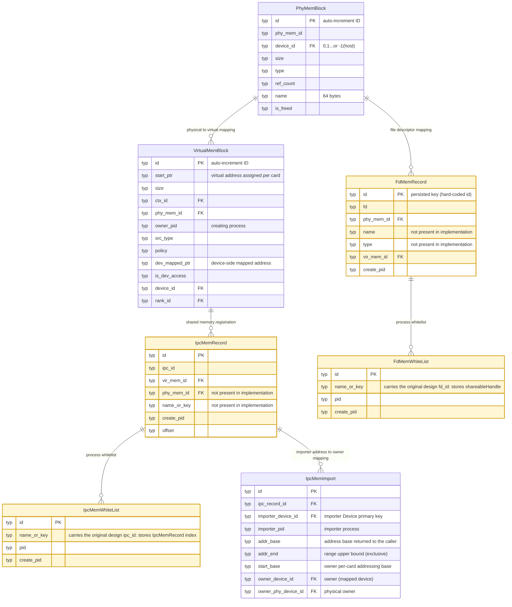

> **Persisted table names**: The entities in this diagram are persisted to the tables registered in `include/runnerdb/db_sim_sqlite_db.h`. When querying or modifying tables, use the table names: `PhyMemBlock` -> `PhMem`, `VirtualMemBlock` -> `VirMem`, `IpcMemWhiteList` -> `IpMemWhiteList`; for field names, see `include/runnerdb/sim_models.h`.

#### 2.2.1 Key Relationship Description (Basic Memory Management Relationship Modeling)

1. **Central role of physical memory**.
   `PhyMemBlock` serves as the base entity and associates with all other entities through `phy_mem_id`, reflecting the Huawei Ascend "physical memory pooling" design philosophy.
2. **Three-layer mapping system**:

   - Physical -> virtual (`VirtualMemBlock`)
   - Physical -> IPC shared (`IpcMemRecord`)
   - Physical -> file descriptor (`fdMemRecord`)
3. **Security control**:
   `IpcMemWhiteList` implements secure sharing in Huawei HCCS (Huawei Collective Communication Service) through a process PID whitelist.
4. **Special mapping types**:
   `MemMapRecord` records dual virtual address mapping scenarios (such as mappings produced by `aclrtMapMem`), supporting zero-copy data transfer on Huawei NPUs.
5. **Cross-device (P2P/PCIe) address owner reverse lookup**:
   `IpcMemImport` registers the "importer-received address range -> memory owner (mapped device / physical owner)" mapping when `aclrtIpcMemImportByKey` succeeds.
   The reason persistence is required: A5 P2P transfer writes the peer buffer address unchanged into the SDMA SQE (`BuildA5SqeSdmaCopy` fills only srcAddr/dstAddr/length/opcode/partId).
   The SQE contains neither `rmtEid` nor deviceId (in contrast, UBDMA relies on the WQE `rmtEid` to locate the peer). The device process can only reverse-lookup this table by
   `(importer_device_id, addr_base <= addr < addr_end)` to find the peer device, then convert to the owner's per-card virtual address
   (`virtualAddress = start_base + (addr - addr_base)`; see `ResolveImportedTaskAddress` / `ResolveTaskAddressLocalOrImported` in `src/device_arm/common/hccl_device_pub.cc`). A3 (910) `hrtIpcOpenMemory` uses the same import interface,
   so the mapping also holds (A3 task path goes through the level1 northbound interface and does not consume this table).

#### 2.2.2 Interface Mapping Table (Basic Memory Management Relationship Modeling)

| Entity | Key Management Interface |
| ------------------------------ | ----------------------------------------------------------------------------------------------------------------------------------------------- |
| PhyMemBlock | `rtMallocPhysical`, `rtFreePhysical` |
| VirtualMemBlock | `rtMallocWithCfg`, `rtMallocForTaskScheduler`, `rtMallocHostWithCfg`, `rtFree`, `rtReserveMemAddress`, `ReleaseMemAddress`, `rtMapMem`, `rtUnmapMem` |
| VirtualMemBlock.ctx_id | `rtPointerGetAttributes` |
| FdMemRecord.fd | `rtMemExportToShareableHandle`, `rtMemImportFromShareableHandle` |
| FdMemWhiteList.pid | `rtMemSetPidToShareableHandle` |
| IpcMemRecord.name_or_key | `rtIpcMemGetExportKey` |
| IpcMemRecord.id | `rtIpcMemImportByKey`, `IpcMemClose` |
| IpcMemWhiteList.pid | `rtIpcMemSetImportPid` |
| IpcMemImport (whole row) | Registered when `aclrtIpcMemImportByKey` succeeds; cascade-cleaned by `ipc_record_id` on `aclrtIpcMemClose`; `DeleteAll` together with memory tables on `hccl-vm reset` |
| IpcMemImport.addr_base/addr_end | Range hit by device-side `ResolveImportedTaskAddress` (peer resolution for A5 cross-device SDMA SQE) |
| IpcMemImport.owner_phy_device_id | Physical owner convention for task fields `srcDeviceId`/`dstDeviceId` (consistent with step 3 of `ResolveTaskAddress`) |
| MemMapRecord | `rtHostRegister`, `rtHostUnRegister` |

## 3. Extending the Data Task Model on the Basic Model

### 3.1 Data / Task Flow Modeling

Task placement on a Stream. The Task family is carried by `Task` / `EventSyncTask` in the implementation. For synchronization primitives, see [section 3.3 Asynchronous / Synchronous Execution Modeling](#33-asynchronous--synchronous-execution-modeling).

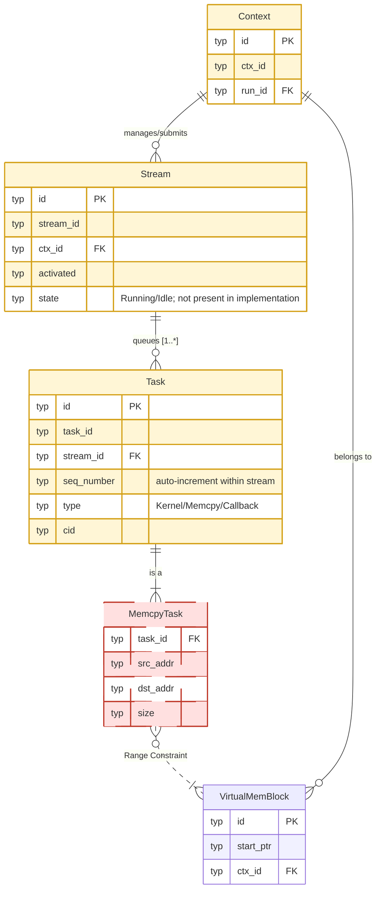

### 3.2 CCU Resource Modeling

One NPU device contains two CCUs, die0 and die1. For the die-level hardware synchronization resource (Notify) of the CCU, see [section 3.3.1 Notify Resource Management](#331-notify-resource-management); for UB-side context interfaces, see [section 4.1.4 Data Plane: UB Unified Bus](#414-data-plane-ub-unified-bus).

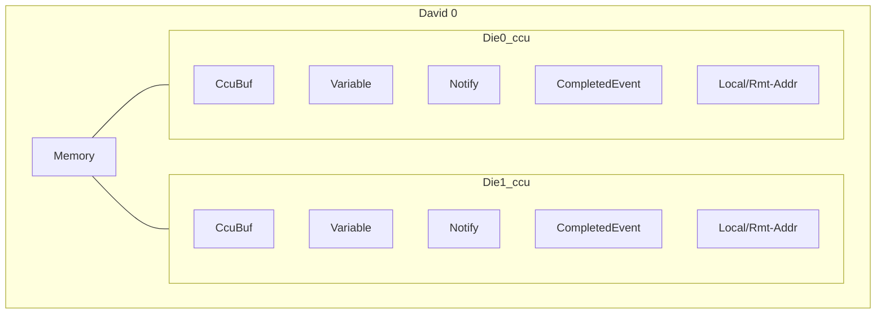

#### 3.2.1 Interface Mapping Table (CCU Resource Modeling)

| Entity | Key Management Interface |
| ------------------ | -------------------------------------------------------- |
| CcuBuf | `rtCcuBufAlloc`, `rtCcuBufFree`, `rtCcuBufGetAddr` |
| Variable | `rtVariableCreate`, `rtVariableDestroy`, `rtVariableSet` |
| Notify | `rtCreateNotify`, `rtDestroyNotify` |
| CompletedEvent | `rtCreateEvent`, `rtDestroyEvent` |
| Local/Rmt-Addr | `rtGetDeviceLocalAddr`, `rtGetDeviceRemoteAddr` |
| CCU resource query | `rtGetCcudieInfo`, `rtGetCcudieNum` |

#### 3.2.2 CCU Resource Lifecycle Description

**CCU initialization flow**:

1. When the Device starts, the two CCUs (die0/die1) initialize automatically.
2. Each CCU allocates an independent CcuBuf, Variable, and Notify resource pool.
3. CompletedEvent is used to notify task completion status.

**Resource constraints**:

- Each CCU has a limited CcuBuf count (depends on Device.version)
- Variable stores shared variables during communication.
- Notify is used for cross-CCU synchronization notification.
- Local/Rmt-Addr is used for address translation during cross-die communication.

> Note: The Notify inside the CCU here is the die-level hardware synchronization resource (an hcomm-side concept). It is not the same entity as the `Notify` managed by `rtCreateNotify` in section 3.3.1 (Device/Context level, persisted to table `sim::Notify`: `create_ctx_id` + `device_notify_seq`).

### 3.3 Asynchronous / Synchronous Execution Modeling

#### 3.3.1 [Notify Resource Management](https://www.hiascend.com/document/detail/zh/CANNCommunityEdition/850alpha001/appdevg/acldevg/aclcppdevg_000524.html)

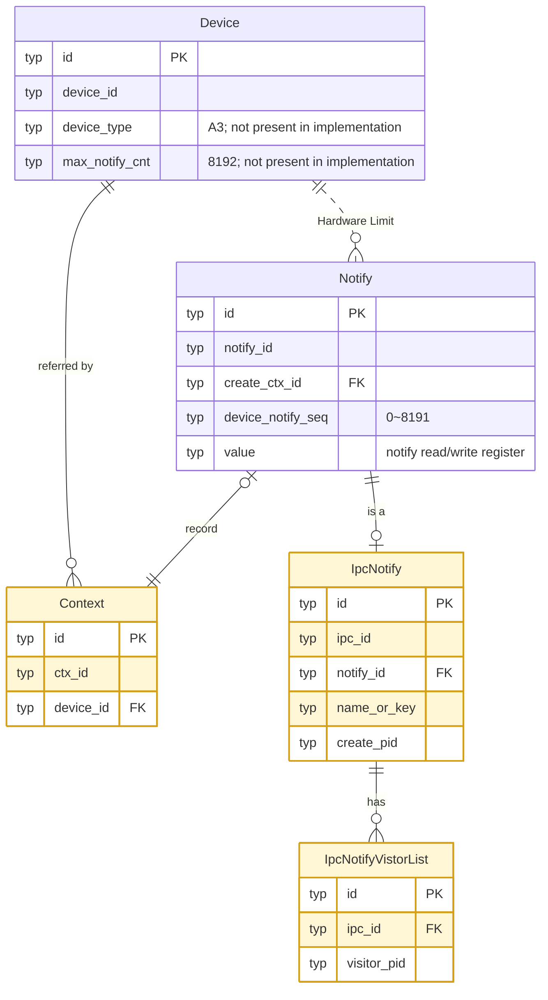

##### Key Relationship Description ([Notify Resource Management](https://www.hiascend.com/document/detail/zh/CANNCommunityEdition/850alpha001/appdevg/acldevg/aclcppdevg_000524.html))

**Hardware constraints between Notify and Device**:

- The maximum Notify count per Device is `max_notify_cnt` (for example, 8192 on the A3 chip; source `src/plugin/runner/runner_utils/device_resource.h:22 MAX_NOTIFY_NUM`)
- `device_notify_seq` is the physical index of a Notify within the Device (0 to 8191)
- When creating a Notify, you must specify its owning Context, and the Context binds to a specific Device.

**Notify IPC sharing mechanism**:

- `IpcNotify` allows Notify instances to be shared across processes.
- `name_or_key` is the sharing identifier, obtained through `rtNotifyGetExportKey`.
- Other processes import and use it through `rtNotifyImportByKey`.
- `IpcNotifyVistorList` records the PIDs of processes permitted to access the Notify.

**Notify state management**:

- The `value` field maps to a hardware register and is used for read/write state.
- `rtWaitAndResetNotify` waits until the Notify becomes Ready and then resets it.
- Notify is used for inter-Stream synchronization and cross-process synchronization.

##### Interface Mapping Table ([Notify Resource Management](https://www.hiascend.com/document/detail/zh/CANNCommunityEdition/850alpha001/appdevg/acldevg/aclcppdevg_000524.html))

| Entity | Key Management Interface |
| -------------------------- | --------------------------------------------------- |
| Notify.id | `rtCreateNotify`, `rtDestroyNotify`, `rtGetNotifyId` |
| Notify.value | `lrtWaitAndResetNotify`, `rtWaitAndResetNotify` |
| IpcNotify.name_or_key | `rtNotifyGetExportKey`, `rtNotifyImportByKey` |
| IpcNotifyVistorList.ipc_id | `rtNotifySetImportPid` |

#### 3.3.2 Notify Synchronization Control

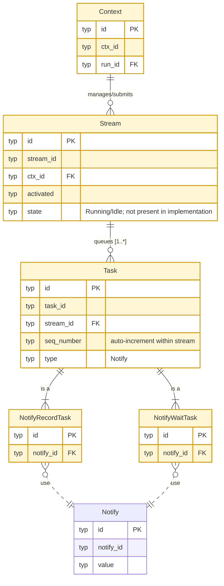

##### Key Relationship Description (Notify Synchronization Control)

**Notify task types**:

- `NotifyRecordTask`: Sets the Notify state to Ready, indicating that an event has completed.
- `NotifyWaitTask`: Waits until the Notify state becomes Ready, implementing inter-Stream synchronization.

**Task execution order**:

- NotifyRecordTask executes on StreamA and sets the Notify to Ready.
- NotifyWaitTask executes on StreamB and waits on the same Notify.
- After the Notify becomes Ready, subsequent tasks on StreamB can continue to execute.

**Cross-Stream synchronization example**:

```text
StreamA: Task1 -> NotifyRecordTask(notify_id=1) -> Task2
StreamB: NotifyWaitTask(notify_id=1) -> Task3
// Task3 must wait until Task1 completes before executing
```

##### Interface Mapping Table (Notify Synchronization Control)

| Entity | Key Management Interface |
| ---------------- | ----------------------- |
| NotifyRecordTask | `rtRecordNotify` |
| NotifyWaitTask | `lrtWaitAndResetNotify` |

#### 3.3.3 Event Resource Management

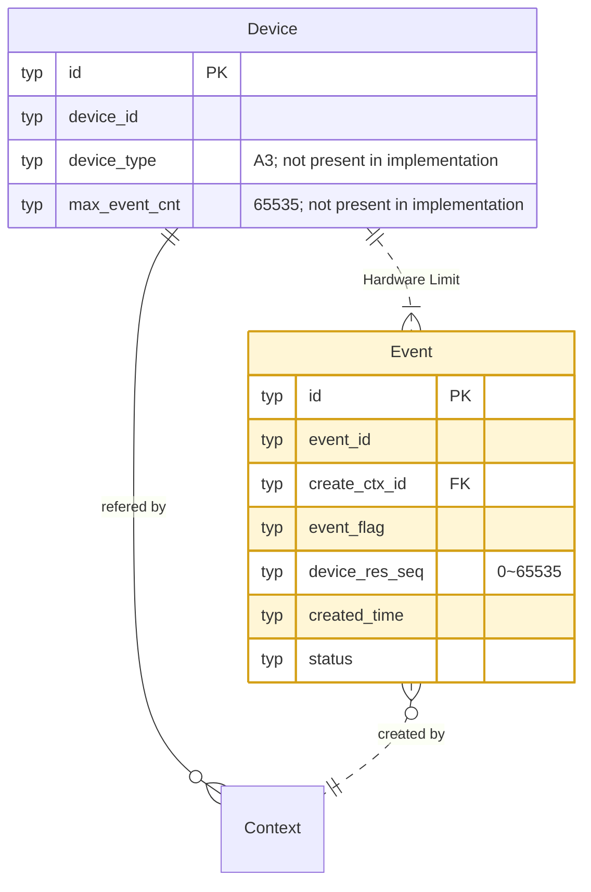

##### Key Relationship Description (Event Resource Management)

**Hardware constraints between Event and Device**:

- The maximum Event count per Device is `max_event_cnt` (for example, 65535 on the A3 chip; source `src/proxy/level2/aclrt_event_stub.cc:191,220`)
- `device_res_seq` is the physical index of an Event within the Device (0 to 65535)
- When creating an Event, you must specify its owning Context, and the Context binds to a specific Device.

**Relationship between Event and Context**:

- `create_ctx_id` records the Context that created the Event.
- Events can be shared across multiple Streams but must belong to the same Context.
- Cross-Context Event sharing requires the IPC mechanism (similar to Notify)

**Event state management**:

- The `status` field indicates the current Event state: NotRecorded/Recorded/Completed.
- `event_flag` controls Event behavior (such as whether to auto-reset)
- `created_time` is used for performance statistics.

##### Interface Mapping Table (Event Resource Management)

| Entity | Key Management Interface |
| -------------- | ------------------------------------------------------------------------ |
| Event.id | `rtCreateEvent`, `rtCreateEventWithFlag`, `rtDestroyEvent`, `rtGetEventId` |
| Event.status | `rtRecordEvent`, `rtQueryEventStatus` |

#### 3.3.4 Event Flow Control

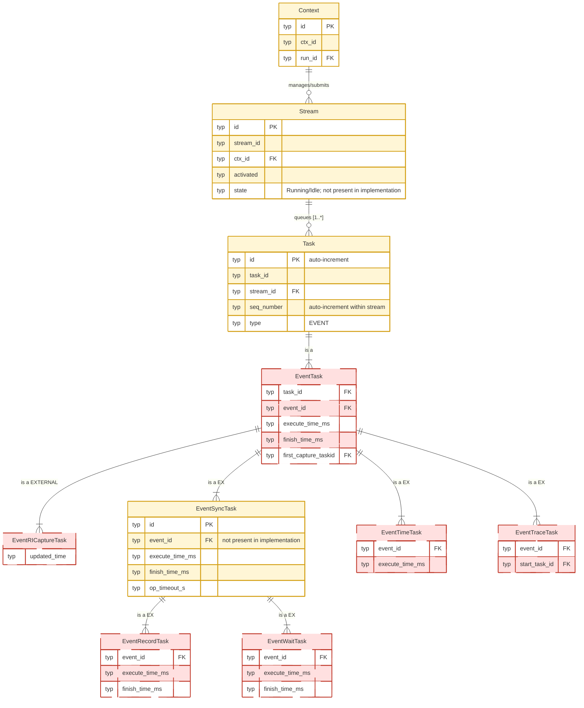

##### Key Relationship Description (Event Flow Control)

**Event task type classification**:

- `EventRecordTask`: Sets the Event state to Recorded/Completed.
- `EventWaitTask`: Waits until the Event state becomes Completed.
- `EventSyncTask`: Synchronously waits for the Event to complete (blocking call)
- `EventRICaptureTask`: A special record task in RI Capture mode.
- `EventTimeTask`: A task related to recording timestamps.
- `EventTraceTask`: A task record used for performance tracing.

**Event task inheritance relationship**:

- `EventTask` is the base class, containing task-id, event-id, execute-time, and finish-time. (The implementation `EventSyncTask` does not have `task_id`/`event_id`; the Event identity is `Event.id`; the time fields use the implementation names `execute_time_ms`/`finish_time_ms`)
- `EventSyncTask` inherits from EventTask and adds the op_timeout_s timeout parameter.
- `EventRecordTask` and `EventWaitTask` inherit from EventSyncTask.
- `EventRICaptureTask`, `EventTimeTask`, and `EventTraceTask` inherit directly from EventTask.

**Event execution flow**:

```text
StreamA: KernelTask -> EventRecordTask(event_id=1)
StreamB: EventWaitTask(event_id=1) -> KernelTask2
// KernelTask2 on StreamB must wait for KernelTask on StreamA to complete
```

**Task tracing relationship**:

- `first_capture_task_id` records the Task ID of the first Capture.
- `EventTraceTask.id` associates with the start task of tracing.
- EventRecordTask implements cross-Stream synchronization through EventWaitTask mapping.

##### Interface Mapping Table (Event Flow Control)

| Entity | Key Management Interface |
| --------------- | ---------------------------------------------------- |
| EventTask | `rtRecordEvent`, `rtResetEvent`, `rtSynchronizeEvent` |
| EventRecordTask | `rtRecordEvent`, `rtResetEvent` |
| EventWaitTask | `rtStreamWaitEvent`, `rtQueryEventWaitStatus` |
| EventTimeTask | `rtResetEvent`, `rtRecordEvent` |
| EventTraceTask | `rtResetEvent`, `rtRecordEvent` |

## 4. Communicator Modeling

Cross-machine communication involves orchestrating mixed tasks across multiple communicators.
The essence of a communicator is the multi-card network topology maintained by HCCL at the framework layer through the link-establishment capability provided by the Rdma_Agent. It resides in the host process. For interface lists of each plane, see [section 4.1.8 HCCP Interface Classification](#418-hccp-interface-classification).

### 4.1 Communicator Core Concepts

A communicator is the basic abstraction of HCCL collective communication. Each communicator defines a set of participating Ranks and their topology relationships. For Rank / EndPoint entity modeling, see [section 2.1.2 Network Communication Resources](#212-network-communication-resources).

#### 4.1.1 Communicator Basic Definition

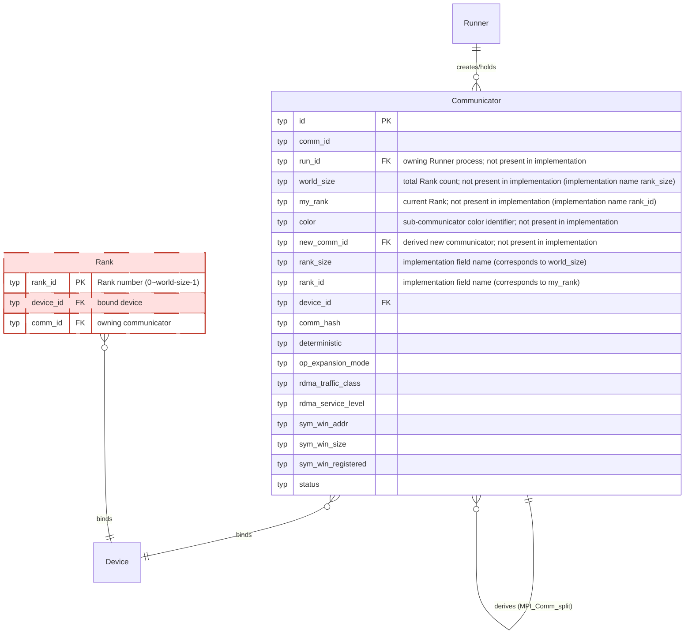

#### 4.1.2 Control Plane: Socket Communication

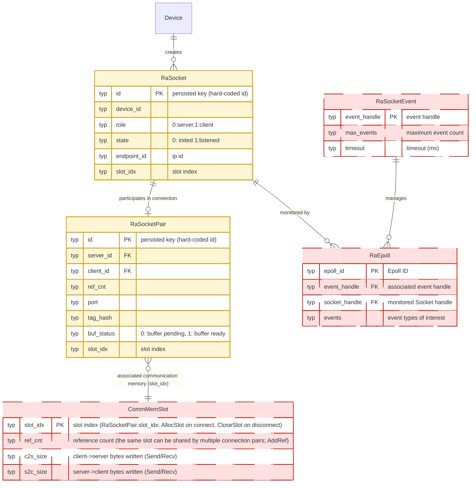

#### 4.1.3 Data Plane: RDMA Communication

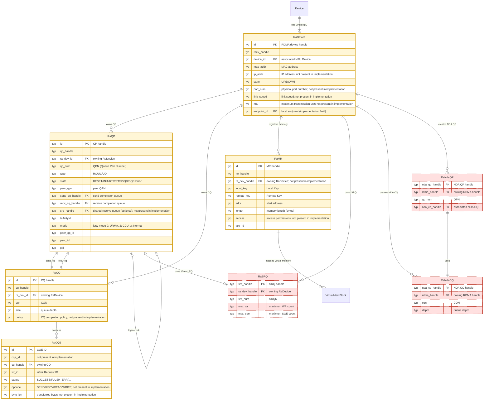

#### 4.1.4 Data Plane: UB Unified Bus

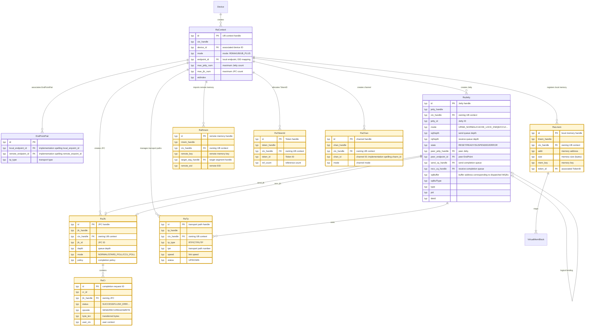

#### 4.1.5 Asynchronous Request Management

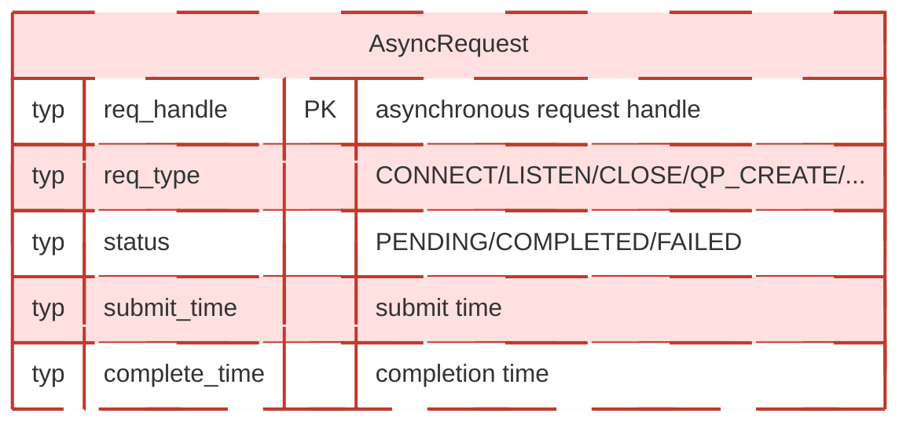

> Note: `AsyncRequest` is an internal implementation object and does not require modeling yet (no corresponding struct or persisted table exists).

#### 4.1.6 Communicator Architecture Summary

```text
+---------------------------------------------------------------+
|                   HCCL Communicator Architecture               |
+---------------------------------------------------------------+
|  Application layer                                             |
|  +----------------------------------------------------------+ |
|  |  Communicator                                             | |
|  |  +-- Rank[0..N] (participant nodes, each bound to a Device)| |
|  +----------------------------------------------------------+ |
+---------------------------------------------------------------+
|  Control plane (link establishment / handshake)                |
|  +----------------------------------------------------------+ |
|  |  RaSocket (Socket communication)                          | |
|  |  +-- RaSocketPair (connection pair)                       | |
|  |  +-- RaEpoll (event monitoring)                           | |
|  +----------------------------------------------------------+ |
+---------------------------------------------------------------+
|  Data plane (data transfer)                                    |
|  +----------------------+   +----------------------+          |
|  |  RDMA (legacy mode)  |   |  UB (unified bus)    |          |
|  |  +-- RaDevice        |   |  +-- RaContext       |          |
|  |  +-- RaQP (queue pair)|   |  +-- RaJetty (QP)   |          |
|  |  +-- RaCQ (completion queue)|  +-- RaJfc (CQ)   |          |
|  |  +-- RaMR (memory registration)|  +-- RaLmem/Rmem|          |
|  |  +-- RaSRQ (shared RQ)|   |  +-- RaTp (transport path)|     |
|  +----------------------+   +----------------------+          |
+---------------------------------------------------------------+
```

#### 4.1.7 Key Entity Comparison Table

| Concept | RDMA Mode | UB Mode | Description |
| --- | --- | --- | --- |
| Context | RaDevice | RaContext | Device / context handle |
| Queue pair | RaQP | RaJetty | Data transfer channel |
| Completion queue | RaCQ | RaJfc | Completion notification |
| Completion element | RaCQE | RaCr | Completion status |
| Local memory | RaMR | RaLmem | Memory registration |
| Remote memory | - | RaRmem | Remote memory import |
| Transport path | - | RaTp | Physical path management |
| Security token | - | RaTokenId | Access control |

#### 4.1.8 HCCP Interface Classification

> In the "Implementation" column of the table: paths omit the common prefix `src/proxy/level2/`; `hcomm/` only means the current repo has no implementation (the implementation resides in `hcomm/src/base_comm/resources/hccp/inc/network/hccp_nda.h`); a marker indicates not modeled.

```text
HCCP Network API
+-- Control plane (Socket communication)
|   +-- Initialization: RaSocketInit/RaSocketDeinit (Socket)
|   +-- Connection management: RaSocketBatchConnect/Close/Abort
|   +-- Listen management: RaSocketListenStart/Stop
|   +-- Data send/receive: RaSocketSend/Recv
|   +-- State query: RaGetSockets
|   +-- Event management: RaEpollCtlAdd/Mod/Del
+-- Data plane - RDMA
|   +-- Initialization: RaRdevInit/RaRdevDeinit (RDMA device)
|   +-- QP management: RaQpCreate/Destroy/ConnectAsync
|   +-- CQ management: RaCqCreate/Destroy
|   +-- MR management: RaMrReg/Dereg
|   +-- Work requests: RaSendWr/RaRecvWrlist
|   +-- Completion polling: RaPollCq
+-- Data plane - UB
|   +-- Initialization: RaCtxInit/RaCtxDeinit (unified context)
|   +-- Jetty management: RaCtxQpCreate/Destroy/Import/Bind
|   +-- JFC management: RaCtxCqCreate/Destroy
|   +-- Memory management: RaCtxLmemRegister/RmemImport
|   +-- Token management: RaCtxTokenIdAlloc/Free
|   +-- Work requests: RaBatchSendWr
+-- Asynchronous operations
|   +-- RaSocketBatchConnectAsync
|   +-- RaCtxQpCreateAsync/DestroyAsync
|   +-- RaGetAsyncReqResult
+-- Network diagnostics
|   +-- RaPingInit/RaPingDeinit (Ping)
|   +-- RaPingTargetAdd/Del
|   +-- RaPingTaskStart/Stop
|   +-- RaPingGetResults
+-- TLV messages
|   +-- RaTlvInit/RaTlvDeinit (TLV)
    +-- RaTlvRequest
```

##### Socket Communication Interfaces

| Interface | Function | Key Parameters | Implementation |
| ---------------------- | -------------- | ------------------------------------------------------------------------ | -------- |
| `RaSocketInit` | Socket initialization | `mode`, `rdevInfo`, `socketHandle` | `hccp_ra_socket_stub.cc:66` |
| `RaSocketDeinit` | Socket deinitialization | `socketHandle` | `hccp_ra_socket_stub.cc:110` |
| `RaSocketBatchConnect` | Batch connect | `SocketConnectInfoT[]`, `num` | `hccp_ra_socket_stub.cc:138` |
| `RaSocketBatchClose` | Batch close | `SocketCloseInfoT[]`, `num` | `hccp_ra_socket_stub.cc:254` |
| `RaSocketBatchAbort` | Batch abort | `SocketConnectInfoT[]`, `num` | `hccp_ra_socket_stub.cc:279` |
| `RaSocketListenStart` | Start listening | `SocketListenInfoT[]`, `num` | `hccp_ra_socket_stub.cc:118` |
| `RaSocketListenStop` | Stop listening | `SocketListenInfoT[]`, `num` | `hccp_ra_socket_stub.cc:128` |
| `RaGetSockets` | Get Socket state | `role`, `SocketInfoT[]`, `num`, `connectedNum` | `hccp_ra_socket_stub.cc:188` |
| `RaSocketSend` | Send data | `fdHandle`, `data`, `size`, `sentSize` | `hccp_ra_socket_stub.cc:286` |
| `RaSocketRecv` | Receive data | `fdHandle`, `data`, `size`, `receivedSize` | `hccp_ra_socket_stub.cc:298` |
| `RaEpollCtlAdd` | Add Epoll event | `fdHandle`, `event` | `hccp_ra_socket_stub.cc:313` |
| `RaEpollCtlMod` | Modify Epoll event | `fdHandle`, `event` | `hccp_ra_socket_stub.cc:320` |
| `RaEpollCtlDel` | Delete Epoll event | `fdHandle` | `hccp_ra_socket_stub.cc:327` |
| `RaCreateEventHandle` | Create event handle | `eventHandle` | `hccp_stub.cc:486` |
| `RaWaitEventHandle` | Wait for event | `eventHandle`, `SocketEventInfoT[]`, `timeout`, `maxevents`, `eventsNum` | `hccp_stub.cc:498` |
| `RaDestroyEventHandle` | Destroy event handle | `eventHandle` | `hccp_stub.cc:505` |
| `RaSocketWhiteListAdd` | Add whitelist entry | `socketHandle`, `SocketWlistInfoT[]`, `num` | `hccp_stub.cc:1605` |
| `RaSocketWhiteListDel` | Delete whitelist entry | `socketHandle`, `SocketWlistInfoT[]`, `num` | `hccp_stub.cc:1611` |

###### RDMA Operation Interfaces

| Interface | Function | Key Parameters | Implementation |
| --------------------- | -------------- | ----------------------------------------------------------------------- | -------- |
| `RaRdevInit` | RDMA device initialization | `mode`, `notifyType`, `rdevInfo`, `rdmaHandle` | `hccp_stub.cc:976` |
| `RaRdevInitV2` | RDMA device initialization (extended) | `RdevInitInfo`, `rdevInfo`, `rdmaHandle` | `hccp_stub.cc:948` |
| `RaRdevInitWithBackup` | Initialization with backup | `initInfo`, `rdevInfo`, `backupRdevInfo` | `hccp_stub.cc:796` |
| `RaRdevDeinit` | RDMA device deinitialization | `rdmaHandle`, `notifyType` | `hccp_stub.cc:983` |
| `RaQpCreate` | Create QP | `rdevHandle`, `flag`, `qpMode`, `qpHandle` | `hccp_stub.cc:1049` |
| `RaQpCreateWithAttrs` | Create QP (with attributes) | `rdevHandle`, `QpExtAttrs`, `qpHandle` | `hccp_stub.cc:1085` |
| `RaAiQpCreate` | Create AI QP | `rdevHandle`, `QpExtAttrs`, `AiQpInfo`, `qpHandle` | `hccp_stub.cc:1126` |
| `RaLoopbackQpCreate` | Create loopback QP | `rdevHandle`, `LoopbackQpPair`, `qpHandle` | `hccp_stub.cc:522` |
| `RaTypicalQpCreate` | Create typical QP | `rdevHandle`, `flag`, `qpMode`, `TypicalQp`, `qpHandle` | `hccp_stub.cc:1132` |
| `RaQpDestroy` | Destroy QP | `qpHandle` | `hccp_stub.cc:1217` |
| `RaQpConnectAsync` | Connect QP asynchronously | `qpHandle`, `fdHandle` | `hccp_stub.cc:587` |
| `RaGetQpStatus` | Get QP status | `qpHandle`, `status` | `hccp_stub.cc:803` |
| `RaTypicalQpModify` | Modify typical QP | `qpHandle`, `localQpInfo`, `remoteQpInfo` | `hccp_stub.cc:1483` |
| `RaMrReg` | Register MR | `qpHandle`, `MrInfoT` | `hccp_stub.cc:324` |
| `RaMrDereg` | Deregister MR | `qpHandle`, `MrInfoT` | `hccp_stub.cc:353` |
| `RaRegisterMr` | Register MR standalone | `rdmaHandle`, `MrInfoT`, `mrHandle` | `hccp_stub.cc:376` |
| `RaDeregisterMr` | Deregister MR standalone | `rdmaHandle`, `mrHandle` | `hccp_stub.cc:407` |
| `RaRemapMr` | Remap MR | `rdmaHandle`, `MemRemapInfo[]`, `num` | `hccp_stub.cc:401` |
| `RaGetNotifyMrInfo` | Get notify MR information | `rdevHandle`, `MrInfoT` | `hccp_stub.cc:918` |
| `RaSendWr` | Send work request | `qpHandle`, `SendWr`, `SendWrRsp` | `hccp_stub.cc:426` |
| `RaSendWrV2` | Send work request V2 | `qpHandle`, `SendWrV2`, `SendWrRsp` | `hccp_stub.cc:607` |
| `RaSendWrlist` | Batch send | `qpHandle`, `SendWrlistData[]`, `SendWrRsp[]`, `sendNum`, `completeNum` | `hccp_stub.cc:822` |
| `RaRecvWrlist` | Batch receive | `qpHandle`, `RecvWrlistData`, `recvNum`, `completeNum` | `hccp_stub.cc:669` |
| `RaPollCq` | Poll CQ | `qpHandle`, `isSendCq`, `numEntries`, `wc` | `hccp_stub.cc:630` |
| `RaCqCreate` | Create CQ | `rdevHandle`, `CqAttr` | `hccp_stub.cc:991` |
| `RaCqDestroy` | Destroy CQ | `rdevHandle`, `CqAttr` | `hccp_stub.cc:1025` |
| `RaCreateSrq` | Create SRQ | `rdmaHandle`, `SrqAttr` | `hccp_stub.cc:474` |
| `RaDestroySrq` | Destroy SRQ | `rdmaHandle`, `SrqAttr` | `hccp_stub.cc:480` |
| `RaSetQpAttrQos` | Set QP QoS | `qpHandle`, `QosAttr` | `hccp_stub.cc:450` |
| `RaSetQpAttrTimeout` | Set QP timeout | `qpHandle`, `timeout` | `hccp_stub.cc:456` |
| `RaSetQpAttrRetryCnt` | Set QP retry count | `qpHandle`, `retryCnt` | `hccp_stub.cc:462` |
| `RaGetQpAttr` | Get QP attributes | `qpHandle`, `QpAttr` | `hccp_stub.cc:1562` |
| `RaGetQpContext` | Get QP context | `qpHandle`, `qp`, `sendCq`, `recvCq` | `hccp_stub.cc:696` |

###### UB Unified Bus Interfaces

| Interface | Function | Key Parameters | Implementation |
| ----------------------- | ---------------- | ---------------------------------------------------------------- | -------- |
| `RaCtxInit` | Context initialization | `CtxInitCfg`, `CtxInitAttr`, `ctxHandle` | `hccp_stub.cc:1138` |
| `RaCtxDeinit` | Context deinitialization | `ctxHandle` | `hccp_stub.cc:1175` |
| `RaGetDevEidInfoNum` | Get EID count | `RaInfo`, `num` | `hccp_ccu_stub.cc:575` |
| `RaGetDevEidInfoList` | Get EID list | `RaInfo`, `HccpDevEidInfo[]`, `num` | `hccp_ccu_stub.cc:586` |
| `RaGetEidByIp` | Get EID by IP | `ctxHandle`, `IpInfo[]`, `HccpEid[]`, `num` | `hccp_stub.cc:2306` |
| `RaGetDevBaseAttr` | Get device attributes | `ctxHandle`, `DevBaseAttr` | `hccp_stub.cc:1182` |
| `RaCtxGetAsyncEvents` | Get asynchronous events | `ctxHandle`, `AsyncEvent[]`, `num` | `hccp_ccu_stub.cc:553` |
| `RaCtxTokenIdAlloc` | Allocate TokenID | `ctxHandle`, `HccpTokenId`, `tokenIdHandle` | `hccp_stub.cc:1885` |
| `RaCtxTokenIdFree` | Free TokenID | `ctxHandle`, `tokenIdHandle` | `hccp_stub.cc:2036` |
| `RaCtxLmemRegister` | Register local memory | `ctxHandle`, `MrRegInfoT`, `lmemHandle` | `hccp_stub.cc:2047` |
| `RaCtxLmemUnregister` | Unregister local memory | `ctxHandle`, `lmemHandle` | `hccp_stub.cc:1906` |
| `RaCtxRmemImport` | Import remote memory | `ctxHandle`, `MrImportInfoT`, `rmemHandle` | `hccp_stub.cc:1968` |
| `RaCtxRmemUnimport` | Unimport remote memory | `ctxHandle`, `rmemHandle` | `hccp_stub.cc:1919` |
| `RaCtxChanCreate` | Create channel | `ctxHandle`, `ChanInfoT`, `chanHandle` | `hccp_stub.cc:1993` |
| `RaCtxChanDestroy` | Destroy channel | `ctxHandle`, `chanHandle` | `hccp_stub.cc:2005` |
| `RaCtxCqCreate` | Create CQ | `ctxHandle`, `CqInfoT`, `cqHandle` | `hccp_stub.cc:2142` |
| `RaCtxCqDestroy` | Destroy CQ | `ctxHandle`, `cqHandle` | `hccp_stub.cc:2148` |
| `RaCtxQpCreate` | Create QP/Jetty | `ctxHandle`, `QpCreateAttr`, `QpCreateInfo`, `qpHandle` | `hccp_stub.cc:1254` |
| `RaCtxQpQueryBatch` | Batch query QP | `qpHandle[]`, `JettyAttr[]`, `num` | `hccp_stub.cc:2106` |
| `RaCtxQpDestroy` | Destroy QP/Jetty | `qpHandle` | `hccp_stub.cc:2012` |
| `RaCtxQpImport` | Import Jetty | `ctxHandle`, `QpImportInfoT`, `remQpHandle` | `hccp_stub.cc:1321` |
| `RaCtxQpUnimport` | Unimport Jetty | `ctxHandle`, `remQpHandle` | `hccp_stub.cc:1425` |
| `RaCtxQpBind` | Bind Jetty | `qpHandle`, `remQpHandle` | `hccp_stub.cc:1394` |
| `RaCtxQpUnbind` | Unbind Jetty | `qpHandle` | `hccp_stub.cc:2112` |
| `RaBatchSendWr` | Batch send | `qpHandle`, `SendWrData[]`, `SendWrResp[]`, `num`, `completeNum` | `hccp_stub.cc:2135` |
| `RaCtxUpdateCi` | Update CI | `qpHandle`, `ci` | `hccp_stub.cc:2154` |
| `RaCtxGetAuxInfo` | Get auxiliary information | `ctxHandle`, `HccpAuxInfoIn`, `HccpAuxInfoOut` | `hccp_stub.cc:2270` |
| `RaCtxGetCrErrInfoList` | Get CR errors | `ctxHandle`, `CrErrInfo[]`, `num` | `hccp_stub.cc:2276` |

###### Asynchronous Operation Interfaces

| Interface | Function | Key Parameters | Implementation |
| --------------------------- | -------------- | -------------------------------------------------------------------- | -------- |
| `RaGetAsyncReqResult` | Get asynchronous result | `reqHandle`, `reqResult` | `hccp_ra_socket_stub.cc:341` |
| `RaSocketBatchConnectAsync` | Asynchronous batch connect | `SocketConnectInfoT[]`, `num`, `reqHandle` | `hccp_ra_socket_stub.cc:348` |
| `RaSocketListenStartAsync` | Asynchronous start listening | `SocketListenInfoT[]`, `num`, `reqHandle` | `hccp_ra_socket_stub.cc:354` |
| `RaSocketListenStopAsync` | Asynchronous stop listening | `SocketListenInfoT[]`, `num`, `reqHandle` | `hccp_ra_socket_stub.cc:362` |
| `RaSocketBatchCloseAsync` | Asynchronous batch close | `SocketCloseInfoT[]`, `num`, `reqHandle` | `hccp_ra_socket_stub.cc:370` |
| `RaSocketSendAsync` | Asynchronous send | `fdHandle`, `data`, `size`, `sentSize`, `reqHandle` | `hccp_ra_socket_stub.cc:377` |
| `RaSocketRecvAsync` | Asynchronous receive | `fdHandle`, `data`, `size`, `receivedSize`, `reqHandle` | `hccp_ra_socket_stub.cc:384` |
| `RaCtxLmemRegisterAsync` | Asynchronous register memory | `ctxHandle`, `MrRegInfoT`, `lmemHandle`, `reqHandle` | `hccp_stub.cc:2075` |
| `RaCtxLmemUnregisterAsync` | Asynchronous unregister memory | `ctxHandle`, `lmemHandle`, `reqHandle` | `hccp_stub.cc:1937` |
| `RaCtxQpCreateAsync` | Asynchronous create QP | `ctxHandle`, `QpCreateAttr`, `QpCreateInfo`, `qpHandle`, `reqHandle` | `hccp_stub.cc:2239` |
| `RaCtxQpDestroyAsync` | Asynchronous destroy QP | `qpHandle`, `reqHandle` | `hccp_stub.cc:1943` |
| `RaCtxQpDestroyBatchAsync` | Asynchronous batch destroy | `ctxHandle`, `qpHandle[]`, `num`, `reqHandle` | `hccp_stub.cc:1958` |
| `RaCtxQpImportAsync` | Asynchronous import Jetty | `ctxHandle`, `QpImportInfoT`, `remQpHandle`, `reqHandle` | `hccp_stub.cc:1378` |
| `RaGetTpInfoListAsync` | Asynchronous get TP info | `ctxHandle`, `GetTpCfg`, `HccpTpInfo[]`, `num`, `reqHandle` | `hccp_stub.cc:2082` |
| `RaGetEidByIpAsync` | Asynchronous get EID | `ctxHandle`, `IpInfo[]`, `HccpEid[]`, `num`, `reqHandle` | `hccp_stub.cc:2091` |
| `RaGetTpAttrAsync` | Asynchronous get TP attributes | `ctxHandle`, `tpHandle`, `attrBitmap`, `TpAttr`, `reqHandle` | `hccp_stub.cc:2098` |
| `RaSetTpAttrAsync` | Asynchronous set TP attributes | `ctxHandle`, `tpHandle`, `attrBitmap`, `TpAttr`, `reqHandle` | `hccp_stub.cc:2263` |

###### Network Diagnostic Interfaces

| Interface | Function | Key Parameters | Implementation |
| ------------------ | ------------ | -------------------------------------------- | -------- |
| `RaPingInit` | Ping initialization | `PingInitAttr`, `PingInitInfo`, `pingHandle` | `hccp_stub.cc:1843` |
| `RaPingDeinit` | Ping deinitialization | `pingHandle` | `hccp_stub.cc:1849` |
| `RaPingTargetAdd` | Add Ping target | `pingHandle`, `PingTargetInfo[]`, `num` | `hccp_stub.cc:1855` |
| `RaPingTargetDel` | Delete Ping target | `pingHandle`, `PingTargetCommInfo[]`, `num` | `hccp_stub.cc:1873` |
| `RaPingTaskStart` | Start Ping task | `pingHandle`, `PingTaskAttr` | `hccp_stub.cc:1861` |
| `RaPingTaskStop` | Stop Ping task | `pingHandle` | `hccp_stub.cc:1879` |
| `RaPingGetResults` | Get Ping results | `pingHandle`, `PingTargetResult[]`, `num` | `hccp_stub.cc:1867` |

###### TLV Message Interfaces

| Interface | Function | Key Parameters | Implementation |
| -------------- | ----------- | --------------------------------------------- | -------- |
| `RaTlvInit` | TLV initialization | `TlvInitInfo`, `bufferSize`, `tlvHandle` | `hccp_stub.cc:1670` |
| `RaTlvDeinit` | TLV deinitialization | `tlvHandle` | `hccp_stub.cc:1680` |
| `RaTlvRequest` | TLV request processing | `tlvHandle`, `moduleType`, `TlvMsg`, `TlvMsg` | `hccp_stub.cc:1821` |

###### NDA (Network Direct Access) Interfaces

| Interface | Function | Key Parameters | Implementation |
| -------------------- | ---------------- | ------------------------------------------------------ | -------- |
| `RaNdaGetDirectFlag` | Get direct access flag | `rdmaHandle`, `directFlag` | `hcomm/` only |
| `RaNdaCqCreate` | Create NDA CQ | `rdmaHandle`, `NdaCqInitAttr`, `NdaCqInfo`, `cqHandle` | `hcomm/` only |
| `RaNdaCqDestroy` | Destroy NDA CQ | `rdmaHandle`, `cqHandle` | `hcomm/` only |
| `RaNdaQpCreate` | Create NDA QP | `rdmaHandle`, `NdaQpInitAttr`, `NdaQpInfo`, `qpHandle` | `hcomm/` only |

###### General Query Interfaces

| Interface | Function | Key Parameters | Implementation |
| ------------------------ | -------------- | ---------------------------------------------- | -------- |
| `RaGetIfnum` | Get interface count | `RaGetIfattr`, `num` | `hccp_stub.cc:1622` |
| `RaGetIfaddrs` | Get interface addresses | `RaGetIfattr`, `InterfaceInfo[]`, `num` | `hccp_stub.cc:1640` |
| `RaSocketGetVnicIpInfos` | Get virtual NIC IP | `phyId`, `IdType`, `ids[]`, `num`, `IpInfo[]` | `hccp_stub.cc:99` |
| `RaGetTlsEnable` | Get TLS status | `RaInfo`, `tlsEnable` | `hccp_stub.cc:936` |
| `RaGetHccnCfg` | Get HCCN configuration | `RaInfo`, `HccnCfgKey`, `value`, `valueLen` | `hccp_stub.cc:942` |
| `RaGetInterfaceVersion` | Get interface version | `phyId`, `interfaceOpcode`, `interfaceVersion` | `hccp_stub.cc:130` |
| `RaRdevGetHandle` | Get Rdev handle | `phyId`, `rdmaHandle` | `hccp_stub.cc:759` |
| `RaRdevGetSupportLite` | Get Lite support | `rdmaHandle`, `supportLite` | `hccp_stub.cc:147` |
| `RaSaveSnapshot` | Save snapshot | `RaInfo`, `SaveSnapshotAction` | `hccp_stub.cc:785` |
| `RaRestoreSnapshot` | Restore snapshot | `RaInfo` | `hccp_stub.cc:791` |
| `RaGetSecRandom` | Get secure random number | `RaInfo`, `value` | `hccp_stub.cc:1900` |

##### Key Relationship Description (HCCP Interface Classification)

**Communicator hierarchical structure**:

- `Communicator` is the core abstraction of HCCL collective communication and defines a set of participating Ranks.
- `Rank` is a participant node in a communicator; each Rank binds to a specific Device.
- A parent communicator derives child communicators (for example, grouping implemented by the `color` attribute)

**Control plane and data plane separation**:

- **Control plane (Socket)**: Used for link establishment, QP information exchange, and control signaling; based on TCP.
- **Data plane (RDMA/UB)**: Used for high-performance data transfer; based on RDMA Verbs or the UB protocol.

**RDMA resource hierarchy**:

- `RaDevice` is the virtual NIC abstraction; one Device can create multiple RaDevices.
- `RaQP` is a queue pair that contains a Send Queue and a Receive Queue.
- `RaCQ` is a completion queue used to poll WR completion status.
- `RaMR` is memory registration that maps virtual memory to RDMA-accessible physical memory.
- `RaSRQ` is a shared receive queue; multiple QPs can share one SRQ to improve resource utilization.

**UB resource hierarchy**:

- `RaContext` is the UB unified context, which replaces the RaDevice device abstraction.
- `RaJetty` is the QP equivalent and supports multiple modes (URMA_NORMAL/CCU/etc.)
- `RaJfc` is the CQ equivalent, used for completion request management.
- `RaLmem/RaRmem` are local/remote memory management, replacing RaMR.
- `RaTp` is transport path management and supports three types: RTP/CTP/UTP.
- `RaTokenId` is a secure communication token used for cross-process memory access control.

**Entity association key points**:

1. `RaSocketPair` requires two `RaSocket` instances (client side and server side) to establish a connection.
2. `RaQP.state` must go through the RESET -> INIT -> RTR -> RTS state transitions before normal communication is possible.
3. `RaMR.lkey` is used for local access; `RaMR.rkey` is used for remote RDMA access.
4. `RaJetty` establishes a logical connection with the peer Jetty through the `Bind` operation.
5. `RaLmem` must be registered before `RaRmem` can be imported and accessed from the peer.

**NDA (Network Direct Access) direct access mechanism**:

- `RaNdaQP` and `RaNdaCQ` are QP/CQ variants for Network Direct Access.
- NDA mode bypasses part of the protocol stack to reduce latency.
- `RaNdaGetDirectFlag` checks whether the device supports NDA mode.

**Asynchronous request management**:

- `AsyncRequest` uniformly manages request handles for all asynchronous operations.
- Asynchronous operations include: connect, listen, QP create/destroy, memory registration, etc.
- `RaGetAsyncReqResult` polls asynchronous operation results.

**Socket event mechanism**:

- `RaSocketEvent` is the handle of the event wait mechanism.
- `RaEpoll` implements a Linux Epoll-like event monitoring mechanism.
- It supports adding, modifying, and deleting monitored Socket events.

**Network interfaces and configuration**:

- `InterfaceInfo` describes network interface attributes such as IP/MAC/MTU.
- `HccnConfig` stores HCCN network configuration key-value pairs.
- `Snapshot` supports saving and restoring device state.

##### Control Plane vs Data Plane

| Dimension | Control Plane | Data Plane |
| ------------ | ------------------------------------------------------------- | ------------------------------------------ |
| **Core function** | Link establishment, QP information exchange, control signaling | Data transfer, RDMA operations |
| **Key entities** | RaSocket (zombie), SocketConnection, RaEpoll | RaQP, RaCQ, RaMR, RaJetty |
| **Key interfaces** | `RaSocketBatchConnect`, `RaSocketListenStart`, `RaGetSockets` | `RaSendWr`, `RaPollCq`, `RaQpConnectAsync` |
| **Communication method** | TCP Socket | RDMA Verbs / UB |

##### RDMA Mode vs UB Mode

| Comparison | RDMA Mode | UB Mode |
| ------------ | ---------------- | ---------------------- |
| **Device abstraction** | RaDevice | RaContext |
| **Queue pair** | RaQP (QP) | RaJetty (Jetty) |
| **Completion queue** | RaCQ (CQ) | RaJfc (JFC) |
| **Memory registration** | RaMR (lkey/rkey) | RaLmem/RaRmem (MemKey) |
| **Address identifier** | IP + GID | EID (Endpoint ID) |
| **Transport path** | QPN + GID | RaTp (TPN) |

##### Key Point Description

1. **RaContext/RaDevice**: A unified context entity that supports both RDMA and UB modes.
2. **RaJetty/RaJfc/RaQP/RaCQ**: QP/CQ equivalents in UB mode.
3. **RaLmem/RaRmem/RaMR**: Local/remote memory management in UB mode.
4. **RaTp**: UB transport path management.
5. **RaTokenId**: Secure communication token.

##### Key Attribute Supplement

- **QP Mode**: `NOR` (normal), `GDR_TMPL` (template), `OP` (operation), `GDR_ASYN` (asynchronous GDR)
- **Transport Mode**: `RC` (reliable connection), `RM` (reliable message, UB only)
- **Jetty Mode**: `URMA_NORMAL`, `CACHE_LOCK_DWQE`, `CCU`, `USER_CTL_NORMAL`
- **JFC Mode**: `NORMAL`, `STARS_POLL`, `CCU_POLL`

##### Interface Mapping Table (HCCP Interface Classification)

| Entity | Initialization Interface | Create Interface | Operation Interface | Destroy/Cleanup Interface |
| --------------- | ---------------------------- | -------------------------------------------------------- | ------------------------------------------ | ------------------------------------------ |
| **Communicator** | - | `HcclCommInitRankInfo`, `HcclCommInitClusterInfo` | `HcclGetRankId`, `HcclGetRankSize` | `HcclCommDestroy` |
| **Rank** | - | - | - | - |
| **RaSocket** | `RaSocketInit` | `RaSocketBatchConnect` | `RaSocketSend`, `RaSocketRecv`, `RaGetSockets` | `RaSocketDeinit`, `RaSocketBatchClose`, `RaSocketBatchAbort` |
| **RaSocketPair** | - | `RaSocketBatchConnect` | `RaGetSockets` | `RaSocketBatchClose` |
| **RaSocketEvent** | `RaCreateEventHandle` | - | `RaWaitEventHandle` | `RaDestroyEventHandle` |
| **RaEpoll** | - | `RaEpollCtlAdd` | `RaEpollCtlMod` | `RaEpollCtlDel` |
| **RaDevice** | `RaRdevInit`, `RaRdevInitV2`, `RaRdevInitWithBackup` | - | `RaRdevGetHandle`, `RaRdevGetSupportLite` | `RaRdevDeinit` |
| **RaQP** | - | `RaQpCreate`, `RaQpCreateWithAttrs`, `RaTypicalQpCreate`, `RaAiQpCreate`, `RaLoopbackQpCreate` | `RaQpConnectAsync`, `RaSendWr`, `RaSendWrV2`, `RaSendWrlist`, `RaRecvWrlist`, `RaPollCq`, `RaGetQpStatus`, `RaTypicalQpModify` | `RaQpDestroy` |
| **RaCQ** | - | `RaCqCreate` | `RaPollCq` | `RaCqDestroy` |
| **RaSRQ** | - | `RaCreateSrq` | `RaModifySrq` | `RaDestroySrq` |
| **RaMR** | - | `RaMrReg`, `RaRegisterMr` | `RaRemapMr`, `RaGetNotifyMrInfo` | `RaMrDereg`, `RaDeregisterMr` |
| **RaCQE** | - | - | `RaPollCq` | - |
| **RaQPAttr** | - | - | `RaGetQpAttr`, `RaSetQpAttrQos`, `RaSetQpAttrTimeout`, `RaSetQpAttrRetryCnt`, `RaGetQpContext` | - |
| **RaNdaQP** | - | `RaNdaQpCreate` | - | - |
| **RaNdaCQ** | - | `RaNdaCqCreate` | - | `RaNdaCqDestroy` |
| **RaContext** | `RaCtxInit` | - | `RaGetDevBaseAttr`, `RaGetDevEidInfoList`, `RaGetDevEidInfoNum`, `RaGetEidByIp`, `RaCtxGetAsyncEvents` | `RaCtxDeinit` |
| **RaJetty** | - | `RaCtxQpCreate` | `RaBatchSendWr`, `RaCtxUpdateCi`, `RaCtxQpQueryBatch` | `RaCtxQpDestroy` |
| **EndPointPair** | - | - | `RaCtxQpBind`, `RaCtxQpUnbind`, `RaCtxQpImport`, `RaCtxQpUnimport` | - |
| **RaJfc** | - | `RaCtxCqCreate` | `RaCtxGetAuxInfo`, `RaCtxGetCrErrInfoList` | `RaCtxCqDestroy` |
| **RaCr** | - | - | `RaCtxGetAuxInfo` | - |
| **RaLmem** | - | `RaCtxLmemRegister` | - | `RaCtxLmemUnregister` |
| **RaRmem** | - | `RaCtxRmemImport` | - | `RaCtxRmemUnimport` |
| **RaTp** | - | `RaGetTpInfoListAsync` | `RaGetTpAttrAsync`, `RaSetTpAttrAsync` | - |
| **RaTokenId** | - | `RaCtxTokenIdAlloc` | - | `RaCtxTokenIdFree` |
| **RaChan** | - | `RaCtxChanCreate` | - | `RaCtxChanDestroy` |
| **RaPing** | `RaPingInit` | `RaPingTargetAdd` | `RaPingTaskStart`, `RaPingGetResults` | `RaPingDeinit`, `RaPingTargetDel` |
| **RaTlv** | `RaTlvInit` | - | `RaTlvRequest` | `RaTlvDeinit` |
| **AsyncRequest** | - | `RaSocketBatchConnectAsync`, `RaCtxQpCreateAsync`, `RaCtxQpDestroyAsync`, `RaCtxQpDestroyBatchAsync`, `RaCtxQpImportAsync`, `RaCtxLmemRegisterAsync`, `RaSocketListenStartAsync`, `RaSocketListenStopAsync`, `RaSocketBatchCloseAsync`, `RaSocketSendAsync`, `RaSocketRecvAsync`, `RaGetTpInfoListAsync`, `RaGetEidByIpAsync`, `RaGetTpAttrAsync`, `RaSetTpAttrAsync` | `RaGetAsyncReqResult` | - |
| **InterfaceInfo** | - | - | `RaGetIfnum`, `RaGetIfaddrs`, `RaSocketGetVnicIpInfos` | - |
| **HccnConfig** | - | - | `RaGetHccnCfg`, `RaGetTlsEnable`, `RaGetInterfaceVersion`, `RaGetSecRandom` | - |
| **Snapshot** | - | - | `RaSaveSnapshot`, `RaRestoreSnapshot` | - |

##### Entity Attribute and Interface Mapping Supplement Table

| Entity Attribute | Corresponding Interface |
| -------------------------- | ------------------------------------------------------------------------ |
| RaSocket.state | State returned by `RaGetSockets` |
| RaSocket.list (not modeled) | `RaSocketWhiteListAdd`, `RaSocketWhiteListDel` |
| RaQP.qp_num/peer_qpn/perr_lid | `RaQpConnectAsync` exchanges peer information |
| RaQP.mode/type/state | `RaGetQpAttr`, `RaSetQpAttrQos`, `RaSetQpAttrTimeout`, `RaSetQpAttrRetryCnt` |
| RaQP.send_cq_handle/recv_cq_handle | `RaGetQpContext` returns the send_cq and recv_cq of the QP |
| RaCQE.wr_id | Set by `RaSendWr`, `RaSendWrV2`, `RaSendWrlist`, `RaRecvWrlist` |
| RaCQE.status | Returned by `RaPollCq` |
| RaJetty.state | Returned by `RaCtxQpQueryBatch` |
| RaJetty.jetty_id/peer_jetty_handle | Set by `RaCtxQpBind`, `RaCtxQpImport` |
| RaMR.local_key/remote_key | Set by `RaMrReg` parameters |
| RaLmem.id | Pre-allocated by `RaCtxTokenIdAlloc` |
| RaTp.tp_type | Returned by `RaGetTpInfoListAsync` |
| RaContext.endpoint_id | Obtained by `RaGetDevEidInfoList`, `RaGetEidByIp` |
| RaContext.mode | Returned by `RaGetDevBaseAttr` |
| AsyncRequest.status (not modeled) | Returned by `RaGetAsyncReqResult` |
| InterfaceInfo.* (not modeled) | Obtained by `RaGetIfnum`, `RaGetIfaddrs`, `RaSocketGetVnicIpInfos` |
| HccnConfig.value (not modeled) | Obtained by `RaGetHccnCfg` |
| RaNdaQP.flag (not modeled) | `RaNdaGetDirectFlag` checks NDA support |
| Snapshot.data (not modeled) | Saved by `RaSaveSnapshot`, restored by `RaRestoreSnapshot` |
| RaSocketEvent.events (not modeled) | Managed by `RaEpollCtlAdd`, `RaEpollCtlMod`, `RaEpollCtlDel` |
| RaDevice.flag (not modeled) | `RaNdaGetDirectFlag` checks NDA support |

> Description: Field names in the table follow `include/runnerdb/sim_models.h`. A marker means the implementation does not have the field or the entity is not modeled. A brain marker means only this process accesses it and it can be moved to process-private memory. An ice marker means the library table is registered but has zero library calls in the whole repo (zombie table). See the "Persistence Necessity Classification" subsection for classification criteria.
>
> **ER diagram coloring** (based on whole-repo `struct`/`class`/`enum` definition scanning + real library call directory attribution review):
> - Red `unimplemented`: No same-name entity exists in the whole repo; pure design or conceptual entities (30 entities; see 31 occurrences in the diagram).
> - Yellow `inproc`: The library table is accessed only by `src/proxy` stubs or `cmd` dumps at runtime; no cross-process/cross-component consumers (33 entities).
> - Uncolored: External components such as `src/device_arm`/`src/plugin`/`src/store`/`src/topo` have real library calls (16 entities, including `IpcMemImport`: `src/proxy` writes, `src/device_arm` reads).

##### Persistence Coverage Comparison (`include/runnerdb/db_sim_sqlite_db.h`)

The persistence registration table contains 66 tables (the master catalog entry count in `include/runtime_state/db_sim_runner_ops.h`, in one-to-one correspondence with the static tables in `sqlite_master` in the library; excluding per-process dynamically created tables `opTask_P_<pid>`). Compared with the entities in this document, there are three types of differences:

- **Table name != struct name**: `VirMem` (VirtualMemBlock), `PhMem` (PhyMemBlock), `IpMemWhiteList` (IpcMemWhiteList).
- **In persistence but not modeled in this document (16 tables)**: `HcclBuffer`, `HcclChannel`, `HcclEngineCtx` (zombie), `HcclMem`, `HcclThread`, `HcommEndpoint`, `HcommMemReg`, `DpuDeviceInfo`, `DpuPendingNotify`, `CommunicatorDestroySync`, `SimModelData`, `MemoryLayout`, `RunModeConfig`, `TopoMetaConfig`, `Plugin`, `RaTlv`.
- **In this document but not registered in persistence (30 entities)**: `AsyncRequest`, `Rank`, `ReportChannel`, `RaEpoll`, `RaSRQ`, `RaNdaCQ`, `RaNdaQP`, `RaSocketEvent`, `CommMemSlot` (store-layer mmap communication memory pool slot; not a library table), `LinkProtocolMapping` (implemented as the `Link.protocols[8]` array field), `KernelBinary`/`KernelBinaryHandle`/`KernelFuncHandle`/`KernelFuncArgsHandle`/`KernelFuncArgsParamHandle`/`KernelLaunchCfg` (ACL-side configuration types), `CPU`/`Scalar`/`CcuInternal`/`Cube`/`Vector`/`HybridComputeDie` (conceptual entities), `MemcpyTask`/`CallbackTask`/`EventTask`/`EventRICaptureTask`/`EventRecordTask`/`EventWaitTask`/`EventTimeTask`/`EventTraceTask` (carried by `Task`/`EventSyncTask` in the implementation).

##### Persistence Necessity Classification (Process-Private Candidates)

The determining criterion is **whether any other process/component actually calls the library API at runtime** (`Add`/`Get*`/`Update*`/`Delete*` `<sim::X>`). The mere appearance of an entity's name in another directory does not count. The original criterion mistakenly counted `cmd` `PrintTable` dumps and local variables of same-named structs as runtime use; this section corrects that.

- **C1 Cross-process shared**: `src/device_arm` (a separate aarch64 `device` executable, links `db_sim_sqlite_db.cc` separately), `src/plugin/runner`, `src/plugin/checker`, `src/store` (shm channel), `src/plugin/hccl_plugin_manager.cc` contain real library calls => Must persist.
- **C2 Topology/hardware fact**: Written by `src/topo/topo_ascend_cluster_parser.cc` and shared-read by multiple processes => Must persist.
- **C3 This process access only**: Only `src/proxy` has real library calls; `cmd` only does `PrintTable` dumps => Can be process-private.
- **C4 No runtime access**: Only `cmd` calls (dump + `DeleteAll` reset) or zero calls in the whole repo => Should not persist.

| Category | Count | Tables |
| --- | --- | --- |
| A Must persist (C1/C2) | 20 | `Ccu`, `Communicator`, `Device`, `DpuDeviceInfo`, `EndPoint`, `EndPointPair`, `EndPointPortMapping`, `HcclChannel`, `HcclThread`, `Host`, `IpcMemImport`, `Link`, `Notify`, `PhyMemBlock`, `Plugin`, `Port`, `RaContext`, `RaJetty`, `Server`, `VirtualMemBlock` |
| B Process-private candidate (C3) | 29 | `Context`, `DeviceConnection`, `DeviceStatus`, `DpuPendingNotify`, `Event`, `FdMemWhiteList`, `HcclBuffer`, `HcclMem`, `HcommEndpoint`, `HcommMemReg`, `IpcMemRecord`, `IpcMemWhiteList`, `IpcNotify`, `IpcNotifyVistorList`, `RaCQ`, `RaCQE`, `RaChan`, `RaDevice`, `RaLmem`, `RaMR`, `RaQP`, `RaRmem`, `RaSocketPair`, `RaTlv`, `RaTokenId`, `RaTp`, `SimModelData`, `Stream`, `Task` |
| C cmd-only access (C4) | 9 | `CcuChannel`, `EventSyncTask`, `FdMemRecord`, `MemoryLayout`, `NotifyRecordTask`, `NotifyWaitTask`, `RaCr`, `RaJfc`, `RunModeConfig` |
| D ops-layer self-use (callers to be verified) | 5 | `CommunicatorDestroySync`, `ComputeDie`, `Runner`, `TaskSchedulerDevice`, `TopoMetaConfig` |
| E Zombie (zero library calls) | 2 | `HcclEngineCtx`: data lives only in the `unordered_map<uint64_t, sim::HcclEngineCtx>` in `src/proxy/level1/level1_proxy_common.h`; library-layer zero calls; `cmd` only `dlsym`s its `HcclEngineCtxResetAll`. `RaSocket`: only struct definition and registration entry exist; the actually used entities are `RaSocketPair`/`RaSocketEvent`. |

> 23 tables are persisted only because they are visible in dumps: `Context`, `Stream`, `Task`, `Event`, `Runner`, `Plugin`, `SimModelData`, `DeviceStatus`, `DeviceConnection`, `HcclBuffer`, `HcclMem`, `HcommEndpoint`, `HcommMemReg` (13 tables) are written only by `src/proxy` and read only by `cmd`, and `cmd` only does `PrintTable` (`src/cmd/cmd_table_utils.cc`). Additionally, `CcuChannel`, `ComputeDie`, `CommunicatorDestroySync`, `EventSyncTask`, `MemoryLayout`, `NotifyRecordTask`, `NotifyWaitTask`, `RunModeConfig`, `TaskSchedulerDevice`, `TopoMetaConfig` (10 tables) are referenced only by `cmd` (writers are on the runner side; to be verified). If "export on process exit" is adopted in the future, these 23 tables can be converted to process-private as a whole.

## 5. Callback and Report Relationship Modeling

Callback (`CallbackTask`) and report channel (`ReportChannel`) are consumed by the Host Runner thread; for the Task family definition, see [section 3.1 Data / Task Flow Modeling](#31-data--task-flow-modeling).

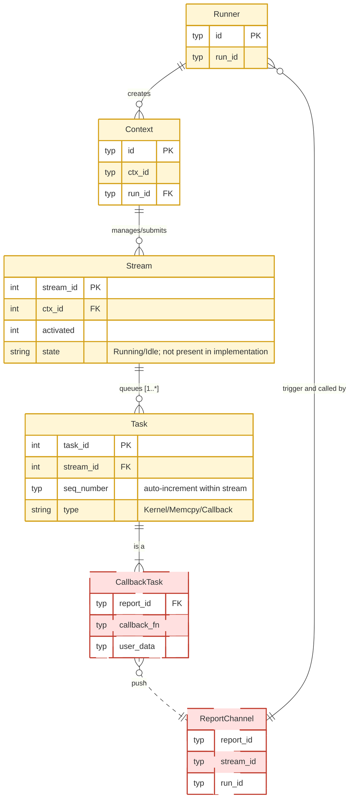

### 5.1 Key Relationship Description (Callback and Report Relationship Modeling)

When the **device** reaches a CallbackTask, it triggers the Host Runner thread to execute the callback.

#### 5.1.1 Interface Mapping Table (Callback and Report Relationship Modeling)

| Entity | Key Management Interface |
| ------------- | --------------------------------------------------------------------- |
| CallbackTask | `rtSetExceptionInfoCallback`, `rtLaunchCallback`, `rtSynchronizeEvent` |
| ReportChannel | `rtSubscribeReport`, `rtUnSubscribeReport` |
| Runner | `rtProcessReport` |

## 6. Fine-Grained Low-Level Extension of the Basic `Device` Model

Fine-grained low-level scheduling entities refined on top of the Device hierarchy in [section 2.1.1 Hierarchical Structure Overview](#211-hierarchical-structure-overview) (conceptual entities such as `Die` / `SuperPod` / `Plane` do not have corresponding structs in this repo's implementation).

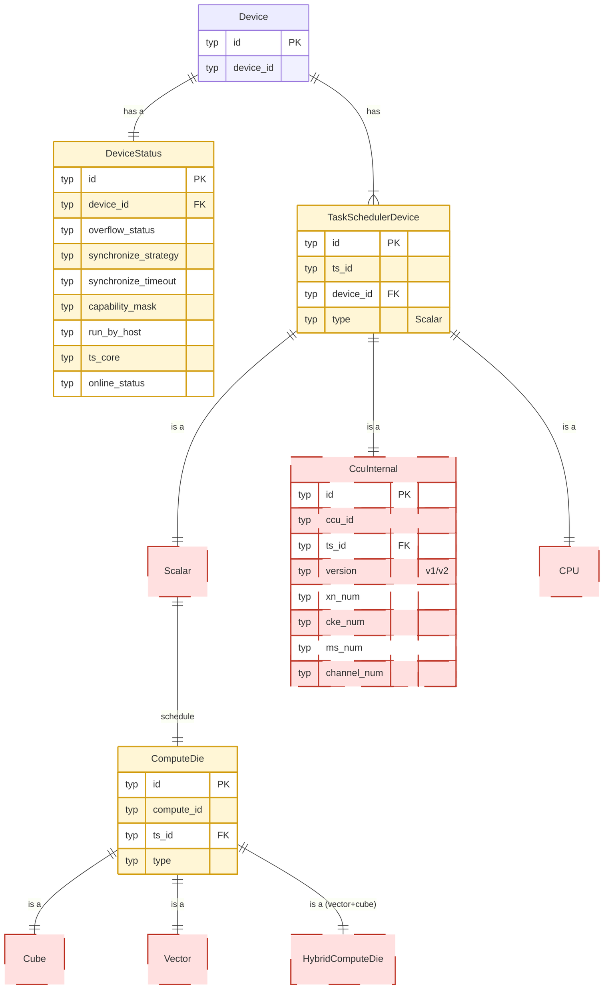

### 6.1 Key Relationship Description (Fine-Grained Low-Level Extension of the Basic `Device` Model)

**Device scheduler hierarchy**:

- `TaskSchedulerDevice` is the abstraction of a device scheduler. One Device can contain multiple schedulers.
- Scheduler types include: `Scalar` (scalar processor), `CCU` (collective communication unit), `CPU` (AI CPU)
- In the entity block, this CCU is labeled `CcuInternal` to distinguish it from the persisted `Ccu` modeled in section 2.1.1 (CCU resource allocation table). The `type` field takes values `Scalar`/`CCU`/`CPU`.
- Different scheduler types handle different compute task types.

**ComputeDie compute unit**:

- `ComputeDie` is the abstraction of a compute unit; the inheritance relationship indicates the compute unit type.
- `Vector`: Vector compute unit, processes vector operations.
- `Cube`: Cube compute unit, processes matrix operations.
- `HybridComputeDie`: Hybrid compute unit, supports both Vector and Cube. (The implementation does not have this type; it is distinguished by `ComputeDie.type`; zero hits in both this repo and `hcomm/`)

**CCU internal structure**:

- `xn_num`: XN node count (cross-node communication)
- `cke_num`: CKE engine count (Checksum engine)
- `ms_num`: MS module count (Memory Scheduler)
- `channel_num`: Communication channel count.
- `version`: CCU version (v1/v2, determines functional differences)

**DeviceStatus state management**:

- `overflow_status`: Overflow status.
- `synchronize_strategy`: Synchronization strategy configuration.
- `synchronize_timeout`: Synchronization timeout setting.
- `capability_mask`: Device capability mask.
- `run_by_host`: Whether running in Host mode.
- `ts_core`: Scheduler core count.
- `online_status`: Device online status.

**Scalar scheduling relationship**:

- The `Scalar` scheduler manages `ComputeDie` execution.
- Different ComputeDie types correspond to different compute workloads.

#### 6.1.1 Interface Mapping Table (Fine-Grained Low-Level Extension of the Basic Device Model)

| Entity | Key Management Interface |
| ------------------- | ---------------------------------- |
| TaskSchedulerDevice | `rtGetDeviceInfo`, `rtSetTsDevice` |
| DeviceStatus | `rtGetRunMode` |

## 7. Kernel Runtime Relationship Modeling

Kernel-side entities are submitted through ACL interfaces and carried by Task / EventSyncTask (see [section 3.1 Data / Task Flow Modeling](#31-data--task-flow-modeling)); for the interfaces corresponding to each entity, see [section 7.1.1 Interface Mapping Table](#711-interface-mapping-table-kernel-runtime-relationship-modeling).

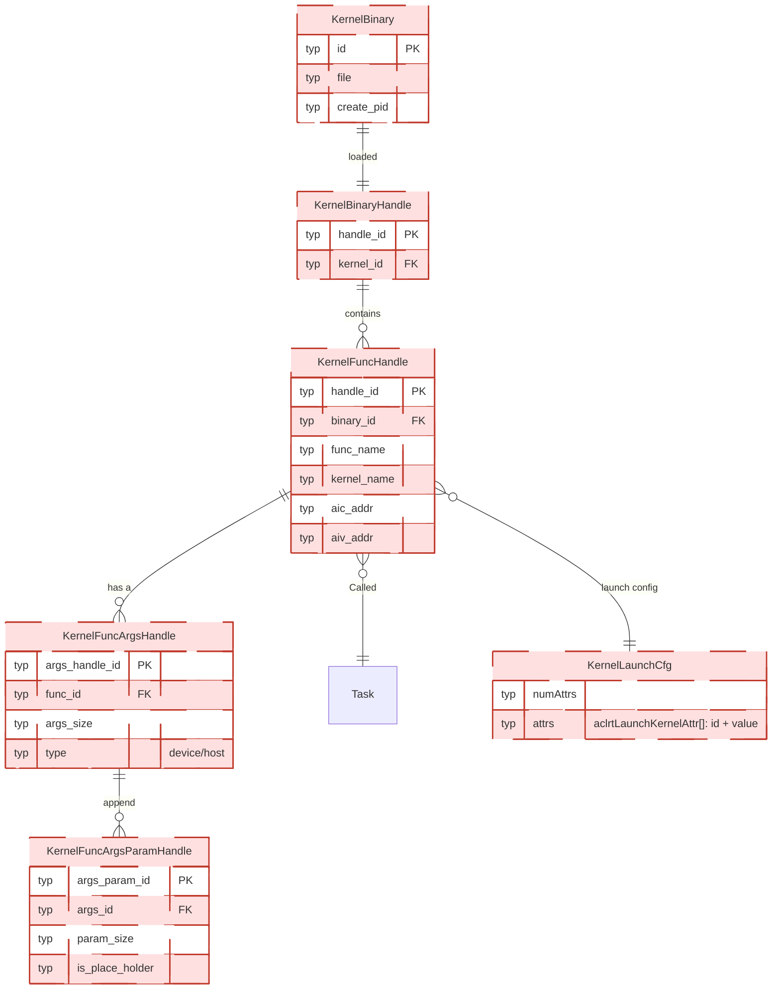

### 7.1 Key Relationship Description (Kernel Runtime Relationship Modeling)

**KernelBinary loading flow**:

1. `KernelBinary` stores the .o/.so binary file path and the creating process PID.
2. `rtBinaryLoadFromFile` or `rtBinaryLoadFromData` loads the binary into device memory.
3. After loading, a `KernelBinaryHandle` is produced, containing handle_id and kernel_id.
4. `KernelFuncHandle` represents a specific function in the binary, containing func_name, kernel_name, and address information.

**Kernel function call relationship**:

- `aic_addr` is the AI Core function address.
- `aiv_addr` is the AI Vector function address.
- `KernelFuncArgsHandle` stores function argument information.
- `KernelFuncArgsParamHandle` records argument size and whether it is a placeholder.
- `KernelLaunchCfg` configures Kernel launch parameters (block/grid, etc.) (not a `sim_models.h` entity; not persisted. On the implementation side it is the ACL type `aclrtLaunchKernelCfg`: `numAttrs` + `attrs[]`. There are 9 attribute ids: `SCHEM_MODE`(1)/`DYN_UBUF_SIZE`(2)/`ENGINE_TYPE`(3)/`BLOCKDIM_OFFSET`(4)/`BLOCK_TASK_PREFETCH`(5)/`DATA_DUMP`(6)/`TIMEOUT`(7)/`TIMEOUT_US`(8)/`ENABLE_PROFILING`(9). The authoritative definition is in `runtime/include/external/acl/acl_rt.h:527-541` (`aclrtLaunchKernelAttrId`). `LOCAL_MEMORY_SIZE` is a deprecated alias of `DYN_UBUF_SIZE` (same value 2, `acl_rt.h:529-532`). `TIMEOUT` and `TIMEOUT_US` cannot be carried at the same time (`acl_rt.h:538`). The stub in this repo recognizes only the first 8; the 9th is not implemented, see `src/proxy/level2/aclrt_kernel_stub.cc:564,1101`.)

**Kernel lifecycle**:

```text
rtCreateBinary -> rtBinaryLoad -> rtBinaryGetFunction
                -> rtLaunchKernel(funcHandle, argsHandle, cfg)
                -> rtBinaryUnLoad -> rtDestroyBinary
```

**Parameter management mechanism**:

- args_handle_id supports both device and host types.
- is_place_holder indicates whether a parameter is a placeholder (late binding)
- param_size records the size of a single parameter.

#### 7.1.1 Interface Mapping Table (Kernel Runtime Relationship Modeling)

| Entity | Key Management Interface |
| ------------------ | --------------------------------------------------------------------------------------------------------------- |
| KernelBinary | `rtCreateBinary`, `rtDestroyBinary` |
| KernelBinaryHandle | `rtBinaryLoad`, `rtBinaryUnLoad`, `rtBinaryLoadFromFile`, `rtBinaryLoadFromData` |
| KernelFuncHandle | `rtBinaryGetFunction`, `rtBinaryGetFunctionByEntry`, `rtGetFunctionAddr`, `rtGetFunctionName`, `rtRegisterCpuFunc` |
| KernelLaunchCfg (not modeled) | `rtLaunchKernelWithConfig` (ACL-side type; not a sim model) |

## 8. Model Loading Relationship Modeling
